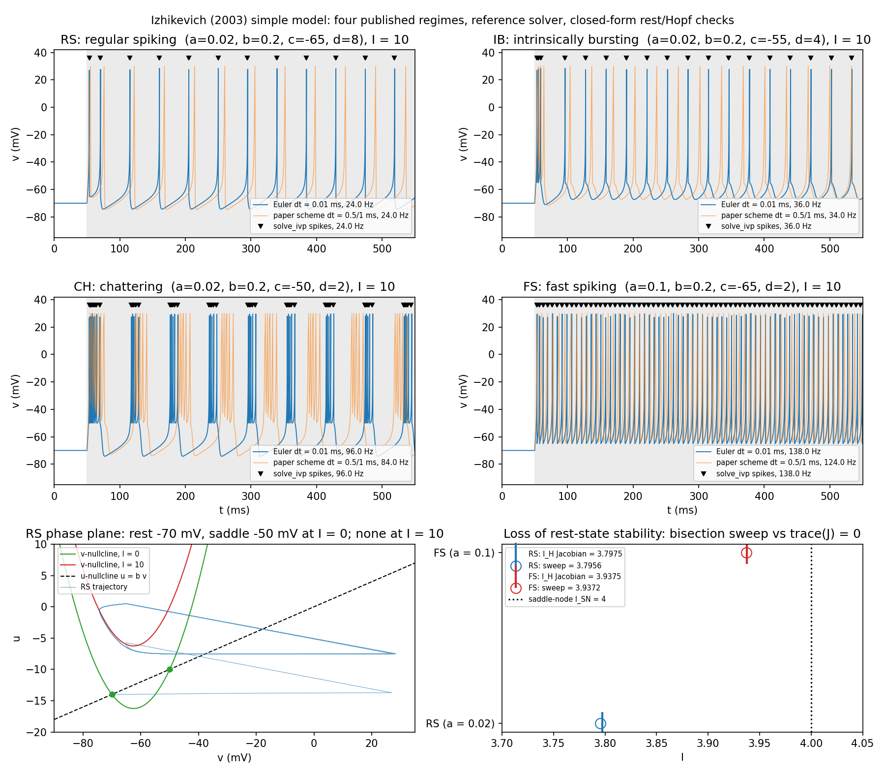

# neuron-models-from-scratch

Hodgkin–Huxley, leaky integrate-and-fire, FitzHugh–Nagumo, quadratic integrate-and-fire, theta, Izhikevich and exponential integrate-and-fire neurons implemented in NumPy from the original equations, with each checked against something other than its own plot.

**Result.** The LIF simulation matches the closed-form firing-rate curve to 1.7% mean relative error across 0–50 nA. The Hodgkin–Huxley spike train is converged in timestep: shrinking dt tenfold (0.01 → 0.001 ms) moves spike times by at most 0.019 ms. The FitzHugh–Nagumo Hopf bifurcation currents found by sweeping the simulation agree with the linearised Jacobian prediction to 0.07% (lower) and 0.02% (upper). The theta-neuron f–I curve matches the closed form f = √I/π to 0.04% max relative error over 40 currents, and the quadratic integrate-and-fire neuron mapped through V = tan(θ/2) reproduces it: same firing rate at every current to 4×10⁻⁶ relative, same trajectory to 3×10⁻³ rad. The Izhikevich (2003) model reproduces the regular-spiking, intrinsically-bursting, chattering and fast-spiking regimes with the published parameters (24, 36, 96 and 138 Hz at I = 10), with the same spike count as a tight-tolerance `solve_ivp` reference in every regime and a spike-time error that halves when dt is halved; the current at which the rest state loses stability, found by sweep, matches the Jacobian closed form to 0.05% (RS) and 0.008% (FS) of the saddle-node current. The exponential integrate-and-fire neuron with the Fourcaud-Trocmé et al. (2003) parameters has its rheobase, found by sweep, within 0.10% (ΔT = 3.48 mV) and 0.012% (ΔT = 1 mV) of the nullcline value g_L(V_T − E_L − ΔT); its f–I curve matches a quadrature of the inter-spike-interval integral to 0.59% max relative error over 24 currents; the spike-onset rapidness measured from the phase plot scales as 1/ΔT and matches the analytical slope to 0.15%; and as ΔT → 0 the inter-spike interval approaches the LIF closed form as ΔT ln(1/ΔT), matching the derived asymptotic τ_m(ΔT/a) ln(1 + a/ΔT) to 5–6%.


## Roadmap

This repository grows by one model per day in order of difficulty; see [ROADMAP.md](ROADMAP.md) for the sequence and [CONVENTIONS.md](CONVENTIONS.md) for the standard each model must meet.

## Method

**Hodgkin–Huxley** (`src/hodgkin_huxley.py`). A single-compartment model with Na⁺, K⁺ and leak currents. It uses the squid-axon parameters of Hodgkin & Huxley (1952), written in the modern convention with rest at −65 mV: C_m = 1 µF/cm², ḡ_Na = 120, ḡ_K = 36, g_L = 0.3 mS/cm², E_Na = 50, E_K = −77, E_L = −54.4 mV. The gating variables m, h and n follow first-order kinetics with voltage-dependent α/β rates and start at their steady-state values. Integration is forward Euler at dt = 0.01 ms. The stimulus is a 10 µA/cm² step from 10 to 110 ms, which gives 7 action potentials (~70 Hz) and a return to rest after the step ends.

**Leaky integrate-and-fire** (`src/leaky_integrate_and_fire.py`). τ_m dV/dt = −(V − E_L) + R_m·I_e with τ_m = 20 ms, E_L = V_reset = −65 mV, V_th = −50 mV, a 2 ms absolute refractory period, and forward Euler at dt = 0.1 ms. The script plots a voltage trace and inter-spike intervals at I_e = 20 nA. It then sweeps I_e from 0 to 50 nA and compares the simulated firing rate with the analytical rate r = 1 / (τ_ref + τ_m ln[(V_∞ − V_reset)/(V_∞ − V_th)]), where V_∞ = E_L + R_m·I_e.


### FitzHugh–Nagumo

`src/fitzhugh_nagumo.py`. The two-variable reduction of Hodgkin–Huxley (FitzHugh 1961; Nagumo et al. 1962) in dimensionless form: dv/dt = v − v³/3 − w + I, dw/dt = ε(v + a − bw) with a = 0.7, b = 0.8, ε = 1/τ = 0.08. v is the fast voltage-like variable and w the slow recovery variable. The stimulus is a constant current I; forward Euler at dt = 0.005 (dimensionless time). The v-nullcline is w = v − v³/3 + I and the w-nullcline is w = (v + a)/b; they intersect at a single fixed point because 1/b − 1 > 0 makes the resulting cubic monotone. The Jacobian at the fixed point has trace 1 − v*² − εb, so the rest state loses stability (Hopf) where v*² = 1 − εb, which gives closed-form currents I_H = v*³/3 − v* + (v* + a)/b with v* = ∓√(1 − εb): I_H = 0.3313 (onset of oscillation) and 1.4187 (excitation block). The script finds both currents independently by a vectorised bisection sweep that tests whether a 10⁻³ perturbation of the fixed point grows or decays over 3000 time units, and compares them with the prediction. At I = 0 the simulated rest state is compared with the cubic root; at I = 0.5 the script shows the relaxation oscillation (period ≈ 40 time units) and the phase plane.


### Quadratic integrate-and-fire and the theta neuron

`src/quadratic_if_theta.py`. The QIF is the normal form of a saddle-node-on-invariant-circle bifurcation, in the dimensionless canonical form of Izhikevich (2007, sec. 8.1.3): dV/dt = V² + I, with a spike when V reaches V_peak = 10 and reset to −V_peak. The theta neuron (Ermentrout & Kopell 1986) is the same system under V = tan(θ/2): dθ/dt = (1 − cos θ) + (1 + cos θ) I, with a spike when θ crosses π. A QIF with finite V_peak is exactly a theta neuron with threshold θ_peak = 2 arctan V_peak; the standard theta neuron is the QIF with V_peak → ∞. The stimulus is a constant current I; both models are integrated by forward Euler at dt = 10⁻³, with the spike time interpolated linearly across the threshold crossing. For I > 0 the QIF solution is V(t) = √I tan(√I t + arctan(V₀/√I)), so the inter-spike interval is T = (2/√I) arctan(V_peak/√I), and for the theta neuron T = π/√I, i.e. f = √I/π: the rate rises continuously from 0 Hz at I = 0 (class I). For I < 0 the fixed points are V* = ∓√(−I) (stable node, saddle), θ* = ∓2 arctan √(−I). The script simulates the f–I curves of the theta neuron (θ_peak = π), the QIF (V_peak = 10) and a theta neuron with θ_peak = 2 arctan 10, each over 40 currents in [0.02, 2] with the rate taken as 1/mean ISI, and compares them with the closed forms and with each other; it also overlays one QIF trajectory mapped through 2 arctan V on the theta-neuron trajectory and on the exact solution at I = 0.5, and checks the resting state at I = −0.25.


### Izhikevich (2003) simple model

`src/izhikevich.py`. The two-variable model of Izhikevich (2003): dv/dt = 0.04v² + 5v + 140 − u + I, du/dt = a(bv − u), with the reset v ← c, u ← u + d whenever v reaches 30 mV. v is in mV, t in ms, and u is a recovery variable; the quadratic term and the constants 5 and 140 were fitted by Izhikevich so that the spike-initiation dynamics have mV scale. The four published parameter sets from Fig. 2 of the paper are used: RS (a = 0.02, b = 0.2, c = −65, d = 8), IB (c = −55, d = 4), CH (c = −50, d = 2) and FS (a = 0.1, c = −65, d = 2). The stimulus is a step I = 10 from 50 to 550 ms after 50 ms at rest; the integrator is forward Euler at dt = 0.01 ms with the spike time interpolated across the 30 mV crossing before the reset. For comparison each trace is also recomputed with the scheme printed in the paper (dt = 1 ms, v advanced in two 0.5 ms half-steps, u in one step), which is what the paper's figures were drawn with. With constant I the fixed points solve 0.04v² + (5 − b)v + 140 + I = 0, so v* = [−(5 − b) ∓ √D]/0.08 with D = (5 − b)² − 0.16(140 + I): for b = 0.2 the rest state is at −70 mV with a saddle at −50 mV, and the two merge at I_SN = (5 − b)²/0.16 − 140 = 4. The Jacobian at rest has trace b − a − √D and determinant a√D, so the rest state loses stability (Andronov–Hopf) at I_H = [(5 − b)² − (b − a)²]/0.16 − 140, i.e. 3.7975 for a = 0.02 and 3.9375 for a = 0.1. The script finds these currents independently by a vectorised bisection sweep that tests whether a 10⁻³ perturbation of the fixed point grows or decays over 2000 ms, compares every regime's spike times with `solve_ivp` (DOP853, rtol = atol = 10⁻¹⁰, terminal event at 30 mV, exact reset) at dt = 0.01 and 0.005 ms, and tests each pattern against the paper's description with explicit criteria (RS: last ISI > 1.2 × first; IB: an initial burst then only single spikes; CH: ≥ 3 bursts with inter-burst frequency ≤ 40 Hz; FS: ISI coefficient of variation < 0.05 and a higher rate than RS).



### Exponential integrate-and-fire

`src/exponential_if.py`. The EIF of Fourcaud-Trocmé, Hansel, van Vreeswijk & Brunel (2003): C dV/dt = −g_L(V − E_L) + g_L ΔT exp((V − V_T)/ΔT) + I, with a spike when V reaches V_peak = 20 mV, reset to V_r and an absolute refractory period τ_ref. The parameters are the paper's fit to the Wang–Buzsáki model: C = 1 µF/cm², g_L = 0.05 mS/cm² (τ_m = 20 ms), E_L = −65 mV, V_T = −59.9 mV, ΔT = 3.48 mV, V_r = −68 mV, τ_ref = 1.7 ms; V in mV, t in ms, I in µA/cm². The cut-off V_peak is a numerical choice: the exact solution diverges in finite time and the model spends 7×10⁻⁷ ms between 0 mV and V_peak at I = 0.5, so the rate does not depend on it. The stimulus is a constant current; the integrator is forward Euler at dt = 0.01 ms with the spike time interpolated across the V_peak crossing (the rheobase sweep uses dt = 0.02 ms over 4000 ms because the slow passage near the saddle-node ghost is what it resolves). The right-hand side is minimal at V = V_T, where its derivative −g_L + g_L e^{(V−V_T)/ΔT} vanishes, so with x = (V − V_T)/ΔT the fixed points solve e^x − x = k(I) = [g_L(V_T − E_L) − I]/(g_L ΔT), exist only for k ≥ 1, and are given by the two real branches of the Lambert W function, x = −k − W₀(−e^{−k}) (stable rest) and x = −k − W₋₁(−e^{−k}) (saddle). They merge at V_T when I reaches the rheobase I_rh = g_L(V_T − E_L − ΔT) = 0.081 µA/cm² (0.205 at ΔT = 1 mV): a saddle-node on an invariant circle, so the rate rises continuously from 0 Hz (class I). Above I_rh the inter-spike interval is T = τ_ref + ∫_{V_r}^{V_peak} C dV / F(V), which the script evaluates with `scipy.integrate.quad` as the reference for the simulated f–I curve. In the phase plot (dV/dt against V) the slope of the upstroke, (g_L/C)(e^x − 1), is the "onset rapidness" of Naundorf, Wolf & Volgushev (2006); where dV/dt first reaches a criterion V̇_c = 10 mV/ms it has the closed form r = (g_L/C)(k_c + x_c − 1) with e^{x_c} − x_c = k_c = [C V̇_c − I + g_L(V_T − E_L)]/(g_L ΔT), which for k_c ≫ 1 is r ≈ V̇_c/ΔT − g_L/C, so sharpness scales as 1/ΔT. The script measures r from simulated traces as the secant of the finite-difference phase plot across the criterion crossing for ΔT = 0.5, 1, 2, 3.48 and 6 mV. Finally, as ΔT → 0 the model becomes the repository's LIF with threshold V_T, T_LIF = τ_ref + τ_m ln[(V_∞ − V_r)/(V_∞ − V_T)]; linearising the leak about V_T gives the excess T_EIF − T_LIF ≈ τ_m (ΔT/a) ln(1 + a/ΔT) with a = V_∞ − V_T, i.e. the convergence is O(ΔT ln(1/ΔT)) rather than first order, which the script checks for ΔT = 1.6, 0.8, 0.4, 0.2 mV at I = 1 µA/cm².


## Validation

| Check | Script | Outcome |
|---|---|---|
| LIF f–I curve vs closed form, 0–50 nA | `leaky_integrate_and_fire.py` | Rheobase at 15 nA in both; mean relative error 1.7% on firing points, max 2.45 Hz |
| HH timestep convergence, dt 0.01 vs 0.001 ms | `check_hh_timestep.py` | Same spike count (7); max spike-time shift 0.019 ms |
| FHN rest state at I = 0 vs cubic root of the nullcline equations | `fitzhugh_nagumo.py` | (v*, w*) = (−1.19941, −0.62426) in both; max deviation 1.1e−13 |
| FHN Hopf currents by sweep vs Jacobian trace = 0 | `fitzhugh_nagumo.py` | Lower: 0.33105 (sweep) vs 0.33128 (predicted), 0.069%; upper: 1.41896 vs 1.41872, 0.017%; tolerance 1% |
| Theta neuron f–I vs closed form f = √I/π, 40 currents in [0.02, 2] | `quadratic_if_theta.py` | Max relative error 0.041% (at I = 1.90), mean 0.015%; tolerance 1% |
| QIF (V_peak = 10) f–I vs 1/T, T = (2/√I) arctan(V_peak/√I) | `quadratic_if_theta.py` | Max relative error 0.040%, mean 0.015%; tolerance 1% |
| QIF ≡ theta neuron under V = tan(θ/2) | `quadratic_if_theta.py` | Rates of the QIF and of a theta neuron with θ_peak = 2 arctan 10 differ by at most 3.9×10⁻⁶ relative (tolerance 1%); one trajectory mapped by 2 arctan V deviates from the theta trajectory by at most 3.0×10⁻³ rad and from the exact solution by 3.2×10⁻³ rad (tolerance 0.02 rad) |
| QIF/theta rest state at I = −0.25 vs V* = −√(−I), θ* = −2 arctan √(−I) | `quadratic_if_theta.py` | V = −0.500000, θ = −0.927295; deviations 2.8×10⁻¹⁴ and 5.5×10⁻¹⁴; no spikes |
| Izhikevich rest state at I = 0 (b = 0.2) vs closed-form root of the nullclines | `izhikevich.py` | v* = −70 mV, u* = −14 in both; deviations 1.3×10⁻⁵ mV and 7.2×10⁻⁶; no spikes; tolerance 10⁻⁴ |
| Izhikevich loss of rest-state stability by sweep vs Jacobian trace = 0 | `izhikevich.py` | RS: 3.79556 (sweep) vs 3.79750 (closed form), 0.049% of I_SN = 4; FS: 3.93719 vs 3.93750, 0.008%; tolerance 1% of I_SN |
| Izhikevich RS/IB/CH/FS at I = 10, Euler dt = 0.01 ms vs `solve_ivp` reference | `izhikevich.py` | Same spike count in every regime (12, 18, 48, 69 over 500 ms = 24, 36, 96, 138 Hz; rate difference 0.000%); max spike-time deviation 0.33, 0.56, 1.30, 2.67 ms (28–39 µs per spike), falling to 0.18, 0.31, 0.65, 1.35 ms at dt = 0.005 ms (ratios 1.89, 1.83, 2.00, 1.98; tolerance: ratio in [1.6, 2.4]) |
| Izhikevich regimes vs the paper's descriptions (sec. III) | `izhikevich.py` | RS: first ISI 17.2 ms, last 44.8 ms (ratio 2.61); IB: 3-spike burst (ISIs 2.15, 3.40 ms) then 15 single spikes at 31–37 ms; CH: 9 bursts of 5–8 spikes, intra-burst ISI 1.4–5.1 ms, inter-burst 60 ms = 16.7 Hz (paper: "as high as 40 Hz"); FS: 138 Hz vs RS 24 Hz, ISI CV 0.033 |
| EIF rheobase by bisection sweep (fires within 4000 ms from E_L?) vs nullcline value I_rh = g_L(V_T − E_L − ΔT) | `exponential_if.py` | ΔT = 3.48 mV: 0.081084 (sweep) vs 0.081000 (closed form), 0.104%; ΔT = 1 mV: 0.205025 vs 0.205000, 0.012%; tolerance 1% |
| EIF rest state at I = 0 and 0.06 µA/cm² vs Lambert-W root of the nullcline | `exponential_if.py` | V* = −63.8963 mV and −61.7620 mV in both; deviations 4.0×10⁻⁸ and 6.5×10⁻⁵ mV; no spikes; tolerance 10⁻⁴ mV |
| EIF f–I curve, Euler dt = 0.01 ms vs `quad` of the ISI integral, 24 currents in [0.1, 3] µA/cm² | `exponential_if.py` | Max relative error 0.585% (at I = 2.87, 117.9 vs 118.6 Hz), mean 0.34%; 4.16 Hz at I = 0.1 in both; tolerance 1% |
| EIF onset rapidness at dV/dt = 10 mV/ms, secant from the simulated phase plot vs analytical slope (g_L/C)(e^x − 1) at its midpoint, ΔT = 0.5–6 mV | `exponential_if.py` | 20.37, 9.70, 5.08, 3.00, 1.75 /ms measured; max relative error 0.147% (at ΔT = 0.5), tolerance 2%; Lambert-W r(V̇_c) = 19.76, 9.97, 5.06, 2.96, 1.76 /ms, r·ΔT/V̇_c = 0.99–1.05 (tolerance 25% from the 1/ΔT law) |
| EIF → LIF as ΔT → 0: excess ISI over T_LIF = 10.383 ms at I = 1 vs asymptotic τ_m(ΔT/a) ln(1 + a/ΔT) | `exponential_if.py` | Simulated excess 5.307, 3.367, 2.050, 1.220 ms at ΔT = 1.6, 0.8, 0.4, 0.2 mV; ratio to the asymptotic law 1.059, 1.053, 1.048, 1.051 (tolerance 10%); quadrature ratio 1.050 → 1.018, monotone (tolerance 2% at 0.2 mV) |

## Reproduce

```bash
python -m venv .venv && source .venv/bin/activate
pip install -r requirements.txt
python src/hodgkin_huxley.py            # writes figures/hh_simulation.png
python src/leaky_integrate_and_fire.py  # writes figures/lif_simulation.png
python src/check_hh_timestep.py         # prints convergence check
python src/fitzhugh_nagumo.py           # writes figures/fitzhugh_nagumo.png (~20 s)
python src/quadratic_if_theta.py        # writes figures/quadratic_if_theta.png (~4 s)
python src/izhikevich.py                # writes figures/izhikevich.png (~7 s)
python src/exponential_if.py            # writes figures/exponential_if.png (~30 s)
```

Tested with Python 3.9–3.10, NumPy 1.26, Matplotlib 3.9 and SciPy 1.15 (SciPy is used only for validation). No external data is needed.

## Limitations and failure cases

- **Forward Euler only.** Convergence is shown for one HH stimulus protocol, not for all inputs. There is no comparison against an adaptive or higher-order solver (e.g. `scipy.integrate.solve_ivp`). A stiffer protocol or a larger dt could diverge without warning.
- **HH is not compared quantitatively with published traces.** Spike shape, the ~+40 mV first peak and the ~70 Hz rate look qualitatively right for these parameters. No curve from the 1952 paper or a reference simulator (NEURON, Brian2) has been overlaid.
- **Singular rate functions.** α_m and α_n divide by zero at exactly V = −40 mV and −55 mV. No guard exists, despite the comment in the code. Floating-point trajectories do not hit these values in practice, but a clamped-voltage experiment at those holding potentials would return NaN.
- **FHN Hopf sweep has a small, predictable integrator bias.** Forward Euler is weakly unstable on a neutrally stable centre, so the sweep widens the oscillatory window by about dt·ω²/(d trace/dI) ≈ 2×10⁻⁴ at each end (lower onset found at 0.33105 rather than 0.33128, upper at 1.41896 rather than 1.41872). The check passes at 1% but the residual is dominated by the integrator, not by the bisection (bracket half-width 4×10⁻⁶). The sweep detects the loss of linear stability; the canard explosion to the full-amplitude relaxation cycle, which in FHN happens within an O(ε) distance of the Hopf point, is not resolved separately.
- **QIF/theta checks are self-consistent rather than independent of Euler.** All three f–I curves and the mapped trajectory are forward-Euler runs at the same dt = 10⁻³, so their mutual agreement (4×10⁻⁶ in rate) mostly shows that the two formulations discretise alike; the independent evidence is the comparison against the closed forms, where the residual (0.04% in rate, 3×10⁻³ rad on a trajectory) is the integrator's first-order error, not a model discrepancy. The trajectory residual is ten times larger for the QIF than for the theta neuron because Euler steps in V lose accuracy where V² is large. A finite V_peak also changes the rate: the QIF with V_peak = 10 fires up to 9.8% faster than the standard theta neuron at I = 2 because the reset skips the time the exact solution spends beyond |V| = 10; the script states this but does not treat it as an error.
- **Izhikevich rates are not compared with numbers from the paper, because the paper prints none.** Fig. 2 of Izhikevich (2003) shows traces without stated currents or rates, so the "comparison with the paper's figure" is (i) the four patterns tested against the paper's verbal descriptions with criteria chosen here (the ISI thresholds of 10 ms and the 1.2 adaptation ratio are not from the paper), and (ii) the traces recomputed with the paper's own 0.5/1 ms Euler scheme. That coarse scheme is not converged: at I = 10 it gives 24, 34, 84 and 124 Hz for RS, IB, CH and FS against 24, 36, 96 and 138 Hz from dt = 0.01 ms and `solve_ivp`, i.e. up to 10% slower, and some CH bursts have a different spike count. Published figures made with the paper's code therefore differ from the converged model by that much. The CH inter-burst frequency at I = 10 is 16.7 Hz; the paper's "as high as 40 Hz" is an upper bound reached at other inputs, so the check only asserts ≤ 40 Hz.
- **Izhikevich spike times drift linearly with spike count under Euler.** The spike-time error against `solve_ivp` is a phase drift of about 0.03–0.04 ms per spike at dt = 0.01 ms (2.7 ms after 69 FS spikes). It is first order in dt (ratios 1.8–2.0 when dt is halved) and comes from the quadratic blow-up near the 30 mV cut-off, not from a model discrepancy; the mean rates agree to the printed precision. A run much longer than 500 ms, or a comparison of individual late spike times, would need a smaller dt or a higher-order integrator.
- **EIF checks are against the model's own ODE, not against the paper's figures.** The quadrature, the Lambert-W fixed points and the onset-rapidness slope are exact consequences of the same equation the simulation integrates, so they test the integrator and the derivations, not whether the EIF reproduces Fourcaud-Trocmé et al.'s Wang–Buzsáki fits (the paper gives the parameters but no f–I numbers to compare with). The onset-rapidness check is the weakest of the five: under Euler every recorded point lies on the vector field by construction, so the finite-difference secant can only differ from the analytical slope by the curvature over one 0.1 mV step (0.15% at ΔT = 0.5 mV). The 1/ΔT scaling is asserted loosely (25%) because r ≈ V̇_c/ΔT − g_L/C is only the leading term; the exact Lambert-W values deviate from V̇_c/ΔT by 1–5% over the range tested.
- **EIF inter-spike intervals are quantised to dt.** The refractory period ends on the first grid step after t_spike + τ_ref, so every ISI after the first is a multiple of dt = 0.01 ms (e.g. 15.69, 13.75, 12.43 ms in the LIF-limit runs) and the simulated rate sits 0.02–0.59% below the quadrature, growing with the rate. The excess ISI over the LIF therefore carries a constant ≈ 0.04 ms Euler bias, which is why its ratio to the asymptotic law stays at 1.05–1.06 while the quadrature's ratio falls to 1.018 at ΔT = 0.2 mV; at ΔT ≤ 0.05 mV the bias would exceed 10% of the excess and the 10% tolerance would fail. The rheobase sweep inherits the same first-order bias in the opposite direction (0.10% high at ΔT = 3.48 mV with dt = 0.02 ms; the bisection bracket itself is 3×10⁻¹⁴ wide).
- **EIF convergence to the LIF is slow.** Because the excess ISI is O(ΔT ln(1/ΔT)), the rate at ΔT = 0.2 mV is still 10.5% below the LIF rate at I = 1 µA/cm², and halving ΔT reduces the deviation by factors of only 1.4–1.6. "ΔT → 0 gives the LIF" is true but needs ΔT far below the 0.5–3.5 mV range fitted to real neurons to hold to 1%.
- **LIF rate quantisation.** The simulated rate is a spike count over 500 ms, so it is only resolved to 2 Hz, and that accounts for most of the 1.7% gap. The +20 mV "spike" is drawn for display and is not part of the model.
- **Scope.** These are single-compartment, deterministic, temperature-independent models: no noise, dendrites, synapses or networks. The scripts are procedural and have no unit tests.

## References

- Hodgkin, A. L., & Huxley, A. F. (1952). A quantitative description of membrane current and its application to conduction and excitation in nerve. *Journal of Physiology*, 117(4), 500–544.
- FitzHugh, R. (1961). Impulses and physiological states in theoretical models of nerve membrane. *Biophysical Journal*, 1(6), 445–466.
- Nagumo, J., Arimoto, S., & Yoshizawa, S. (1962). An active pulse transmission line simulating nerve axon. *Proceedings of the IRE*, 50(10), 2061–2070.
- Ermentrout, G. B., & Kopell, N. (1986). Parabolic bursting in an excitable system coupled with a slow oscillation. *SIAM Journal on Applied Mathematics*, 46(2), 233–253.
- Ermentrout, B. (1996). Type I membranes, phase resetting curves, and synchrony. *Neural Computation*, 8(5), 979–1001.
- Izhikevich, E. M. (2003). Simple model of spiking neurons. *IEEE Transactions on Neural Networks*, 14(6), 1569–1572.
- Izhikevich, E. M. (2007). *Dynamical Systems in Neuroscience*, secs. 4.2.4 and 8.1.3. MIT Press.
- Fourcaud-Trocmé, N., Hansel, D., van Vreeswijk, C., & Brunel, N. (2003). How spike generation mechanisms determine the neuronal response to fluctuating inputs. *Journal of Neuroscience*, 23(37), 11628–11640.
- Naundorf, B., Wolf, F., & Volgushev, M. (2006). Unique features of action potential initiation in cortical neurons. *Nature*, 440(7087), 1060–1063.
- Dayan, P., & Abbott, L. F. (2001). *Theoretical Neuroscience: Computational and Mathematical Modeling of Neural Systems*, ch. 5. MIT Press.

## Licence

MIT
