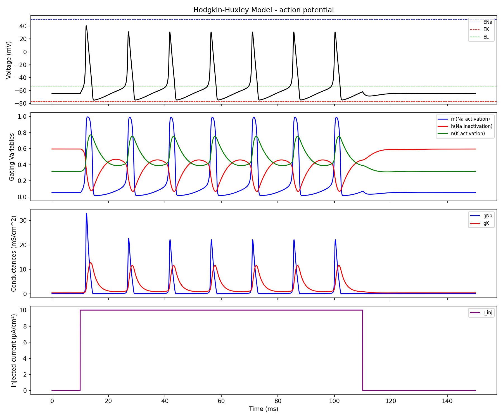
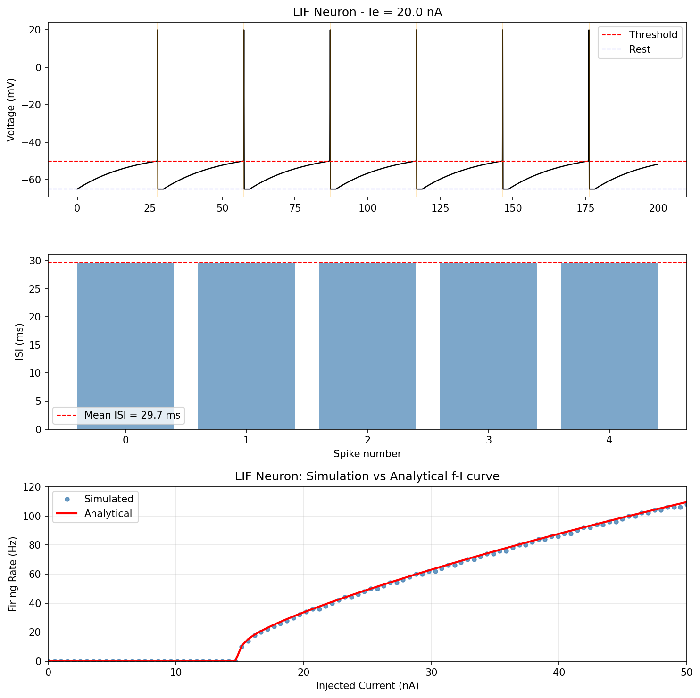
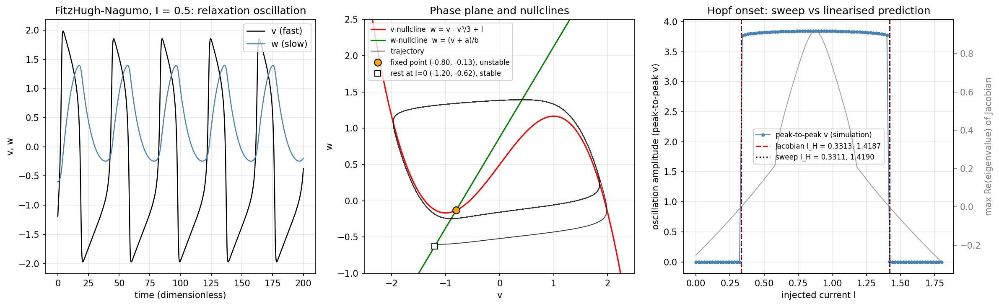
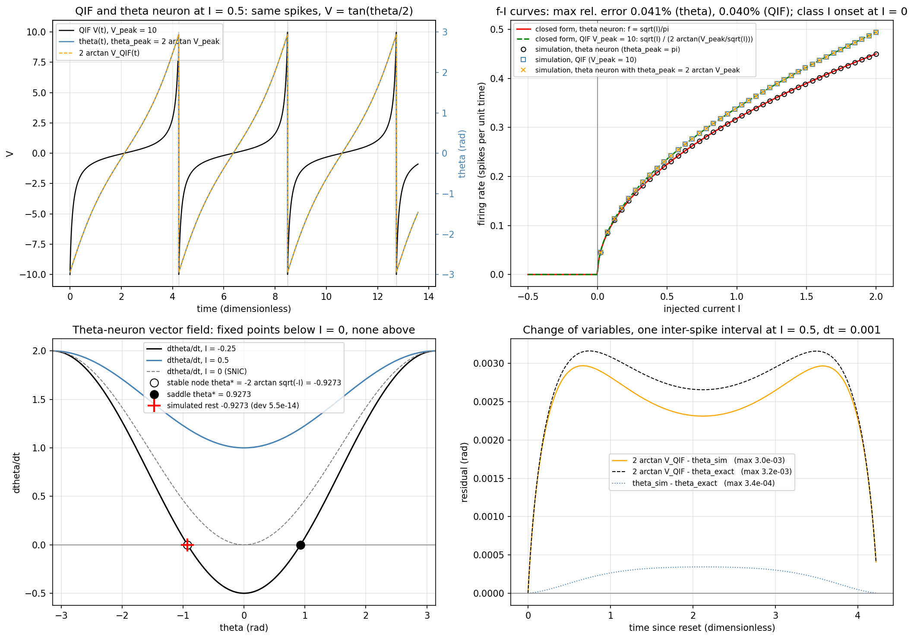

# neuron-models-from-scratch

Hodgkin–Huxley, leaky integrate-and-fire, FitzHugh–Nagumo, quadratic integrate-and-fire and theta neurons implemented in NumPy from the original equations, with each checked against something other than its own plot.

**Result.** The LIF simulation matches the closed-form firing-rate curve to 1.7% mean relative error across 0–50 nA. The Hodgkin–Huxley spike train is converged in timestep: shrinking dt tenfold (0.01 → 0.001 ms) moves spike times by at most 0.019 ms. The FitzHugh–Nagumo Hopf bifurcation currents found by sweeping the simulation agree with the linearised Jacobian prediction to 0.07% (lower) and 0.02% (upper). The theta-neuron f–I curve matches the closed form f = √I/π to 0.04% max relative error over 40 currents, and the quadratic integrate-and-fire neuron mapped through V = tan(θ/2) reproduces it: same firing rate at every current to 4×10⁻⁶ relative, same trajectory to 3×10⁻³ rad.



## Roadmap

This repository grows by one model per day in order of difficulty; see [ROADMAP.md](ROADMAP.md) for the sequence and [CONVENTIONS.md](CONVENTIONS.md) for the standard each model must meet.

## Method

**Hodgkin–Huxley** (`src/hodgkin_huxley.py`). A single-compartment model with Na⁺, K⁺ and leak currents. It uses the squid-axon parameters of Hodgkin & Huxley (1952), written in the modern convention with rest at −65 mV: C_m = 1 µF/cm², ḡ_Na = 120, ḡ_K = 36, g_L = 0.3 mS/cm², E_Na = 50, E_K = −77, E_L = −54.4 mV. The gating variables m, h and n follow first-order kinetics with voltage-dependent α/β rates and start at their steady-state values. Integration is forward Euler at dt = 0.01 ms. The stimulus is a 10 µA/cm² step from 10 to 110 ms, which gives 7 action potentials (~70 Hz) and a return to rest after the step ends.

**Leaky integrate-and-fire** (`src/leaky_integrate_and_fire.py`). τ_m dV/dt = −(V − E_L) + R_m·I_e with τ_m = 20 ms, E_L = V_reset = −65 mV, V_th = −50 mV, a 2 ms absolute refractory period, and forward Euler at dt = 0.1 ms. The script plots a voltage trace and inter-spike intervals at I_e = 20 nA. It then sweeps I_e from 0 to 50 nA and compares the simulated firing rate with the analytical rate r = 1 / (τ_ref + τ_m ln[(V_∞ − V_reset)/(V_∞ − V_th)]), where V_∞ = E_L + R_m·I_e.



### FitzHugh–Nagumo

`src/fitzhugh_nagumo.py`. The two-variable reduction of Hodgkin–Huxley (FitzHugh 1961; Nagumo et al. 1962) in dimensionless form: dv/dt = v − v³/3 − w + I, dw/dt = ε(v + a − bw) with a = 0.7, b = 0.8, ε = 1/τ = 0.08. v is the fast voltage-like variable and w the slow recovery variable. The stimulus is a constant current I; forward Euler at dt = 0.005 (dimensionless time). The v-nullcline is w = v − v³/3 + I and the w-nullcline is w = (v + a)/b; they intersect at a single fixed point because 1/b − 1 > 0 makes the resulting cubic monotone. The Jacobian at the fixed point has trace 1 − v*² − εb, so the rest state loses stability (Hopf) where v*² = 1 − εb, which gives closed-form currents I_H = v*³/3 − v* + (v* + a)/b with v* = ∓√(1 − εb): I_H = 0.3313 (onset of oscillation) and 1.4187 (excitation block). The script finds both currents independently by a vectorised bisection sweep that tests whether a 10⁻³ perturbation of the fixed point grows or decays over 3000 time units, and compares them with the prediction. At I = 0 the simulated rest state is compared with the cubic root; at I = 0.5 the script shows the relaxation oscillation (period ≈ 40 time units) and the phase plane.



### Quadratic integrate-and-fire and the theta neuron

`src/quadratic_if_theta.py`. The QIF is the normal form of a saddle-node-on-invariant-circle bifurcation, in the dimensionless canonical form of Izhikevich (2007, sec. 8.1.3): dV/dt = V² + I, with a spike when V reaches V_peak = 10 and reset to −V_peak. The theta neuron (Ermentrout & Kopell 1986) is the same system under V = tan(θ/2): dθ/dt = (1 − cos θ) + (1 + cos θ) I, with a spike when θ crosses π. A QIF with finite V_peak is exactly a theta neuron with threshold θ_peak = 2 arctan V_peak; the standard theta neuron is the QIF with V_peak → ∞. The stimulus is a constant current I; both models are integrated by forward Euler at dt = 10⁻³, with the spike time interpolated linearly across the threshold crossing. For I > 0 the QIF solution is V(t) = √I tan(√I t + arctan(V₀/√I)), so the inter-spike interval is T = (2/√I) arctan(V_peak/√I), and for the theta neuron T = π/√I, i.e. f = √I/π: the rate rises continuously from 0 Hz at I = 0 (class I). For I < 0 the fixed points are V* = ∓√(−I) (stable node, saddle), θ* = ∓2 arctan √(−I). The script simulates the f–I curves of the theta neuron (θ_peak = π), the QIF (V_peak = 10) and a theta neuron with θ_peak = 2 arctan 10, each over 40 currents in [0.02, 2] with the rate taken as 1/mean ISI, and compares them with the closed forms and with each other; it also overlays one QIF trajectory mapped through 2 arctan V on the theta-neuron trajectory and on the exact solution at I = 0.5, and checks the resting state at I = −0.25.



## Validation

| Check | Script | Outcome |
|---|---|---|
| LIF f–I curve vs closed form, 0–50 nA | `leaky_integrate_and_fire.py` | Rheobase at 15 nA in both; mean relative error 1.7% on firing points, max 2.45 Hz |
| HH timestep convergence, dt 0.01 vs 0.001 ms | `check_hh_timestep.py` | Same spike count (7); max spike-time shift 0.019 ms |
| FHN rest state at I = 0 vs cubic root of the nullcline equations | `fitzhugh_nagumo.py` | (v*, w*) = (−1.19941, −0.62426) in both; max deviation 1.1e−13 |
| FHN Hopf currents by sweep vs Jacobian trace = 0 | `fitzhugh_nagumo.py` | Lower: 0.33105 (sweep) vs 0.33128 (predicted), 0.069%; upper: 1.41896 vs 1.41872, 0.017%; tolerance 1% |
| Theta neuron f–I vs closed form f = √I/π, 40 currents in [0.02, 2] | `quadratic_if_theta.py` | Max relative error 0.041% (at I = 1.90), mean 0.015%; tolerance 1% |
| QIF (V_peak = 10) f–I vs 1/T, T = (2/√I) arctan(V_peak/√I) | `quadratic_if_theta.py` | Max relative error 0.040%, mean 0.015%; tolerance 1% |
| QIF ≡ theta neuron under V = tan(θ/2) | `quadratic_if_theta.py` | Rates of the QIF and of a theta neuron with θ_peak = 2 arctan 10 differ by at most 3.9×10⁻⁶ relative (tolerance 1%); one trajectory mapped by 2 arctan V deviates from the theta trajectory by at most 3.0×10⁻³ rad and from the exact solution by 3.2×10⁻³ rad (tolerance 0.02 rad) |
| QIF/theta rest state at I = −0.25 vs V* = −√(−I), θ* = −2 arctan √(−I) | `quadratic_if_theta.py` | V = −0.500000, θ = −0.927295; deviations 2.8×10⁻¹⁴ and 5.5×10⁻¹⁴; no spikes |

## Reproduce

```bash
python -m venv .venv && source .venv/bin/activate
pip install -r requirements.txt
python src/hodgkin_huxley.py            # writes figures/hh_simulation.png
python src/leaky_integrate_and_fire.py  # writes figures/lif_simulation.png
python src/check_hh_timestep.py         # prints convergence check
python src/fitzhugh_nagumo.py           # writes figures/fitzhugh_nagumo.png (~20 s)
python src/quadratic_if_theta.py        # writes figures/quadratic_if_theta.png (~4 s)
```

Tested with Python 3.9–3.10, NumPy 1.26, Matplotlib 3.9 and SciPy 1.15 (SciPy is used only for validation). No external data is needed.

## Limitations and failure cases

- **Forward Euler only.** Convergence is shown for one HH stimulus protocol, not for all inputs. There is no comparison against an adaptive or higher-order solver (e.g. `scipy.integrate.solve_ivp`). A stiffer protocol or a larger dt could diverge without warning.
- **HH is not compared quantitatively with published traces.** Spike shape, the ~+40 mV first peak and the ~70 Hz rate look qualitatively right for these parameters. No curve from the 1952 paper or a reference simulator (NEURON, Brian2) has been overlaid.
- **Singular rate functions.** α_m and α_n divide by zero at exactly V = −40 mV and −55 mV. No guard exists, despite the comment in the code. Floating-point trajectories do not hit these values in practice, but a clamped-voltage experiment at those holding potentials would return NaN.
- **FHN Hopf sweep has a small, predictable integrator bias.** Forward Euler is weakly unstable on a neutrally stable centre, so the sweep widens the oscillatory window by about dt·ω²/(d trace/dI) ≈ 2×10⁻⁴ at each end (lower onset found at 0.33105 rather than 0.33128, upper at 1.41896 rather than 1.41872). The check passes at 1% but the residual is dominated by the integrator, not by the bisection (bracket half-width 4×10⁻⁶). The sweep detects the loss of linear stability; the canard explosion to the full-amplitude relaxation cycle, which in FHN happens within an O(ε) distance of the Hopf point, is not resolved separately.
- **QIF/theta checks are self-consistent rather than independent of Euler.** All three f–I curves and the mapped trajectory are forward-Euler runs at the same dt = 10⁻³, so their mutual agreement (4×10⁻⁶ in rate) mostly shows that the two formulations discretise alike; the independent evidence is the comparison against the closed forms, where the residual (0.04% in rate, 3×10⁻³ rad on a trajectory) is the integrator's first-order error, not a model discrepancy. The trajectory residual is ten times larger for the QIF than for the theta neuron because Euler steps in V lose accuracy where V² is large. A finite V_peak also changes the rate: the QIF with V_peak = 10 fires up to 9.8% faster than the standard theta neuron at I = 2 because the reset skips the time the exact solution spends beyond |V| = 10; the script states this but does not treat it as an error.
- **LIF rate quantisation.** The simulated rate is a spike count over 500 ms, so it is only resolved to 2 Hz, and that accounts for most of the 1.7% gap. The +20 mV "spike" is drawn for display and is not part of the model.
- **Scope.** These are single-compartment, deterministic, temperature-independent models: no noise, dendrites, synapses or networks. The scripts are procedural and have no unit tests.

## References

- Hodgkin, A. L., & Huxley, A. F. (1952). A quantitative description of membrane current and its application to conduction and excitation in nerve. *Journal of Physiology*, 117(4), 500–544.
- FitzHugh, R. (1961). Impulses and physiological states in theoretical models of nerve membrane. *Biophysical Journal*, 1(6), 445–466.
- Nagumo, J., Arimoto, S., & Yoshizawa, S. (1962). An active pulse transmission line simulating nerve axon. *Proceedings of the IRE*, 50(10), 2061–2070.
- Ermentrout, G. B., & Kopell, N. (1986). Parabolic bursting in an excitable system coupled with a slow oscillation. *SIAM Journal on Applied Mathematics*, 46(2), 233–253.
- Ermentrout, B. (1996). Type I membranes, phase resetting curves, and synchrony. *Neural Computation*, 8(5), 979–1001.
- Izhikevich, E. M. (2007). *Dynamical Systems in Neuroscience*, secs. 4.2.4 and 8.1.3. MIT Press.
- Dayan, P., & Abbott, L. F. (2001). *Theoretical Neuroscience: Computational and Mathematical Modeling of Neural Systems*, ch. 5. MIT Press.

## Licence

MIT
