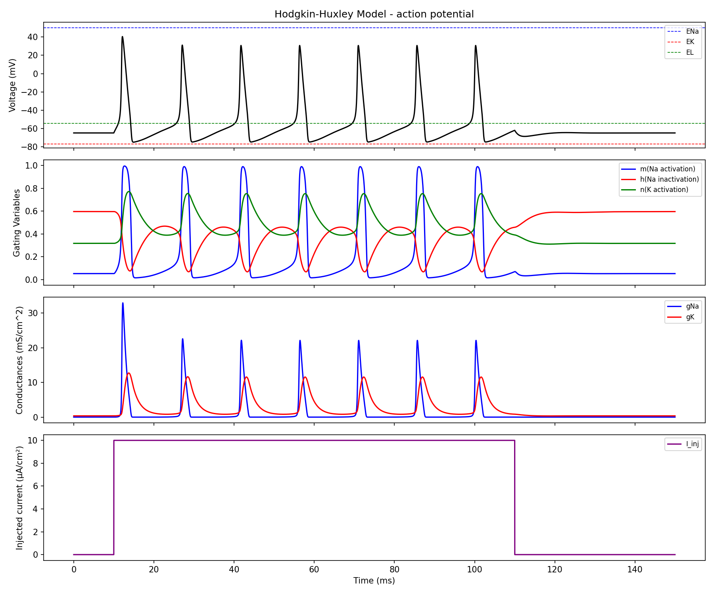
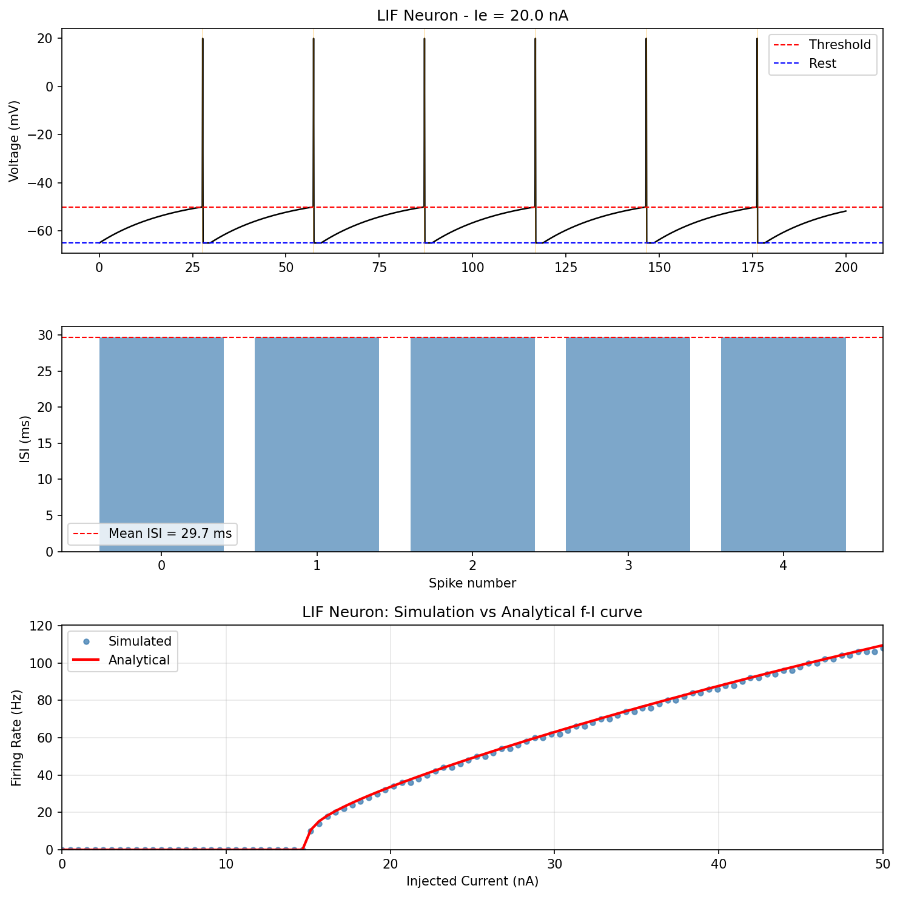
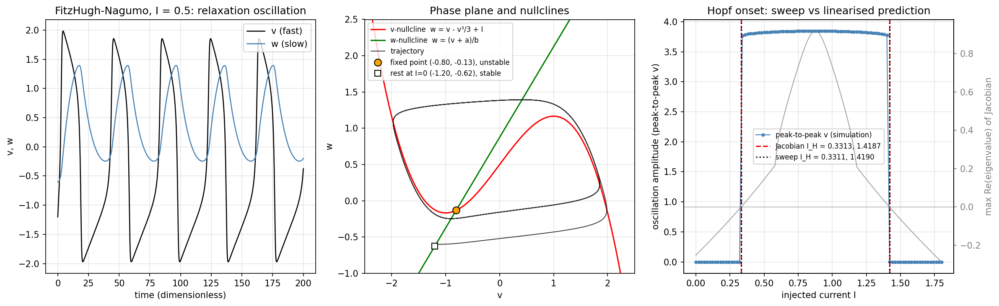
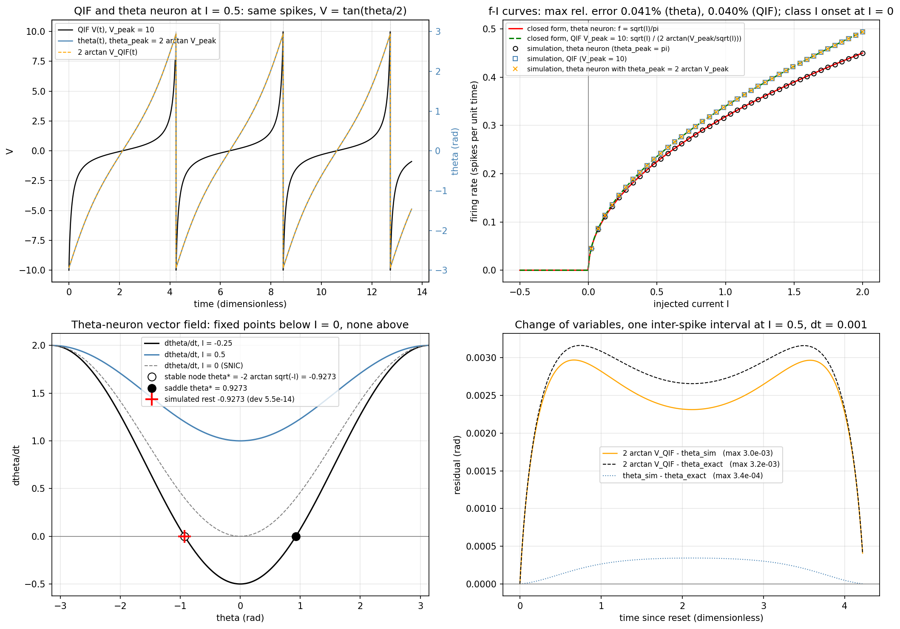
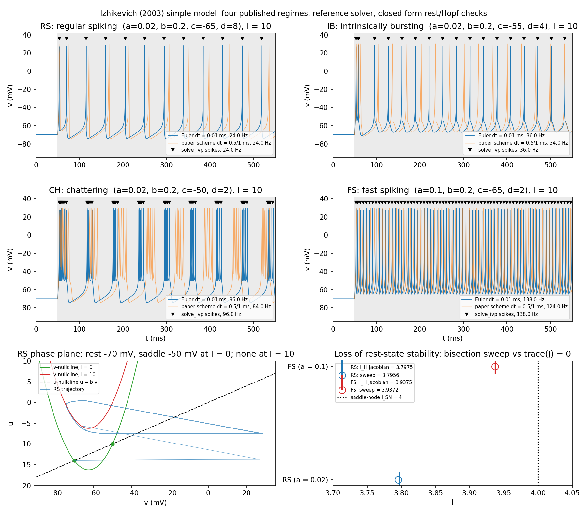
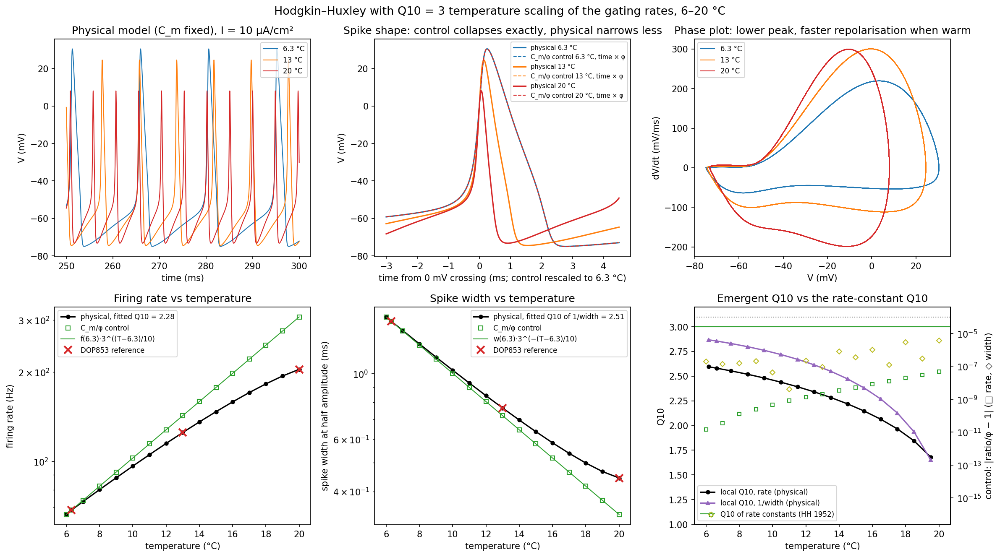

# neuron-models-from-scratch

Hodgkin–Huxley, leaky integrate-and-fire, FitzHugh–Nagumo, quadratic integrate-and-fire, theta, Izhikevich, exponential integrate-and-fire, adaptive exponential integrate-and-fire, Morris–Lecar, Hindmarsh–Rose, Connor–Stevens and Wang–Buzsáki neurons, a leaky integrate-and-fire neuron driven by white or Ornstein–Uhlenbeck noise, Hodgkin–Huxley with stochastic Markov-chain and Fox–Lu Langevin channels, a passive cable solved in compartments, the Pinsky–Rinzel two-compartment CA3 pyramidal cell, and a Traub-style multi-compartment CA3 cell with an active dendrite, implemented in NumPy from the original equations, with each checked against something other than its own plot.

**Result.** The LIF simulation matches the closed-form firing-rate curve to 1.7% mean relative error across 0–50 nA. The Hodgkin–Huxley spike train is converged in timestep: shrinking dt tenfold (0.01 → 0.001 ms) moves spike times by at most 0.019 ms. The FitzHugh–Nagumo Hopf bifurcation currents found by sweeping the simulation agree with the linearised Jacobian prediction to 0.07% (lower) and 0.02% (upper). The theta-neuron f–I curve matches the closed form f = √I/π to 0.04% max relative error over 40 currents, and the quadratic integrate-and-fire neuron mapped through V = tan(θ/2) reproduces it: same firing rate at every current to 4×10⁻⁶ relative, same trajectory to 3×10⁻³ rad. The Izhikevich (2003) model reproduces the regular-spiking, intrinsically-bursting, chattering and fast-spiking regimes with the published parameters (24, 36, 96 and 138 Hz at I = 10), with the same spike count as a tight-tolerance `solve_ivp` reference in every regime and a spike-time error that halves when dt is halved; the current at which the rest state loses stability, found by sweep, matches the Jacobian closed form to 0.05% (RS) and 0.008% (FS) of the saddle-node current. The exponential integrate-and-fire neuron with the Fourcaud-Trocmé et al. (2003) parameters has its rheobase, found by sweep, within 0.10% (ΔT = 3.48 mV) and 0.012% (ΔT = 1 mV) of the nullcline value g_L(V_T − E_L − ΔT); its f–I curve matches a quadrature of the inter-spike-interval integral to 0.59% max relative error over 24 currents; the spike-onset rapidness measured from the phase plot scales as 1/ΔT and matches the analytical slope to 0.15%; and as ΔT → 0 the inter-spike interval approaches the LIF closed form as ΔT ln(1/ΔT), matching the derived asymptotic τ_m(ΔT/a) ln(1 + a/ΔT) to 5–6%. The adaptive exponential integrate-and-fire (AdEx) neuron with six parameter sets from Naud et al. (2008, Table 1) reproduces tonic, adapting, initial-burst, regular-bursting, delayed-accelerating and irregular firing, with adaptation index A = 0.001 (tonic) vs 0.031 (adapting) and −0.011 (accelerating); the five non-chaotic regimes match a tight-tolerance `solve_ivp` reference in mean ISI to 0.04–0.43% with first-order convergence in dt; the rest-state bifurcation currents match the closed forms to 0.09% and 0.014% (saddle-node, from the first-spike-latency law) and to 2×10⁻⁷ relative (Andronov–Hopf, by sweep). The Morris–Lecar model with the two Rinzel & Ermentrout (1998) parameter sets shows class I and class II excitability: in the class I set the inter-spike interval near onset follows the saddle-node law T = π/√(K(I − I_SN)) + T0, with the fitted I_SN within 5×10⁻⁷ relative of the closed form 39.963 µA/cm² and K within 0.39% of the normal-form coefficient αβ, so the rate starts from 0 Hz (0.56 Hz at 0.01 µA/cm² above onset); in the class II set the rest state loses stability at the Jacobian Hopf current 93.858 µA/cm² (sweep: 0.066% low, the size of the predicted Euler bias), firing starts at 88.25 µA/cm² at 7.5 Hz, and rest and spiking coexist in between; Euler ISIs match `solve_ivp` to 0.31% at eight currents. The Hindmarsh–Rose model (r = 0.001) rests up to I = 1.25, bursts from 1.30 to 3.235 with 5 to 36 spikes per burst, and fires tonically from 3.245; the rest state loses stability at the Jacobian Hopf current 1.26986, where the growth rate measured from simulation crosses zero 0.0024% away and matches Re λ to 7×10⁻⁷ at nine currents; the bursting/tonic boundary is 0.75% below the fast–slow prediction I_T = 3.2643 at r = 0.001 (but 2.4% below at r = 0.0005, see Limitations); the inter-burst interval scales as 1/r with a slow-passage delay through the fold that follows the Airy law: r·T_q − Q falls with log-log slope 0.67–0.72 (law 2/3), and Q + Ω₀(αβ(I − I₀))^(−1/3) r^(2/3) with no free parameters matches the simulated interval to 0.4–4.4% at r = 0.00025, where the 1/r term alone is 23–28% short. The Connor–Stevens model (Hodgkin–Huxley plus an A-type K⁺ current, Dayan & Abbott parameters) is class I: its rest state disappears in a saddle-node at I_SN = 81.1405 nA/mm², the maximum of the steady-state I–V curve; the inter-spike interval near onset fits T = π/√(K(I − I_SN)) + T0 with the fitted I_SN within 2×10⁻⁶ relative of that value and K within 1.6% of the normal-form coefficient, so the rate starts from 0 Hz (0.49 Hz at 0.025 nA/mm² above onset). Hodgkin–Huxley in the same units is class II: the rest state loses stability at the Jacobian Hopf current 9.7793 µA/cm² (published 9.78), firing starts at 6.254 ± 0.025 µA/cm² (published 6.26) at 52 Hz, and rest and spiking coexist in between; removing the A-current from Connor–Stevens makes it class II as well (firing starts at 68 Hz). Euler ISIs match `solve_ivp` to 0.28% at seven currents. On the Hodgkin–Huxley step protocol, the error against a `solve_ivp` reference (DOP853, tolerance 10⁻¹³, cross-checked against Radau and RK45 to 4.4×10⁻⁹ mV) falls with dt at the formal order of each fixed-step method: least-squares slope 1.077 for forward Euler (dt = 0.05–0.0016 ms) and 4.050 for RK4 (dt = 0.05–0.0031 ms). At the default dt = 0.01 ms Euler spike times are off by up to 0.017 ms and RK4 spike times by 2×10⁻⁷ ms. With the 1952 temperature factor φ = 3^((T − 6.3)/10) on the gating rates, Hodgkin–Huxley at 10 µA/cm² fires at 68 Hz at 6.3 °C and 205 Hz at 20 °C, with the spike width at half amplitude falling from 1.51 to 0.44 ms; the emergent Q10 is 2.28 for the firing rate and 2.51 for 1/width, not the 3 of the rate constants, because C_m dV/dt is not scaled. A control with C_m/φ, which by construction is the 6.3 °C solution with time compressed by φ, reproduces Q10 = 3 to 5×10⁻⁸ (rate) and 4×10⁻⁶ (width), and the RK4 rates and widths match a DOP853 reference to 4×10⁻⁸ at 6.3, 13 and 20 °C. With Hodgkin–Huxley Na⁺ and K⁺ channels simulated as finite Markov-chain populations (60 Na and 18 K channels per µm²), the open-channel counts under voltage clamp have the binomial mean and variance of the closed form (max |z| = 1.64 over 12 statistics) and relax after a step to 0 mV along n(t)⁴ and m(t)³h(t) (max |z| = 2.84); at 20 µA/cm² the mean ISI approaches the deterministic DOP853 value (+0.34% at 6×10⁶ Na channels, the size of the timestep bias of the deterministic version of the same scheme), and the ISI CV and first-spike jitter fall as N^(−1/2) (log–log slopes −0.503 and −0.475). At I = 0 the Markov patch fires spontaneously at 49 Hz at 1 µm² and 16 Hz at 64 µm²; the Fox–Lu Langevin approximation, whose Na conductance variance under clamp is only 3–38% of the exact value, gives 49 and 1.6 Hz. The Wang–Buzsáki interneuron is class I: a fit of the saddle-node law to ISIs near onset puts the onset current at 0.160084 µA/cm², 1.7×10⁻⁵ from the maximum of the steady-state I–V curve (0.160086), firing starts at 1.75 Hz, and the rate at 20 µA/cm² is 407 Hz against the ~400 Hz of the paper's f–I curve; spikes are 0.56–0.63 ms wide at half amplitude, against 1.51 ms for HH, and RK4 at dt = 0.01 ms matches DOP853 to 7×10⁻⁷ in ISI and width. The noisy LIF neuron in the diffusion approximation matches the Siegert rate formula to 1.3% max (0.30% mean) and Brunel's (2000) closed-form ISI CV to 1.0% max over 20 conditions spanning 2.9–105 Hz and CV 0.15–1.06; a Brownian-bridge threshold test keeps the rate within 0.5% of Siegert from dt = 0.02 to 0.5 ms, where checking the threshold only on the grid loses 4–15%, as predicted by a 0.5826 σ√(dt/τ) shift of the threshold; with Ornstein–Uhlenbeck input of correlation time τ_s = 0.2–2 ms the rate drops by 10–45% and the Fourcaud–Brunel effective-threshold correction accounts for it to within 3.2% (but 1.4–3.0% systematically high at μ = 20 mV, see Limitations). A passive cable with the Dayan & Abbott parameters (λ = 1 mm, τ_m = 10 ms) cut into 10 µm compartments matches the closed-form steady states (cosh for a sealed end, sinh for a killed end, exp for a long cable) to 3.6×10⁻⁶ of V(0), with the error falling as h² (fitted orders 1.999 sealed, 1.958 killed); the input resistance matches R_∞ coth(L/λ) and R_∞ tanh(L/λ) to 5.3×10⁻⁶ for L/λ = 0.1–4; λ fitted to the simulated profile and the electrotonic length arccosh(V(0)/V(L)) both come back within 5×10⁻⁶ of the parameters; the Crank–Nicolson charging transient after a current step matches the Hodgkin–Rushton closed form to 1.0×10⁻⁵ of I_e R_∞ at 0–2λ from the injection site; and against an exact-in-time eigendecomposition the time error falls at order 0.988 (backward Euler) and 2.058 (Crank–Nicolson). The Pinsky–Rinzel two-compartment CA3 cell with the standard coupling g_c = 2.1 mS/cm² fires somatic bursts carried by a dendritic Ca²⁺ spike (2 spikes per burst every 495.0 ms at I_s = 0.75 µA/cm², dendrite peaking at 66 mV); bursting occupies only a window of g_c between about 1.8 and 2.9 mS/cm², with single spikes on either side. As g_c grows the interspike interval approaches that of the one-compartment reduction with error ∝ 1/g_c (log–log slope −0.98 to −1.00), and Richardson extrapolation from g_c = 25 and 50 lands within 0.16–0.43% of it; as g_c → 0 the soma approaches the isolated soma with error ∝ g_c (slope 0.97–1.00, extrapolation within 0.007%); RK4 at dt = 0.02 ms matches DOP853 in burst period to 3×10⁻⁶ and 9×10⁻⁶. A Traub-style multi-compartment cell (the same channels on a soma and a 600 µm, 3 µm-thick apical dendrite, L/λ = 0.69, cut into 20 µm compartments) back-propagates a somatic spike into a passive dendrite with 13% of its somatic amplitude left at the far end (10.9 of 81.8 mV); the bAP amplitude in every compartment matches the closed-form transfer function of the sealed cable applied to the simulated somatic waveform to 9.4×10⁻⁴, with the error falling as h² (fitted order 2.008 over h = 40–10 µm), and the passive steady state matches the cosh profile and R_in to 6.6×10⁻⁵. Dendritic Na channels reduce the attenuation gradually up to 2 mS/cm² (far-end bAP 16.1 mV) and then abruptly, when the dendrite fires its own spike (50.8 mV at 3 mS/cm², 64.7 mV at 6), which can re-excite the soma; RK4 matches DOP853 to 7×10⁻⁸ in bAP amplitude. With one dendritic compartment and the Pinsky–Rinzel parameters the same code reproduces the two-compartment burst period, 495.0190 ms, to 7×10⁻⁸. The two-compartment reduction of the same geometry gets the bAP badly wrong: its dendritic node reaches 9.5 mV against a membrane-mean of 17.9 mV in the converged chain, and it never fires a dendritic spike at any Na density tested.



## Roadmap

This repository grows by one model per day in order of difficulty; see [ROADMAP.md](ROADMAP.md) for the sequence and [CONVENTIONS.md](CONVENTIONS.md) for the standard each model must meet.

## Method

**Hodgkin–Huxley** (`src/hodgkin_huxley.py`). A single-compartment model with Na⁺, K⁺ and leak currents. It uses the squid-axon parameters of Hodgkin & Huxley (1952), written in the modern convention with rest at −65 mV: C_m = 1 µF/cm², ḡ_Na = 120, ḡ_K = 36, g_L = 0.3 mS/cm², E_Na = 50, E_K = −77, E_L = −54.4 mV. The gating variables m, h and n follow first-order kinetics with voltage-dependent α/β rates and start at their steady-state values. Integration is forward Euler at dt = 0.01 ms. The stimulus is a 10 µA/cm² step from 10 to 110 ms, which gives 7 action potentials (~70 Hz) and a return to rest after the step ends.

**Leaky integrate-and-fire** (`src/leaky_integrate_and_fire.py`). τ_m dV/dt = −(V − E_L) + R_m·I_e with τ_m = 20 ms, E_L = V_reset = −65 mV, V_th = −50 mV, a 2 ms absolute refractory period, and forward Euler at dt = 0.1 ms. The script plots a voltage trace and inter-spike intervals at I_e = 20 nA. It then sweeps I_e from 0 to 50 nA and compares the simulated firing rate with the analytical rate r = 1 / (τ_ref + τ_m ln[(V_∞ − V_reset)/(V_∞ − V_th)]), where V_∞ = E_L + R_m·I_e.



### FitzHugh–Nagumo

`src/fitzhugh_nagumo.py`. The two-variable reduction of Hodgkin–Huxley (FitzHugh 1961; Nagumo et al. 1962) in dimensionless form: dv/dt = v − v³/3 − w + I, dw/dt = ε(v + a − bw) with a = 0.7, b = 0.8, ε = 1/τ = 0.08. v is the fast voltage-like variable and w the slow recovery variable. The stimulus is a constant current I; forward Euler at dt = 0.005 (dimensionless time). The v-nullcline is w = v − v³/3 + I and the w-nullcline is w = (v + a)/b; they intersect at a single fixed point because 1/b − 1 > 0 makes the resulting cubic monotone. The Jacobian at the fixed point has trace 1 − v*² − εb, so the rest state loses stability (Hopf) where v*² = 1 − εb, which gives closed-form currents I_H = v*³/3 − v* + (v* + a)/b with v* = ∓√(1 − εb): I_H = 0.3313 (onset of oscillation) and 1.4187 (excitation block). The script finds both currents independently by a vectorised bisection sweep that tests whether a 10⁻³ perturbation of the fixed point grows or decays over 3000 time units, and compares them with the prediction. At I = 0 the simulated rest state is compared with the cubic root; at I = 0.5 the script shows the relaxation oscillation (period ≈ 40 time units) and the phase plane.



### Quadratic integrate-and-fire and the theta neuron

`src/quadratic_if_theta.py`. The QIF is the normal form of a saddle-node-on-invariant-circle bifurcation, in the dimensionless canonical form of Izhikevich (2007, sec. 8.1.3): dV/dt = V² + I, with a spike when V reaches V_peak = 10 and reset to −V_peak. The theta neuron (Ermentrout & Kopell 1986) is the same system under V = tan(θ/2): dθ/dt = (1 − cos θ) + (1 + cos θ) I, with a spike when θ crosses π. A QIF with finite V_peak is exactly a theta neuron with threshold θ_peak = 2 arctan V_peak; the standard theta neuron is the QIF with V_peak → ∞. The stimulus is a constant current I; both models are integrated by forward Euler at dt = 10⁻³, with the spike time interpolated linearly across the threshold crossing. For I > 0 the QIF solution is V(t) = √I tan(√I t + arctan(V₀/√I)), so the inter-spike interval is T = (2/√I) arctan(V_peak/√I), and for the theta neuron T = π/√I, i.e. f = √I/π: the rate rises continuously from 0 Hz at I = 0 (class I). For I < 0 the fixed points are V* = ∓√(−I) (stable node, saddle), θ* = ∓2 arctan √(−I). The script simulates the f–I curves of the theta neuron (θ_peak = π), the QIF (V_peak = 10) and a theta neuron with θ_peak = 2 arctan 10, each over 40 currents in [0.02, 2] with the rate taken as 1/mean ISI, and compares them with the closed forms and with each other; it also overlays one QIF trajectory mapped through 2 arctan V on the theta-neuron trajectory and on the exact solution at I = 0.5, and checks the resting state at I = −0.25.



### Izhikevich (2003) simple model

`src/izhikevich.py`. The two-variable model of Izhikevich (2003): dv/dt = 0.04v² + 5v + 140 − u + I, du/dt = a(bv − u), with the reset v ← c, u ← u + d whenever v reaches 30 mV. v is in mV, t in ms, and u is a recovery variable; the quadratic term and the constants 5 and 140 were fitted by Izhikevich so that the spike-initiation dynamics have mV scale. The four published parameter sets from Fig. 2 of the paper are used: RS (a = 0.02, b = 0.2, c = −65, d = 8), IB (c = −55, d = 4), CH (c = −50, d = 2) and FS (a = 0.1, c = −65, d = 2). The stimulus is a step I = 10 from 50 to 550 ms after 50 ms at rest; the integrator is forward Euler at dt = 0.01 ms with the spike time interpolated across the 30 mV crossing before the reset. For comparison each trace is also recomputed with the scheme printed in the paper (dt = 1 ms, v advanced in two 0.5 ms half-steps, u in one step), which is what the paper's figures were drawn with. With constant I the fixed points solve 0.04v² + (5 − b)v + 140 + I = 0, so v* = [−(5 − b) ∓ √D]/0.08 with D = (5 − b)² − 0.16(140 + I): for b = 0.2 the rest state is at −70 mV with a saddle at −50 mV, and the two merge at I_SN = (5 − b)²/0.16 − 140 = 4. The Jacobian at rest has trace b − a − √D and determinant a√D, so the rest state loses stability (Andronov–Hopf) at I_H = [(5 − b)² − (b − a)²]/0.16 − 140, i.e. 3.7975 for a = 0.02 and 3.9375 for a = 0.1. The script finds these currents independently by a vectorised bisection sweep that tests whether a 10⁻³ perturbation of the fixed point grows or decays over 2000 ms, compares every regime's spike times with `solve_ivp` (DOP853, rtol = atol = 10⁻¹⁰, terminal event at 30 mV, exact reset) at dt = 0.01 and 0.005 ms, and tests each pattern against the paper's description with explicit criteria (RS: last ISI > 1.2 × first; IB: an initial burst then only single spikes; CH: ≥ 3 bursts with inter-burst frequency ≤ 40 Hz; FS: ISI coefficient of variation < 0.05 and a higher rate than RS).



### Exponential integrate-and-fire

`src/exponential_if.py`. The EIF of Fourcaud-Trocmé, Hansel, van Vreeswijk & Brunel (2003): C dV/dt = −g_L(V − E_L) + g_L ΔT exp((V − V_T)/ΔT) + I, with a spike when V reaches V_peak = 20 mV, reset to V_r and an absolute refractory period τ_ref. The parameters are the paper's fit to the Wang–Buzsáki model: C = 1 µF/cm², g_L = 0.05 mS/cm² (τ_m = 20 ms), E_L = −65 mV, V_T = −59.9 mV, ΔT = 3.48 mV, V_r = −68 mV, τ_ref = 1.7 ms; V in mV, t in ms, I in µA/cm². The cut-off V_peak is a numerical choice: the exact solution diverges in finite time and the model spends 7×10⁻⁷ ms between 0 mV and V_peak at I = 0.5, so the rate does not depend on it. The stimulus is a constant current; the integrator is forward Euler at dt = 0.01 ms with the spike time interpolated across the V_peak crossing (the rheobase sweep uses dt = 0.02 ms over 4000 ms because the slow passage near the saddle-node ghost is what it resolves). The right-hand side is minimal at V = V_T, where its derivative −g_L + g_L e^{(V−V_T)/ΔT} vanishes, so with x = (V − V_T)/ΔT the fixed points solve e^x − x = k(I) = [g_L(V_T − E_L) − I]/(g_L ΔT), exist only for k ≥ 1, and are given by the two real branches of the Lambert W function, x = −k − W₀(−e^{−k}) (stable rest) and x = −k − W₋₁(−e^{−k}) (saddle). They merge at V_T when I reaches the rheobase I_rh = g_L(V_T − E_L − ΔT) = 0.081 µA/cm² (0.205 at ΔT = 1 mV): a saddle-node on an invariant circle, so the rate rises continuously from 0 Hz (class I). Above I_rh the inter-spike interval is T = τ_ref + ∫_{V_r}^{V_peak} C dV / F(V), which the script evaluates with `scipy.integrate.quad` as the reference for the simulated f–I curve. In the phase plot (dV/dt against V) the slope of the upstroke, (g_L/C)(e^x − 1), is the "onset rapidness" of Naundorf, Wolf & Volgushev (2006); where dV/dt first reaches a criterion V̇_c = 10 mV/ms it has the closed form r = (g_L/C)(k_c + x_c − 1) with e^{x_c} − x_c = k_c = [C V̇_c − I + g_L(V_T − E_L)]/(g_L ΔT), which for k_c ≫ 1 is r ≈ V̇_c/ΔT − g_L/C, so sharpness scales as 1/ΔT. The script measures r from simulated traces as the secant of the finite-difference phase plot across the criterion crossing for ΔT = 0.5, 1, 2, 3.48 and 6 mV. Finally, as ΔT → 0 the model becomes the repository's LIF with threshold V_T, T_LIF = τ_ref + τ_m ln[(V_∞ − V_r)/(V_∞ − V_T)]; linearising the leak about V_T gives the excess T_EIF − T_LIF ≈ τ_m (ΔT/a) ln(1 + a/ΔT) with a = V_∞ − V_T, i.e. the convergence is O(ΔT ln(1/ΔT)) rather than first order, which the script checks for ΔT = 1.6, 0.8, 0.4, 0.2 mV at I = 1 µA/cm².


### Adaptive exponential integrate-and-fire (AdEx)

`src/adex.py`. The EIF above plus one adaptation current w (Brette & Gerstner 2005): C dV/dt = −g_L(V − E_L) + g_L ΔT exp((V − V_T)/ΔT) − w + I, τ_w dw/dt = a(V − E_L) − w, and when V crosses V_peak = 0 mV, V ← V_r and w ← w + b. a (nS) couples w to the subthreshold voltage; b (pA) is a spike-triggered increment. Units: C in pF, g_L and a in nS, V in mV, w and I in pA, t in ms. Six rows of Naud, Marcille, Clopath & Gerstner (2008), Table 1 (the Fig. 4 rows whose pattern label is unambiguous) are simulated: tonic spiking 4a (C = 200, g_L = 10, E_L = −70, a = 2, τ_w = 30, b = 0, V_r = −58, I = 500), adapting 4b (g_L = 12, τ_w = 300, b = 60), initial burst 4c (C = 130, g_L = 18, E_L = −58, a = 4, τ_w = 150, b = 120, V_r = −50, I = 400), regular bursting 4d (E_L = −58, τ_w = 120, b = 100, V_r = −46, I = 210), delayed accelerating 4e (g_L = 12, a = −10, τ_w = 300, b = 0, I = 300) and irregular spiking 4h (C = 100, g_L = 12, E_L = −60, a = −11, τ_w = 130, b = 30, V_r = −48, I = 160); V_T = −50 mV and ΔT = 2 mV throughout. The stimulus is a 2000 ms step from rest (V = E_L, w = 0) after 50 ms at rest. The integrator is forward Euler at dt = 0.01 ms with the spike time interpolated across V_peak; after the reset the rest of that step is integrated from (V_r, w + b), since otherwise every ISI is a multiple of dt. Fixed points satisfy w* = a(V* − E_L) and I = (g_L + a)(V* − E_L) − g_L ΔT e^{x*}; from the Jacobian [[(g_L/C)(e^x − 1), −1/C], [a/τ_w, −1/τ_w]] the rest state is lost in a saddle-node at I_SN = (g_L + a)[V_T − E_L − ΔT + ΔT ln(1 + a/g_L)] when a/g_L < τ_m/τ_w, and in an Andronov–Hopf bifurcation at I_AH = (g_L + a)[V_T − E_L + ΔT ln(1 + τ_m/τ_w)] − g_L ΔT(1 + τ_m/τ_w) otherwise (τ_m = C/g_L; Naud et al. 2008, sec. 3.1). Each pattern is tested with criteria chosen here (listed in the module docstring) and with the paper's adaptation index A = mean over i = 4…19 of (ISI_i − ISI_{i−1})/(ISI_i + ISI_{i−1}) from the first 20 spikes (A > 0.01: adapting). Spike times are compared with `solve_ivp` (DOP853, rtol = atol = 10⁻¹⁰, terminal event at V_peak, exact reset) at dt = 0.01 and 0.005 ms. The saddle-node currents (4a, 4e) are found by stepping from rest at 0.9 I_SN to eight currents 0.3–12% above it and fitting the first-spike latency to the passage law T = T0 + K(I − I_SN)^(−1/2); the Hopf currents (4b, 4d) by bisection on whether a 10⁻⁴ mV perturbation of the numerically found fixed point grows over 16 s.


### Morris–Lecar

`src/morris_lecar.py`. The two-variable barnacle-muscle model of Morris & Lecar (1981) with the Ca²⁺ activation at steady state, as reduced by Rinzel & Ermentrout (1998): C dV/dt = I − g_L(V − E_L) − g_Ca m∞(V)(V − E_Ca) − g_K w(V − E_K), dw/dt = φ(w∞(V) − w)/τ_w(V), with m∞ = ½[1 + tanh((V − V1)/V2)], w∞ = ½[1 + tanh((V − V3)/V4)] and τ_w = 1/cosh((V − V3)/(2V4)). Shared parameters: C = 20 µF/cm², g_L = 2, g_K = 8 mS/cm², E_L = −60, E_K = −84, E_Ca = 120, V1 = −1.2, V2 = 18 mV. The class II ("Hopf") set has g_Ca = 4.4, V3 = 2, V4 = 30, φ = 0.04; the class I ("SNLC") set has g_Ca = 4, V3 = 12, V4 = 17.4, φ = 1/15. The stimulus is a constant current; the integrator is forward Euler at dt = 0.05 ms, with a spike counted at each upward crossing of 0 mV (interpolated within the step). Fixed points lie on w = w∞(V) at the current I_ss(V) = g_L(V − E_L) + g_Ca m∞(V)(V − E_Ca) + g_K w∞(V)(V − E_K), and det J = 0 exactly where dI_ss/dV = 0. In the class I set I_ss is not monotone and the stable rest state merges with a saddle at its local maximum, I_SN = 39.963 µA/cm² (V = −29.39 mV), on the invariant circle. Projecting onto the null eigenvector r (left null vector l, l·r = 1) gives the normal form dx/dt = α(I − I_SN) + βx² with α = l·∂F/∂I = 0.0608 and β = ½ l·D²F[r, r] = 0.00522 (second derivative by central differences of the analytic Jacobian), so the ISI diverges as T = π/√(αβ(I − I_SN)) + T0 and the rate rises continuously from 0 Hz. The script simulates ten currents log-spaced 0.01–0.5 µA/cm² above I_SN and fits T to that law with I_SN, K and T0 free. In the class II set I_ss is monotone (one fixed point) and the rest state loses stability where trace J = 0, at I_H = 93.858 µA/cm² (ω_H/2π = 12.7 Hz); the script finds this independently by a vectorised bisection on whether a 10⁻³ mV perturbation of the fixed point grows over 4000 ms. The lowest current that sustains firing, I_LPC, is found by bisection on whether a run started on the spiking cycle (a state taken from I = 120) still fires in the last 1500 ms of 6000 ms; between I_LPC and I_H the script checks that a run from rest + 1 mV stays at rest while one from the cycle keeps firing. Finally, Euler ISIs at four currents per set are compared with `solve_ivp` (DOP853, rtol = atol = 10⁻¹⁰) at dt = 0.05 and 0.025 ms.


### Hindmarsh–Rose

`src/hindmarsh_rose.py`. The three-variable bursting model of Hindmarsh & Rose (1984): dx/dt = y − a x³ + b x² − z + I, dy/dt = c − d x² − y, dz/dt = r(s(x − x_R) − z), with a = 1, b = 3, c = 1, d = 5, s = 4, x_R = −1.6 and r = 0.001 unless stated; x is a dimensionless membrane potential, y a fast recovery variable, z a slow adaptation current, and time is dimensionless. The stimulus is a constant current I. The integrator is classical fourth-order Runge–Kutta at dt = 0.02, vectorised over currents and rates; forward Euler at dt = 0.01 was tried first and rejected because it shifts the time-averaged x on the spiking cycle near the end of a burst by 0.13 (−0.766 vs −0.631 from `solve_ivp`), which moves the bursting/tonic boundary. A spike is an upward crossing of x = 1 (interpolated within the step), and a quiescent interval is an ISI longer than 100, about twice the longest period of the fast spiking cycle (48.5). Fixed points solve a x³ + (d − b)x² + s x − c − s x_R − I = 0, which has one root here because 3x² + 4x + 4 > 0; the 3×3 Jacobian there has a complex pair that crosses the imaginary axis at I_H = 1.26986 (r = 0.001; period 376). The script measures the growth rate of a 10⁻⁶ perturbation from 6000-unit runs at nine currents within ±0.02 of I_H and compares it with Re λ. For the fast–slow dissection, u = z − I is frozen: the (x, y) equilibria lie on u = c + (b − d)x² − a x³, whose lower (stable) branch ends at a fold at x_f = −4/3, u_SN = −5/27, and the spiking cycle exists below u_end = 0.084100, found by bisection with `solve_ivp`. On the cycle z drifts at the averaged rate r(s(⟨x⟩(u) − x_R) − I − u), so bursting requires this to be positive along the whole cycle branch and the singular-limit (r → 0) bursting/tonic boundary is I_T = min_u [s(⟨x⟩(u) − x_R) − u] = 3.2643; the rest/firing boundary in the same limit is I₀ = s(x_f − x_R) − u_SN = 1.25185, which the Jacobian Hopf current approaches as r → 0. The regime map uses 38 currents in [1, 3.6] over 20 000 time units, with the first 8000 discarded, and the bursting/tonic boundary is also located at r = 0.0005 on a 0.01 grid. During the quiescent phase the state follows the lower branch x_lo(u) from u_end down to the fold, so to leading order r·T_q → Q(I) = ∫_{u_SN}^{u_end} du / (I + u − s(x_lo(u) − x_R)), i.e. the inter-burst interval scales as 1/r. Slow passage through the fold adds a delay: in the normal form dX/dt = αμ + βX² (α = 3/43, β = 6/43 from the null vectors of the fold Jacobian) with μ growing at rate r(I − I₀), the escape time is Ω₀(αβ r (I − I₀))^(−1/3), where Ω₀ = 2.33811 is the first zero of −Ai, so r·T_q = Q + A r^(2/3) + O(r) with A = Ω₀(αβ(I − I₀))^(−1/3). The script simulates I = 1.5, 2 and 2.5 at r = 0.004, 0.002, 0.001, 0.0005 and 0.00025, checks that the last two quiescent intervals agree to 10⁻³, and compares r·T_q with that expression with no free parameters; one interval is also recomputed with `solve_ivp` (DOP853, rtol = atol = 10⁻¹⁰).


### Connor–Stevens

`src/connor_stevens.py`. Hodgkin–Huxley-type Na⁺, delayed-rectifier K⁺ and leak currents plus a transient A-type K⁺ current (Connor & Stevens 1971; Connor, Walter & McKown 1977), with the equations and parameters of Dayan & Abbott (2001, sec. 6.2): c_m dV/dt = −i_m + I_e/A, i_m = g_L(V − E_L) + g_Na m³h(V − E_Na) + g_K n⁴(V − E_K) + g_A a³b(V − E_A), with m, h, n following α/β kinetics shifted from HH (e.g. α_m = 0.38(V + 29.7)/(1 − e^{−0.1(V+29.7)}), β_m = 15.2 e^{−0.0556(V+54.7)}) and a, b relaxing to a∞ = [0.0761 e^{0.0314(V+94.22)}/(1 + e^{0.0346(V+1.17)})]^{1/3}, b∞ = [1 + e^{0.0688(V+53.3)}]^{−4} with τ_a = 0.3632 + 1.158/(1 + e^{0.0497(V+55.96)}) and τ_b = 1.24 + 2.678/(1 + e^{0.0624(V+50)}) ms (all rate functions are in the module docstring). Parameters: c_m = 10 nF/mm², g_L = 0.003, g_Na = 1.2, g_K = 0.2, g_A = 0.477 mS/mm², E_L = −17, E_Na = 55, E_K = −72, E_A = −75 mV; currents are in nA/mm² (1 µA/cm² = 10 nA/mm²). Two comparison models use the same code and units: Hodgkin–Huxley with this repository's parameters (g_Na = 1.2, g_K = 0.36, g_L = 0.003 mS/mm², E_L = −54.4 mV), and Connor–Stevens with g_A = 0. The stimulus is a constant current; the integrator is forward Euler at dt = 0.01 ms, with a spike counted at each upward crossing of −20 mV (interpolated within the step); the removable singularities of α_m and α_n use their limits. Fixed points have every gate at steady state, at the current I_ss(V) = i_m(V, gates at steady state), and det J = 0 exactly where dI_ss/dV = 0. With the A-current, I_ss is not monotone: its first local maximum, I_SN = 81.1405 nA/mm² at V = −57.12 mV, is a saddle-node at which the other five Jacobian eigenvalues have real parts ≤ −0.365 /ms, and runs started on the spiking cycle 0.05 and 0.5 nA/mm² below it stop firing, so the bifurcation is on the invariant circle. Projecting the six-dimensional vector field onto the null eigenvector r (left null vector l, l·r = 1) gives the normal form dx/dt = α(I − I_SN) + βx² with α = l_V/c_m = 0.01785 and β = ½ l·D²F[r, r] = 0.004904 (second difference of the right-hand side along r), so T = π/√(αβ(I − I_SN)) + T0 near onset. The script simulates eight currents log-spaced 0.025–1 nA/mm² above I_SN for 7 s from a state on the cycle and fits the ISIs to that law with I_SN, K and T0 free. Without the A-current, and in HH, I_ss is monotone and the rest state loses stability where the leading complex pair of the Jacobian (central differences of the analytic right-hand side) crosses the imaginary axis; the script measures the growth rate of a 10⁻³ mV perturbation at 12 currents around that point (Euler at dt = 0.005 ms, which shifts the crossing by dt ω²/(2 dRe λ/dI)) and compares the zero crossing with the Jacobian value. The lowest firing current I_LPC is found by following the spiking cycle down in current with the state carried over, 3 nA/mm² steps with 300 ms holds and then 0.5 nA/mm² steps with 800 ms holds from two coarse steps back; halfway between I_LPC and I_H a run from rest + 1 mV and one from the cycle are compared. Euler ISIs at seven currents are compared with `solve_ivp` (DOP853, rtol = atol = 10⁻¹⁰). The four independent groups of checks run in parallel processes.


### Hodgkin–Huxley integrators: Euler, RK4 and `solve_ivp`

`src/hh_integrators.py`. The Hodgkin–Huxley equations and parameters of `src/hodgkin_huxley.py` (C_m dV/dt = I − ḡ_Na m³h(V − E_Na) − ḡ_K n⁴(V − E_K) − g_L(V − E_L), dx/dt = α_x(1 − x) − β_x x for x = m, h, n) with the same stimulus, a 10 µA/cm² step on [10, 110) ms over 150 ms from the steady state at −65 mV (7 spikes), integrated three ways: forward Euler, classical RK4 (both written out, fixed dt), and `scipy.integrate.solve_ivp`. Every fixed step is 0.1/2^j ms, so the current jumps at 10 and 110 ms fall on grid nodes and the current is evaluated at the step midpoint; a jump inside a step would cap RK4 at first order. The reference is DOP853 at rtol = atol = 10⁻¹³, integrated piecewise over the three constant-current intervals; it agrees with Radau (10⁻¹³) to 2.4×10⁻⁹ mV and with RK45 (10⁻¹²) to 4.4×10⁻⁹ mV. The error measure is max |V − V_ref| over 301 points every 0.5 ms. Euler is run at dt = 0.05 to 0.0015625 ms and RK4 at 0.05 to 0.003125 ms; spike times are upward crossings of 0 mV, by cubic Hermite interpolation on the fixed-step runs and by event location on the reference. The script also bisects for the largest stable dt of each method on this protocol and runs `solve_ivp` RK45 and DOP853 at rtol = 10⁻³ … 10⁻¹⁰ (atol = 10⁻³ rtol) for a work–precision comparison in right-hand-side evaluations.


### Hodgkin–Huxley with temperature dependence (Q10)

`src/hh_temperature.py`. The equations and parameters of `src/hodgkin_huxley.py` with every gating equation multiplied by the factor of Hodgkin & Huxley (1952): dx/dt = φ(T)[α_x(V)(1 − x) − β_x(V)x], φ(T) = 3^((T − 6.3)/10), x = m, h, n. Conductances, reversal potentials and C_m = 1 µF/cm² do not depend on temperature, as in the paper, so the resting state (−65 mV) is the same at every T. Stimulus: a constant 10 µA/cm² from t = 0, starting from rest, for 300 ms, at 6, 7, …, 20 °C and at 6.3 °C; rate and width are measured on [150, 300] ms. Integration is classical RK4 at dt = 0.005 ms, vectorised over temperatures. Spike times are upward crossings of 0 mV and the width is the full width at half amplitude (half level midway between the peak and the preceding after-hyperpolarisation minimum), both located by cubic Hermite interpolation. Three checks: (i) a control with C_m replaced by C_m/φ, for which the system becomes y′ = φ f(y) and the solution is exactly V_6.3(φt), so rate must scale as φ and width as 1/φ (Q10 = 3 exactly); (ii) the physical model against `solve_ivp` DOP853 (rtol = atol = 10⁻¹¹) at 6.3, 13 and 20 °C, measured with the same code; (iii) the fitted Q10 (least squares of ln rate and ln width against T) of the physical model, compared with the 3 of the rate constants.



### Stochastic ion channels: Markov chain and Fox–Lu

`src/stochastic_channels.py`. The membrane equation, rate functions and parameters of `src/hodgkin_huxley.py`, with m³h and n⁴ replaced by the open fractions O_Na/N_Na and O_K/N_K of finite channel populations in an isopotential patch of area A: N_Na = 60 A and N_K = 18 A (A in µm², the densities of Fox 1997 and Goldwyn & Shea-Brown 2011). Markov chain (Skaugen & Walløe 1979; Chow & White 1996): each Na channel is in one of 8 states (0–3 open m subunits × h closed/open, conducting only in m₃h₁), each K channel in one of 5 (0–4 open n subunits); subunits open at α_x(V) and close at β_x(V) independently. The update is exact for V frozen over a step: a closed subunit is open after dt with probability x∞(1 − e^(−dt/τ_x)), an open one with x∞ + (1 − x∞)e^(−dt/τ_x), the channel transition matrix is the distribution of Bin(i, ·) + Bin(s − i, ·) (a Kronecker product of the m and h matrices for Na), and the channels in each state are redistributed with one multinomial draw per state. Its N → ∞ limit is HH with exponential-Euler gating, which is run as a deterministic control. Fox–Lu (Fox & Lu 1994; Fox 1997, subunit form): dx = [α_x(1 − x) − β_x x]dt + √([α_x(1 − x) + β_x x]/N_x) dW, N_m = N_h = N_Na, N_n = N_K, x clipped to [0, 1], Euler–Maruyama. V is forward Euler; dt = 0.01 ms throughout (0.1 ms for the clamp, where the frozen-V update is exact). Patches start from rest (−65.0 mV) with channel states drawn from the stationary distribution. Seed 20261029, one spawned PCG64 stream per experiment. Four experiments: (i) voltage clamp at −60, −45 and −30 mV, A = 100 µm², 1000 patches run for 100 ms from all channels closed, open counts compared with Bin(N, m∞³h∞) and Bin(N, n∞⁴); (ii) a step from −65 to 0 mV, 2000 patches, ensemble mean compared with the closed-form m(t)³h(t) and n(t)⁴; (iii) a constant 20 µA/cm² from rest for 1000 ms, A = 3 … 10⁵ µm², 16 patches per area (mean and CV of ISIs after 100 ms), plus 400 patches per area for 5 ms (first-spike time), compared with deterministic HH from `solve_ivp` (DOP853, tolerance 10⁻¹⁰); (iv) I = 0 for 16 × 1000 ms at A = 1 … 64 µm², spontaneous rate. Spikes are upward crossings of 0 mV, with the detector re-armed below −30 mV.


### Wang–Buzsáki fast-spiking interneuron

`src/wang_buzsaki.py`. The single-cell model of Wang & Buzsáki (1996): C_m dV/dt = I − g_Na m∞³h(V − E_Na) − g_K n⁴(V − E_K) − g_L(V − E_L), with instantaneous Na activation m∞ = α_m/(α_m + β_m) and dh/dt = φ[α_h(1 − h) − β_h h], dn/dt = φ[α_n(1 − n) − β_n n]. Rates: α_m = −0.1(V + 35)/(e^{−0.1(V+35)} − 1), β_m = 4e^{−(V+60)/18}, α_h = 0.07e^{−(V+58)/20}, β_h = 1/(e^{−0.1(V+28)} + 1), α_n = −0.01(V + 34)/(e^{−0.1(V+34)} − 1), β_n = 0.125e^{−(V+44)/80}. Parameters: C_m = 1 µF/cm², g_Na = 35, g_K = 9, g_L = 0.1 mS/cm², E_Na = 55, E_K = −90, E_L = −65 mV, φ = 5. Stimulus: a constant current from t = 0, starting from the I = 0 rest state (−64.018 mV); rates and widths are measured on [300, 1000] ms. Integration is classical RK4 at dt = 0.01 ms, vectorised over currents; spikes are upward crossings of −20 mV and the width is the full width at half amplitude between the after-hyperpolarisation minimum and the peak (the definition used in `hh_temperature.py`), located by cubic Hermite interpolation. Checks: (1) the simulated rest equals the root of the steady-state current I_ss(V) = 0; (2) the onset current from a fit of the saddle-node law T = π/√(K(I − I_SN)) + T0 to ISIs at I_SN + 0.002 … 0.128 µA/cm² equals the maximum of I_ss, the lowest rate is near 0 Hz, and a cell started on the limit cycle 0.005 µA/cm² below I_SN stops firing (no bistability); (3) RK4 against `solve_ivp` DOP853 (tol 10⁻¹⁰) at 1, 5 and 20 µA/cm²; (4) the rate at 20 µA/cm² against the ~400 Hz upper end of the paper's f–I curve.


### Noisy leaky integrate-and-fire: diffusion approximation and Ornstein–Uhlenbeck input

`src/noisy_lif.py`. The leaky integrate-and-fire neuron in the diffusion approximation of Brunel & Hakim (1999) and Brunel (2000): τ dV/dt = −V + μ + σ√τ ξ(t), with V measured from rest, ξ unit Gaussian white noise, threshold θ = 20 mV, reset V_r = 10 mV, τ = 20 ms and τ_ref = 2 ms (Brunel's values). μ and σ are the mean and amplitude of the input in mV; without the threshold V is an Ornstein–Uhlenbeck (OU) process with variance σ²/2. For coloured input the noise first passes through a synaptic filter, τ dV/dt = −V + μ + I_s, τ_s dI_s/dt = −I_s + σ√τ ξ, so I_s is an OU current with correlation time τ_s and variance σ²τ/(2τ_s) (Brunel & Sergi 1998; Fourcaud & Brunel 2002); τ_s → 0 gives back the white-noise model. Stimulus: constant μ and σ; each neuron starts with a spike at t = 0 and records its first K inter-spike intervals, with K fixed per condition before the run (14–400, 500 neurons per condition), so the ISIs are independent renewal draws with no length bias. White-noise integration uses the exact Gaussian transition of the free OU process over each dt = 0.05 ms step plus a Brownian-bridge test for crossings inside the step (spike probability exp(−2(θ − V_n)(θ − V_{n+1})τ/(σ² dt)) when both end points are below θ); the refractory period ends inside a step and the remainder of that step is integrated exactly, so ISIs are not quantised to dt. The OU-input model uses the exact OU update for I_s and the trapezoidal rule for V at dt = 0.01 ms, with spike times by linear interpolation. RNG: NumPy PCG64, seed 1729. Checks: (1) without threshold, the variances of V and I_s under OU input (τ_s/τ = 0.05) against σ²/(2(1 + τ_s/τ)) and σ²τ/(2τ_s); (2) the rate 1/⟨ISI⟩ for 20 (μ, σ) conditions against the Siegert formula 1/ν = τ_ref + τ√π ∫_{(V_r−μ)/σ}^{(θ−μ)/σ} e^{u²}(1 + erf u) du; (3) the ISI CV against Brunel's (2000) closed form CV² = 2π(ντ)² ∫_{y_r}^{y_θ} e^{x²} dx ∫_{−∞}^{x} e^{y²}(1 + erf y)² dy, with y = (V − μ)/σ; (4) the rate at dt = 0.02–0.5 ms with and without the bridge test, the latter compared with the Siegert rate at a threshold raised by 0.5826 σ√(dt/τ), the discrete-monitoring correction of Broadie, Glasserman & Kou (1997); (5) the rate with OU input at τ_s/τ = 0.01–0.1 against the Fourcaud–Brunel correction, the Siegert formula with θ and V_r both raised by σ(α/2)√(τ_s/τ), α = √2|ζ(1/2)| = 2.0652. Standard errors are jackknife estimates over neurons.


### Passive cable

`src/passive_cable.py`. The cable equation without active currents (Rall 1959; Dayan & Abbott 2001, sec. 6.3): c_m ∂V/∂t = (a/2r_L) ∂²V/∂x² − V/r_m + i_e, with V measured from rest, giving λ = √(a r_m/2r_L) and τ_m = r_m c_m. Parameters are the Dayan & Abbott values: radius a = 2 µm, r_L = 1 kΩ·mm, r_m = 1 MΩ·mm², c_m = 10 nF/mm², so λ = 1 mm, τ_m = 10 ms and the semi-infinite input resistance R_∞ = r_L λ/(πa²) = 79.58 MΩ. Stimulus: a current step I_e = 0.1 nA switched on at t = 0 into the sealed end x = 0. The compartmental model (Dayan & Abbott 2001, sec. 6.4) cuts a cable of length L into N cylinders of length h with centres at (j + ½)h; each has capacitance c_m·2πah, leak 2πah/r_m and axial conductance πa²/(r_L h) to each neighbour. A sealed end has no neighbour; a killed end (V = 0 on the end face) is a ghost compartment at −V. The steady state solves the tridiagonal system G V = I directly; the transient uses Crank–Nicolson at dt = 0.01 ms (first two steps replaced by four backward-Euler half-steps, Rannacher 1984, to damp the stiff modes excited by the step) and, for comparison, backward Euler. Both are implicit; the tridiagonal systems are solved by the Thomas algorithm (the unbranched case of Hines 1984) written in NumPy/Python. Checks: (1) steady state on L = λ (sealed, killed) and on a 10λ cable at h = 10 µm against V₀ cosh(ℓ − X)/cosh ℓ, V₀ sinh(ℓ − X)/sinh ℓ and I_e R_∞ e^(−X), with X = x/λ and ℓ = L/λ (the 10λ cable is compared over 0–5λ, where the reflection from its far end is below 10⁻⁶ of V(0)); (2) the steady-state error for N = 5 … 640; (3) the input resistance V(0)/I_e, with V(0) extrapolated from the first three compartment centres, against R_∞ coth ℓ (sealed) and R_∞ tanh ℓ (killed) for ℓ = 0.1–4; (4) λ from an exponential fit to the simulated 10λ profile over 0–3λ, and ℓ = arccosh(V(0)/V(L)) from the simulated L = λ sealed cable; (5) the charging transient on a 10λ cable at h = 5 µm against the Hodgkin & Rushton (1946) solution for a step into the end of a semi-infinite cable, V(X, T) = (I_e R_∞/2)[e^(−X) erfc(X/2√T − √T) − e^X erfc(X/2√T + √T)], T = t/τ_m, for 0.5 ≤ t ≤ 30 ms; (6) on a fixed grid (L = 2λ, N = 200) both integrators at dt = 0.5 … 0.0156 ms against the exact time solution of the same compartment equations from the eigendecomposition of the tridiagonal matrix (`scipy.linalg.eigh_tridiagonal`). The model is deterministic and uses no RNG.


### Pinsky–Rinzel two-compartment CA3 pyramidal cell

`src/pinsky_rinzel.py`. Pinsky & Rinzel (1994) reduce the Traub et al. (1991) 19-compartment CA3 cell to a soma (fraction p of the membrane) and a dendrite (1 − p) joined by a coupling conductance g_c: C_m dV_s/dt = −I_L − I_Na − I_K-DR + (g_c/p)(V_d − V_s) + I_s/p and C_m dV_d/dt = −I_L − I_Ca − I_K-AHP − I_K-C + (g_c/(1 − p))(V_s − V_d), with I_Na = g_Na m∞²(V_s) h (V_s − V_Na), I_K-DR = g_K-DR n (V_s − V_K), I_Ca = g_Ca s² (V_d − V_Ca), I_K-C = g_K-C c min(Ca/250, 1)(V_d − V_K), I_K-AHP = g_K-AHP q (V_d − V_K), dCa/dt = −0.13 I_Ca − 0.075 Ca, and first-order gates h, n, s, c, q with the Traub rate functions (a_q = min(2×10⁻⁵ Ca, 0.01), b_q = 0.001, so the AHP has a time constant near 1 s). Parameters as in the paper: C_m = 3 µF/cm², p = 0.5, g_L = 0.1, g_Na = 30, g_K-DR = 15, g_Ca = 10, g_K-AHP = 0.8, g_K-C = 15 mS/cm², V_Na = 120, V_Ca = 140, V_K = −15, V_L = 0 mV (voltages shifted so the leak reversal is 0), standard g_c = 2.1 mS/cm². Stimulus: a constant somatic current I_s = 0.75, 1.5 or 2.5 µA/cm² from t = 0 (dendritic current 0), from the paper's initial state; analysis over 2000–4000 ms. Integrator: classical RK4 written out, dt = 0.02 ms, vectorised over 142 (I_s, g_c) runs; the soma–dendrite difference mode has rate g_c(1/p + 1/(1 − p))/C_m, so RK4 is stable only up to g_c ≈ 50 at this dt and nothing larger is run. Spikes are upward crossings of V_s = 20 mV; a train is classed as bursting when max ISI/min ISI > 3, with bursts split at the geometric mean of the two. Checks: (1) the rest state at I_s = −0.5 and −1 against the root of the steady-state equations (with every gate at steady state, Ca∞ = −0.13 I_Ca(V_d)/0.075 is explicit, leaving two equations in V_s, V_d), plus Jacobian stability and return from a 1 mV kick; (2) two limiting cases written as separate equations: g_c → ∞, one isopotential compartment with C_m dV/dt = −I_L − p(I_Na + I_K-DR) − (1 − p)(I_Ca + I_K-AHP + I_K-C) + I_s, and g_c → 0, the soma alone driven by I_s/p; the ISI error should scale as 1/g_c and g_c, and Richardson extrapolation from the two most extreme g_c should recover the limit; (3) a bursting run (I_s = 0.75, g_c = 2.1) and a single-spiking run (I_s = 1.5, g_c = 10.5) against `solve_ivp` DOP853 at rtol = atol = 10⁻⁹; (4) the regime sweep over 33 values of g_c from 0.25 to 25 against the paper's qualitative statements (bursting at the standard g_c; strong coupling turns the cell into one compartment that does not burst). The model is deterministic and uses no RNG.


### Multi-compartment Traub-style neuron with active dendrites

`src/traub_multicompartment.py`. A soma and an unbranched apical dendrite cut into a chain of cylindrical compartments, in the spirit of the 19-compartment CA3 cell of Traub et al. (1991), with that cell's channel kinetics in the reduced form of Pinsky & Rinzel (1994) used in `pinsky_rinzel.py` (voltages shifted so the leak reversal is 0). Every compartment obeys C_m dV_k/dt = −g_L(V_k − V_L) − I_Na − I_K-DR − I_Ca − I_K-C − I_K-AHP + c_k,k−1(V_k−1 − V_k) + c_k,k+1(V_k+1 − V_k) + I_inj,k, with the same current and gate equations as Pinsky–Rinzel, its own channel densities, and c_k,j = G_kj/A_k the axial conductance divided by the compartment's membrane area. The geometry is chosen here, not taken from Traub et al.: soma a cylinder 20 µm long and 20 µm across (1257 µm²), dendrite d = 3 µm, L = 600 µm, sealed at the far end, R_a = 100 Ω cm, C_m = 3 µF/cm², g_L = 0.1 mS/cm², so λ = √(d/(4R_a g_L)) = 866 µm, L/λ = 0.69 and τ_m = 30 ms. The dendrite is cut into N = L/h compartments (h = 20 µm by default) with centres at (j − ½)h; neighbours are joined by G = πd²/(4R_a h) and the isopotential soma by 2G. The soma has g_Na = 30 and g_K-DR = 15 mS/cm²; the dendrite has g_Na,d = 0, 1, 2, 3, 4 or 6 mS/cm² with g_K-DR,d = g_Na,d/2 and no Ca or K(Ca) channels in the bAP runs. A somatic holding current of −0.03 nA keeps the soma at about −4.8 mV (without it the Traub Na window current makes the cell fire on its own). Stimulus: a 3 nA, 0.5 ms somatic pulse at t = 1 ms from the rest state (root of the full steady-state equations), recorded for 25 ms. Integrator: classical RK4 with the injected current held constant over each step; the coupling mode has rate about 4G/(AC_m) = 375 /ms at h = 20 µm, so dt scales as h²: 0.02 ms for h ≥ 40 µm, 0.005 ms at 20 µm, 0.00125 ms at 10 µm. The bAP amplitude is the peak minus the resting voltage of each compartment. Checks: (1) with every active density zero and a 0.05 nA DC current, the voltage after 450 ms against the sealed-cable-with-soma closed form V(x) = V0 cosh((L − x)/λ)/cosh(L/λ), R_in = 1/(g_L A_soma + πdλg_L tanh(L/λ)); (2) with a passive dendrite, the dendritic response is a linear functional of the somatic voltage, which is the boundary value at x = 0: in the Laplace domain V(x, s) = V_soma(s) cosh((L − x)q)/cosh(Lq) with q = √(1 + sτ_m)/λ, and the membrane-mean is V_soma(s) tanh(Lq)/(Lq). The script applies these to the simulated somatic waveform with a zero-padded FFT along s = σ + iω (σ = 0.4 /ms, so wrap-around is suppressed by e⁻³⁰) and compares the bAP amplitude in every compartment for h = 600, 300, 150, 75, 40, 20, 10 µm (N = 1 … 60; N = 1 is the two-compartment reduction of the same cell); (3) the active-dendrite sweep at h = 20 µm, with the g_Na,d = 3 run repeated with `solve_ivp` DOP853 at rtol = atol = 10⁻⁹ on the same grid; (4) with one dendritic compartment, areas (0.5, 0.5), coupling g_c = 2.1 mS/cm² and the Pinsky–Rinzel dendritic Ca, K-AHP and K-C densities, the same code must give the burst period printed by `pinsky_rinzel.py` at I_s = 0.75 µA/cm²; (5) the two-compartment reduction is compared with the chain, passive and active (reported, not asserted). The model is deterministic and uses no RNG.


### Conductance-based synapses: AMPA, NMDA and GABA-A

`src/conductance_synapses.py`. Synaptic conductances onto a single passive compartment (Dayan & Abbott 2001, secs. 5.8–5.9): C_m dV/dt = −g_L(V − E_L) − Σ_k g_k(t) B_k(V)(V − E_k) + I_hold, with C_m = 1 µF/cm², g_L = 0.05 mS/cm² (τ_m = 20 ms), E_L = −70 mV. Each presynaptic spike adds g_max s(t − t_spike), with s one of three unit-peak kinetics: exponential e^(−t/τ); alpha (t/τ)e^(1 − t/τ); and bi-exponential N[e^(−t/τ_d) − e^(−t/τ_r)], normalised to peak 1 at t_p = τ_rτ_d ln(τ_d/τ_r)/(τ_d − τ_r). Each is written as a linear two-state ODE, so it is integrated together with V. Receptors (bi-exponential; typical values chosen here, in the ranges of Destexhe, Mainen & Sejnowski 1998, not fitted to data): AMPA τ_r = 0.2, τ_d = 2 ms, E = 0 mV; NMDA 2 and 80 ms, E = 0 mV; GABA-A 0.5 and 6 ms, E = −80 mV. NMDA carries the Jahr & Stevens (1990) magnesium block B(V) = 1/(1 + [Mg²⁺]/3.57 mM · e^(−0.062V)), [Mg²⁺] = 1 mM, instantaneous in V. Stimuli: single spikes, and 5-spike trains at 100 Hz (AMPA) and 50 Hz (NMDA), with g_max = 0.005–0.05 mS/cm². Integrator: RK4 at dt = 0.01 ms for V and all synaptic states, with spikes on the grid and their jumps applied between steps. Checks: (1) the simulated conductances against the closed forms; (2) PSPs without Mg block against the exact solution of the membrane equation, which is linear in V: with u = V − E_L and A(t) = ∫Σg_k/C_m, u(t) = ∫₀ᵗ Σ_k (g_k(s)/C_m)(E_k − E_L) e^(−(t − s)/τ_m − (A(t) − A(s))) ds, evaluated by `scipy.integrate.quad` with A in closed form, plus the RK4 order on the AMPA train for dt = 0.1 … 0.0125 ms; (3) an exponential conductance with τ_s = τ_m, whose PSP to first order in g_max is the alpha function (E_s − E_L)(g_max/C_m) t e^(−t/τ_m), peaking at t = τ_m; (4) the NMDA I–V from an ideal voltage clamp at −100 … +40 mV for [Mg²⁺] = 0, 0.5, 1, 2 mM against g_max B(V)(V − E), its minimum against the root of d/dV[B(V)(V − E)] = 0, and the half-block voltage against ln([Mg²⁺]/3.57)/0.062; (5) NMDA EPSPs with the block in current clamp against `solve_ivp` (DOP853, tolerance 10⁻¹²) with the same jumps; (6) the GABA-A IPSP amplitude against holding potential, which should change sign at E_GABA. The model is deterministic and uses no RNG.

![Conductance-based synapses: exponential, alpha and bi-exponential conductances against closed forms, AMPA and GABA-A PSPs and a 100 Hz AMPA train against the exact quadrature solution with the linear sum of single PSPs, exponential-conductance PSPs approaching the alpha function as g_max falls, NMDA I–V curves for four Mg²⁺ concentrations against Jahr–Stevens, NMDA EPSPs and 50 Hz trains with and without Mg²⁺ against DOP853, RK4 order and linear-limit deviation, and the GABA-A IPSP reversing at −80 mV](figures/conductance_synapses.png)

### Short-term plasticity: Tsodyks–Markram depression and facilitation

`src/short_term_plasticity.py`. The Tsodyks & Markram (1997) synapse with the facilitation extension of Tsodyks, Pawelzik & Markram (1998) and Markram, Wang & Tsodyks (1998): available resources x recover as dx/dt = (1 − x)/τ_D and utilisation u decays as du/dt = −u/τ_F. At each presynaptic spike u jumps first, u⁺ = u⁻ + U(1 − u⁻), then the fraction u⁺x⁻ is released and x⁺ = x⁻ − u⁺x⁻; the efficacy of spike n is E_n = u⁺_n x⁻_n. Without facilitation u⁺ = U at every spike (the 1997 model). The release drives an exponential synaptic current, dI/dt = −I/τ_s + A E_n δ(t − t_n), onto a passive membrane τ_m dV/dt = −(V − E_L) + R_in I. Parameters (chosen here, in the ranges reported in the two papers, not fitted to data): depressing U = 0.5, τ_D = 800 ms; facilitating U = 0.1, τ_D = 100 ms, τ_F = 1000 ms; A = 250 pA, τ_s = 3 ms, τ_m = 20 ms, R_in = 100 MΩ, E_L = −70 mV. Stimuli: regular trains at 0.5–100 Hz (14 rates, each long enough for the transient to fall below 10⁻¹²), 15-spike trains at 20 and 50 Hz followed by a recovery spike 500 ms later, and an 8-spike 20 Hz train with a recovery spike for the voltage check. Integrator: RK4 at dt = 0.05 ms on (x, u, I, V), with spikes on the grid and their jumps applied between steps. Checks: (1) the steady state of a regular train with interval Δ, from the fixed point of the jump map, u_ss = U/(1 − (1 − U)e^(−Δ/τ_F)), x_ss = (1 − e^(−Δ/τ_D))/(1 − (1 − u_ss)e^(−Δ/τ_D)), E_ss = u_ss x_ss, and the steady-state PSP amplitude as it would be measured (peak minus the trough just before the spike) from the periodic sum of PSP kernels, V_ss(t) − E_L ∝ e^(−t/τ_m)/(1 − q_m) − e^(−t/τ_s)/(1 − q_s) with q = e^(−Δ/τ), whose maximum is at t* = ln[τ_m(1 − q_m)/(τ_s(1 − q_s))]/(1/τ_s − 1/τ_m); (2) E_n over the transients against the exact event map, the depressing E_n against its geometric closed form and the facilitating u⁺_n against u_ss + (U − u_ss)[(1 − U)e^(−Δ/τ_F)]^(n−1); (3) V(t) against the superposition of single-PSP kernels R_in A E_n τ_s/(τ_m − τ_s)(e^(−t/τ_m) − e^(−t/τ_s)) weighted by the exact E_n, with the RK4 order for dt = 0.4 … 0.05 ms. Also reported: the depressing synapse's 1/f regime, f E_ss τ_D → 1 above the limiting frequency 1/(Uτ_D) (Tsodyks & Markram 1997), and the rate at which the facilitating E_ss peaks. The model is deterministic and uses no RNG.


### Pair-based spike-timing-dependent plasticity (STDP)

`src/stdp_pair.py`. All-to-all pair-based STDP implemented with traces (Song, Miller & Abbott 2000; Morrison, Diesmann & Gerstner 2008): a presynaptic trace x (dx/dt = −x/τ₊, +1 per pre spike) and a postsynaptic trace y (dy/dt = −y/τ₋, +1 per post spike); at a pre spike w → w − A₋ f₋(w) y, at a post spike w → w + A₊ f₊(w) x. One pair with lag s = t_post − t_pre therefore changes w by W(s) = A₊e^(−s/τ₊) for s > 0 and −A₋e^(s/τ₋) for s < 0. Additive rule: f₊ = f₋ = 1 with hard bounds [0, w_max]; soft-bound rule: f₊ = w_max − w, f₋ = w (van Rossum, Bi & Turrigiano 2000). Between events the traces are advanced by their exact exponential decay (event-driven, no discretisation error). Experiments: (1) the Bi & Poo (1998) protocol, 60 pre/post pairs at 1 Hz, s = −100 … +100 ms in 2 ms steps, with τ₊ = 16.8 ms and τ₋ = 33.7 ms (the exponential fits reported by Bi & Poo 2001) and amplitudes chosen here, 60A₊ = 0.80 and 60A₋ = 0.35, w₀ = 1, w_max = 2 for the soft-bound rule; (2) 5 independent 20 Hz Poisson pre/post train pairs over 20 s; (3) 4000 independent synapses with independent 20 Hz Poisson pre and post trains for 100 s, additive and unbounded, with the Song et al. (2000) window τ₊ = τ₋ = 20 ms, A₊ = 0.005 w_max, A₋/A₊ = 1.05; (4) 2000 such synapses with hard bounds [0, 1], A₊ = 0.002, A₋/A₊ = 1.01, started at w = 0.2, burn-in six relaxation times 2D/μ² (15 150 s), then 24 snapshots half a relaxation time apart; (5) the closed-loop neuron of Song et al. (2000): a conductance-based LIF, τ_m dV/dt = V_rest − V + g_ex(E_ex − V) + g_in(E_in − V), τ_m = 20 ms, V_rest = −70, E_ex = 0, E_in = −70, V_th = −54, V_reset = −60 mV, τ_ex = τ_in = 5 ms, 1000 plastic excitatory synapses at 10 Hz (g_max = 0.015, uniform initial weights) and 200 fixed inhibitory synapses at 10 Hz (ḡ_in = 0.05, in units of the leak conductance), forward Euler at dt = 0.1 ms for 2000 s. Checks: (1) the pairing protocol against 60W(s) and the exact pair sum (additive) and against the 60-fold map w₆₀ = w_max − (w_max − w₀)(1 − A₊e^(−s/τ₊))⁶⁰ for s > 0, w₀(1 − A₋e^(s/τ₋))⁶⁰ for s < 0 (soft bound); (2) the trace implementation against the direct all-to-all sum Σ_post Σ_pre W(t_j − t_i); (3) for independent Poisson pre (rate ρ) and post (ν) trains, the drift E[Δw(T)] → μT with μ = ρν(A₊τ₊ − A₋τ₋) (Kempter, Gerstner & van Hemmen 1999; the exact finite-T expression is used) and the variance Var[Δw(T)] → DT with D = ρν(A₊²τ₊ + A₋²τ₋)/2 + ρν(ρ + ν)(A₊τ₊ − A₋τ₋)², derived here from the second moment of the bilinear Poisson functional; (4) the stationary distribution with hard bounds against the Fokker–Planck (diffusion-limit) solution, a truncated exponential p(w) ∝ e^(−w/λ) on [0, w_max] with λ = D/(2|μ|) and no free parameter; (5) the closed loop is checked only qualitatively for the bimodal weight distribution reported by Song et al. (2000). RNG: PCG64, seed 1998, one spawned stream per experiment.

![Pair-based STDP: weight change after 60 pairs at 1 Hz against spike timing for the additive and soft-bound rules with the closed forms, the protocol and Poisson-train errors against the exact pair sum, the distribution of weight changes under independent Poisson input against the Gaussian with the closed-form drift and diffusion, the stationary hard-bound weight distribution against the Fokker–Planck truncated exponential, and the bimodal weight distribution, mean weight and output rate of the closed-loop LIF neuron](figures/stdp_pair.png)

### Oja's rule: Hebbian learning of the first principal component

`src/oja_rule.py`. A linear rate neuron y = w · x with Oja's (1982) normalised Hebbian rule, applied once per input sample: w ← w + η y (x − y w). Plain Hebbian learning (η y x) grows |w| without bound; the −η y² w term keeps |w| near 1 and makes w converge to ±e₁, the eigenvector of the input covariance C with the largest eigenvalue. Inputs are i.i.d. Gaussian, x ~ N(0, C), in N = 8 dimensions with eigenvalues (4, 2, 1.5, 1, 0.7, 0.5, 0.3, 0.2) in a random orthonormal basis; every learner starts from the same random w₀ with |w₀| = 0.5. The rule is itself the discrete map that is simulated (no separate integrator); time is measured as t = η n, the time of the averaged ODE dw/dt = Cw − (wᵀCw)w. Experiments: (1) 400 learners for t = 20 at η = 10⁻³, then a further t = 5 at η = 10⁻⁴ (annealing); (2) 8000 learners for t = 10 at η = 4×10⁻³, 2×10⁻³, 10⁻³ and 5×10⁻⁴; (3) 400 learners started at e₁ for each of η = 4×10⁻³ … 2.5×10⁻⁴, burn-in t = 8, then sampled every 0.05 for t = 30. Checks: (1) the learned w against the top eigenvector of C from `numpy.linalg.eigh`, the roadmap's |cos θ| > 0.99; (2) the averaged ODE has the closed form w(t) = e^(Ct)w₀ / √(1 − |w₀|² + |e^(Ct)w₀|²) (derived here: with w = v/s and v = e^(Ct)w₀, (s²)′ = (vᵀv)′), checked against `solve_ivp` (DOP853), and the ensemble mean of the stochastic learners must approach it at first order in η; (3) linearising the map about e₁, each transverse component in the eigenbasis is an AR(1) process with decay a_k = η(λ₁ − λ_k) and noise η x₁x_k of variance η²λ₁λ_k, so the stationary misalignment is E[sin²θ] = Σ_{k>1} η²λ₁λ_k/(2a_k − a_k²) ≈ (η/2) Σ λ₁λ_k/(λ₁ − λ_k) (derived here; the η/2 scaling is the standard small-gain result). RNG: PCG64, seed 1982, one spawned stream per experiment.


### Triplet STDP (Pfister & Gerstner 2006) and frequency dependence

`src/triplet_stdp.py`. The all-to-all triplet rule of Pfister & Gerstner (2006, eqs. 1–4). Each synapse keeps two presynaptic traces r₁ (τ₊) and r₂ (τ_x) and sees two postsynaptic traces o₁ (τ₋) and o₂ (τ_y); each trace decays exponentially and jumps by 1 at its own neuron's spikes. At a pre spike w → w − o₁[A₂⁻ + A₃⁻ r₂(t − ε)]; at a post spike w → w + r₁[A₂⁺ + A₃⁺ o₂(t − ε)], where t − ε means the second trace is read before the spike's own increment. The pair terms give the exponential STDP window; the post-pre-post triplet term makes potentiation grow with the postsynaptic rate. The weight is additive and unbounded, as in the paper's fits. Parameters are the visual-cortex sets of Pfister & Gerstner (2006, Table 3), fitted to Sjöström, Turrigiano & Nelson (2001), with τ₊ = 16.8 ms and τ₋ = 33.7 ms: full all-to-all model A₂⁺ = 5×10⁻¹⁰, A₃⁺ = 6.2×10⁻³, A₂⁻ = 7×10⁻³, A₃⁻ = 2.3×10⁻⁴, τ_x = 101 ms, τ_y = 125 ms; minimal model A₂⁺ = A₃⁻ = 0, A₃⁺ = 6.5×10⁻³, A₂⁻ = 7.1×10⁻³, τ_y = 114 ms; and a pair-only control (the full set with A₃⁺ = A₃⁻ = 0). Between spikes the traces are advanced by their exact exponential decay (event-driven, no dt). Experiments: (1) the pairing protocol as simulated in the paper's Methods, 60 pre/post pairs at frequency ρ = 0.1–60 Hz with t_post − t_pre = ±10 ms, compared with the Sjöström data as printed in Pfister & Gerstner's Table 1; (2) 400-pair trains at the five protocol frequencies; (3) 5 independent 20 Hz Poisson train pairs over 20 s; (4) 1000 independent synapses per condition with independent Poisson pre (ρ_x) and post (ρ_y) trains for 100 s, ρ_y = 2–40 Hz, full model at ρ_x = 5, 10, 20 Hz and minimal model at 10 Hz. Checks: (1) the trace code against the exact all-to-all sum computed directly over spike pairs, Σ_post R₁(A₂⁺ + A₃⁺O₂) − Σ_pre O₁(A₂⁻ + A₃⁻R₂); (2) the increment of the last pair of a long train against the periodic steady state g(τ₊, d)[A₂⁺ + A₃⁺g(τ_y, T)] − g(τ₋, T − d)[A₂⁻ + A₃⁻g(τ_x, T)], g(τ, a) = e^(−a/τ)/(1 − e^(−T/τ)), period T, lag d = Δt mod T (derived here); (3) the frequency dependence against the data, by pattern (criteria chosen here) and by the paper's normalised error E = (1/p)Σ((Δw_exp − Δw_model)/SEM)² against its published value; (4) the Poisson drift against the finite-T closed form E[Δw(T)] = ρ_xρ_y[A₂⁺τ₊I₁(τ₊) + A₃⁺ρ_yτ₊τ_yI₂(τ₊, τ_y) − A₂⁻τ₋I₁(τ₋) − A₃⁻ρ_xτ₋τ_xI₂(τ₋, τ_x)], with I₁(a) = T − a(1 − e^(−T/a)) and I₂(a, b) = T − a(1 − e^(−T/a)) − b(1 − e^(−T/b)) + c(1 − e^(−T/c)), c = ab/(a + b) (derived here; the T → ∞ limit is the paper's eq. 6); (5) the zero of the drift, a BCM-like threshold on the postsynaptic rate θ = (A₂⁻τ₋ + A₃⁻τ₋τ_xρ_x − A₂⁺τ₊)/(A₃⁺τ₊τ_y), which slides with ρ_x in the full model, located by a weighted line fit to E[Δw]/(ρ_xρ_yT) against ρ_y. RNG: PCG64, seed 2006, one spawned stream per experiment.


### Wilson–Cowan excitatory–inhibitory population model

`src/wilson_cowan.py`. Two coupled populations (Wilson & Cowan 1972), with E and I the fractions of excitatory and inhibitory cells active and time in units of the common time constant τ: dE/dt = −E + (k_e − r_e E) S_e(c₁E − c₂I + P), dI/dt = −I + (k_i − r_i I) S_i(c₃E − c₄I + Q), with S_j(x) = 1/(1 + e^(−a_j(x − θ_j))) − 1/(1 + e^(a_jθ_j)) and k_j the supremum of S_j. Parameters are the paper's limit-cycle set (also used by Ermentrout & Terman 2010, ch. 11): c₁ = 16, c₂ = 12, c₃ = 15, c₄ = 3, a_e = 1.3, θ_e = 4, a_i = 2, θ_i = 3.7, r_e = r_i = 1, Q = 0; the stimulus is a constant external input P to the excitatory population, used as the bifurcation parameter. Integration is RK4 at dt = 0.02 τ. The fixed points come out in closed form: on the I-nullcline I(E) is the unique root of a monotone equation, and the E-equation then gives P explicitly as P(E) = S_e⁻¹(E/(k_e − E)) − c₁E + c₂I(E), so the whole branch is a parametric curve in E. Its folds (extrema of P(E)) are at P = 0.9087 and 1.0873, with three fixed points in between. On the upper branch trace J = 0 gives the Hopf input P_H = 1.879313 and the linearised angular frequency ω_H = √det J = 2.66431 per τ, i.e. f_H = 0.424039 cycles per τ. The script checks the simulation against this in three ways: (1) perturbations of 10⁻⁹–10⁻⁶ from the fixed point at 12 inputs between P_H − 0.6 and P_H + 0.6 grow or decay as e^(σt) cos ωt, with σ taken from successive maxima and ω from zero crossings, and are compared with the Jacobian eigenvalues; (2) the zero of the measured σ(P) gives P_H from simulation; (3) limit cycles at P = P_H − δ for δ = 0.0025–0.08 are run for 6000 τ, their frequency is extrapolated to δ → 0 by a quadratic fit and compared with f_H, and their squared amplitude must scale as δ¹ (supercritical Hopf). RK4 limit-cycle periods at P = 1.25 and P_H − 0.04 are also compared with `solve_ivp` (DOP853, rtol = atol = 10⁻¹²). At P = 1.25 the populations oscillate with period 4.996 τ.


### Hopfield network: storage capacity and retrieval overlap

`src/hopfield_network.py`. N binary neurons s_i = ±1 store p random patterns ξ^μ (i.i.d. ±1, probability ½) in Hebbian couplings J_ij = (1/N) Σ_μ ξ_i^μ ξ_j^μ with J_ii = 0 (Hopfield 1982), and evolve by zero-temperature asynchronous dynamics s_i ← sgn(h_i), h_i = Σ_j J_ij s_j, with a neuron at h_i = 0 keeping its state. The energy E = −½ Σ J_ij s_i s_j falls by 2|h_i| at every flip, so every run ends at a fixed point. There is no time step: random asynchronous updating is simulated by its jump chain, flipping a uniformly chosen unstable neuron (s_i h_i < 0) and updating the fields h ← h + 2s_i J_:,i, with couplings and fields stored as integers (N J_ij, N h_i) so the dynamics and the tie rule are exact. The load is α = p/N. Protocol: every run starts exactly at a stored pattern and relaxes to a fixed point; the result is the final overlap m = (1/N) Σ ξ_i^μ s_i, and a run counts as a retrieval if m > 0.7 (beyond capacity it falls to m ≈ 0.25–0.4). Each network is tested from 20 of its patterns. Experiments: N = 500, 1000, 2000, 4000, 8000 at α = 0.120–0.180 in steps of 0.005 (400, 300, 200, 120, 100 runs per point), plus N = 8000 at α = 0.06–0.11. Checks: (1) along one run (N = 1000, α = 0.17) the energy computed directly from J falls at every flip by exactly 2|h_i|; (2) at s = ξ¹, ξ_i¹ N h_i = (N − 1) + S_i, where S_i is a sum of K = (N − 1)(p − 1) terms that for fixed i are independent and uniform on ±1, so a stored bit is unstable with probability exactly P[Bin(K, ½) < (K − N + 1)/2] (derived here; its large-N limit is the textbook ½ erfc(1/√(2α))), compared with the fraction of unstable bits over all stored bits of every network; (3) the error fraction (1 − m)/2 of retrieved runs at N = 8000 against the zero-temperature replica-symmetric theory of Amit, Gutfreund & Sompolinsky (1985, 1987), m = erf(y) with y the largest root of erf(y) = y(√(2α) + (2/√π)e^(−y²)), which has a solution only up to α_c = 0.13791 (m_c = 0.96742); (4) the capacity: for each N the retrieval fraction against α is fitted by maximum likelihood with a logistic function, its midpoint α₅₀(N) (standard error by a 200-sample parametric bootstrap) is extrapolated as α₅₀ = α_∞ + a/√N (a finite-size form chosen here), and α_∞ is compared with the published 0.138. RNG: PCG64, seed 1985, one spawned stream per (N, α) condition.


### Brunel (2000) sparsely connected E/I network of LIF neurons

`src/brunel_network.py`. Model A of Brunel (2000): N_E = 10 000 excitatory and N_I = 2 500 inhibitory LIF neurons, τ dV_i/dt = −V_i + τ Σ_j J_ij Σ_k δ(t − t_j^k − D), with τ = 20 ms, θ = 20 mV, V_r = 10 mV and τ_rp = 2 ms (V held at V_r, arriving inputs discarded). Each neuron receives C_E = 1000 excitatory and C_I = 250 inhibitory recurrent synapses (ε = 0.1, γ = 0.25), drawn at random with replacement (fixed in-degree; about 5% of a neuron's inputs repeat another, autapses allowed), with efficacies J = 0.1 mV and −gJ and a common delay D = 1.5 ms, plus C_E external excitatory Poisson inputs of efficacy J at ν_ext = η ν_thr, ν_thr = θ/(J C_E τ) = 10 Hz. Integration is exact between arrivals on a grid of dt = 0.1 ms: V ← V e^(−dt/τ) + (jumps arriving in the step), threshold checked after the jumps, external input a Poisson count per step. Runs: 200 ms discarded, 1000 ms measured, one fixed connectivity, at η = 2 for g = 3, 4, 4.5, 5, 5.5, 6, 7, 8, at η = 4 for g = 5–8 and at η = 0.9 for g = 4.5–8; these include the four sets of Brunel's Fig. 8 (A g = 3, η = 2 synchronous regular; B g = 6, η = 4 synchronous irregular, fast; C g = 5, η = 2 asynchronous irregular; D g = 4.5, η = 0.9 synchronous irregular, slow). Measures: population rate; mean ISI CV over neurons with at least 5 spikes; the synchrony measure χ² = Var_t(⟨V⟩)/⟨Var_t(V_i)⟩ (Golomb 2007, over 1000 neurons); and the peak (10–1000 Hz) of the population-rate spectrum (Welch, 200 ms segments). Mean field (Brunel 2000, eqs. 4–5 and 21): μ = C_E J τ (ν_ext + ν₀(1 − gγ)), σ = J √(C_E τ (ν_ext + ν₀(1 + g²γ))), and ν₀ solves 1/ν₀ = τ_rp + τ√π ∫_{(V_r−μ)/σ}^{(θ−μ)/σ} e^{u²}(1 + erf u) du (root by Brent's method); the CV is the corresponding first-passage formula (Brunel 2000, appendix A). Checks: (1) network rate against ν₀ at η = 2, g = 5–8 (the AI region of Brunel's Fig. 2), tolerance 5%; (2) the diffusion approximation alone: 1000 unconnected neurons driven by independent Poisson E and I trains at the rates the mean-field state at (g, η) = (5, 2) implies, at dt = 0.1, 0.05, 0.02 and 0.01 ms (4 s each), extrapolated linearly in √dt to dt = 0 (checking the threshold once per step acts like a threshold raised by 0.5826 σ√(dt/τ); Broadie, Glasserman & Kou 1997) and compared with Siegert, tolerance 1%; (3) the ISI CV against mean field, tolerance 10% (reported, fails); (4) the Fig. 8 regimes with criteria set before the run (AI: χ < 0.1, CV > 0.7; SR: χ > 0.3, CV < 0.3; SI fast: χ > 0.1, CV > 0.7, peak > 100 Hz; SI slow: χ > 0.1, CV > 0.7, peak < 60 Hz; reported, two fail). The same network at (5, 2) is rerun at dt = 0.05 ms for comparison. RNG: PCG64, seed 2000, spawned streams for the connectivity and every run.


### Ring attractor for head direction

`src/ring_attractor.py`. A threshold-linear rate ring (Ben-Yishai, Bar-Or & Sompolinsky 1995, on the full circle) with velocity input through a modulated odd kernel (Zhang 1996): τ dm_i/dt = −m_i + [I₀ + (1/N) Σ_j J(θ_i − θ_j) m_j]₊, J(Δ) = J₀ + J₁ cos Δ + γ(t) J₁ sin Δ, with N = 512 neurons at θ_i = −π + 2πi/N, τ = 10 ms, J₀ = −8, J₁ = 10 and I₀ = 32 Hz. The bump position is the population-vector angle ψ = arg Σ_j m_j e^{iθ_j}. Integration is RK4 at dt = 0.5 ms, the recurrent sum by FFT, γ held constant within a step. Closed forms (continuum limit): the stationary bump is B[cos θ − cos θ_c]₊ with θ_c − sin θ_c cos θ_c = 2π/J₁ (θ_c = 60.54°) and B = I₀/(−cos θ_c − J₀ g₀), g₀ = (sin θ_c − θ_c cos θ_c)/π (peak 40.457 Hz). Linearised about it, the translation mode H sin θ (H the indicator of the active arc) has eigenvalue exactly 0; the two modes in span{H, H cos θ} have τλ = −1 + eig[[J₀a₀, J₀a₁], [J₁a₁, J₁a₂]] with a₀ = θ_c/π, a₁ = sin θ_c/π, a₂ = (θ_c + sin θ_c cos θ_c)/2π, i.e. −0.6735 and −1.6539; every other mode decays at −1/τ; and a perturbation εH sin θ shifts the bump by ε/B. For velocity, the odd kernel rotates the input profile ahead of the bump by atan γ, and a leaky unit driven by a profile rotating at ω delays its first harmonic by atan(ωτ), so self-consistency gives ωτ = γ exactly, for any γ; the rectified input keeps the static profile F and the rate profile solves M − γM′ = F in the comoving frame (a Fourier series, written out in the docstring). With γ = τ ω_head the bump integrates head angular velocity with unit gain. Checks: (1) a bump formed from random initial rates against the closed form, plus N = 64–2048, tolerance 2×10⁻³ of the peak at N = 512; (2) decay rates of small perturbations along the two amplitude modes (perturbed and unperturbed networks run in lock-step, so the slow drift in (3) cancels) and the eigenvalues of the discrete network's Jacobian against the linearised theory, and the shift after εH sin θ (read at 20 ms) against ε/B, tolerance 2%; (3) drift over 10 s at γ = 0 from 8 start positions, tolerance 0.05 rad; (4) bump speed and travelling profile for γ = ±0.002 … ±2, tolerances 10⁻³ in τω/γ and 2×10⁻³ of the static peak; (5) a 30 s Ornstein–Uhlenbeck head velocity (sd 2 rad/s, correlation time 300 ms) fed in as γ(t) = τ ω(t), decoded ψ against ∫ω dt, tolerance 0.05 rad. RNG: PCG64, seed 1996.


## Validation

| Check | Script | Outcome |
|---|---|---|
| LIF f–I curve vs closed form, 0–50 nA | `leaky_integrate_and_fire.py` | Rheobase at 15 nA in both; mean relative error 1.7% on firing points, max 2.45 Hz |
| HH timestep convergence, dt 0.01 vs 0.001 ms | `check_hh_timestep.py` | Same spike count (7); max spike-time shift 0.019 ms |
| FHN rest state at I = 0 vs cubic root of the nullcline equations | `fitzhugh_nagumo.py` | (v*, w*) = (−1.19941, −0.62426) in both; max deviation 1.1e−13 |
| FHN Hopf currents by sweep vs Jacobian trace = 0 | `fitzhugh_nagumo.py` | Lower: 0.33105 (sweep) vs 0.33128 (predicted), 0.069%; upper: 1.41896 vs 1.41872, 0.017%; tolerance 1% |
| Theta neuron f–I vs closed form f = √I/π, 40 currents in [0.02, 2] | `quadratic_if_theta.py` | Max relative error 0.041% (at I = 1.90), mean 0.015%; tolerance 1% |
| QIF (V_peak = 10) f–I vs 1/T, T = (2/√I) arctan(V_peak/√I) | `quadratic_if_theta.py` | Max relative error 0.040%, mean 0.015%; tolerance 1% |
| QIF ≡ theta neuron under V = tan(θ/2) | `quadratic_if_theta.py` | Rates of the QIF and of a theta neuron with θ_peak = 2 arctan 10 differ by at most 3.9×10⁻⁶ relative (tolerance 1%); one trajectory mapped by 2 arctan V deviates from the theta trajectory by at most 3.0×10⁻³ rad and from the exact solution by 3.2×10⁻³ rad (tolerance 0.02 rad) |
| QIF/theta rest state at I = −0.25 vs V* = −√(−I), θ* = −2 arctan √(−I) | `quadratic_if_theta.py` | V = −0.500000, θ = −0.927295; deviations 2.8×10⁻¹⁴ and 5.5×10⁻¹⁴; no spikes |
| Izhikevich rest state at I = 0 (b = 0.2) vs closed-form root of the nullclines | `izhikevich.py` | v* = −70 mV, u* = −14 in both; deviations 1.3×10⁻⁵ mV and 7.2×10⁻⁶; no spikes; tolerance 10⁻⁴ |
| Izhikevich loss of rest-state stability by sweep vs Jacobian trace = 0 | `izhikevich.py` | RS: 3.79556 (sweep) vs 3.79750 (closed form), 0.049% of I_SN = 4; FS: 3.93719 vs 3.93750, 0.008%; tolerance 1% of I_SN |
| Izhikevich RS/IB/CH/FS at I = 10, Euler dt = 0.01 ms vs `solve_ivp` reference | `izhikevich.py` | Same spike count in every regime (12, 18, 48, 69 over 500 ms = 24, 36, 96, 138 Hz; rate difference 0.000%); max spike-time deviation 0.33, 0.56, 1.30, 2.67 ms (28–39 µs per spike), falling to 0.18, 0.31, 0.65, 1.35 ms at dt = 0.005 ms (ratios 1.89, 1.83, 2.00, 1.98; tolerance: ratio in [1.6, 2.4]) |
| Izhikevich regimes vs the paper's descriptions (sec. III) | `izhikevich.py` | RS: first ISI 17.2 ms, last 44.8 ms (ratio 2.61); IB: 3-spike burst (ISIs 2.15, 3.40 ms) then 15 single spikes at 31–37 ms; CH: 9 bursts of 5–8 spikes, intra-burst ISI 1.4–5.1 ms, inter-burst 60 ms = 16.7 Hz (paper: "as high as 40 Hz"); FS: 138 Hz vs RS 24 Hz, ISI CV 0.033 |
| EIF rheobase by bisection sweep (fires within 4000 ms from E_L?) vs nullcline value I_rh = g_L(V_T − E_L − ΔT) | `exponential_if.py` | ΔT = 3.48 mV: 0.081084 (sweep) vs 0.081000 (closed form), 0.104%; ΔT = 1 mV: 0.205025 vs 0.205000, 0.012%; tolerance 1% |
| EIF rest state at I = 0 and 0.06 µA/cm² vs Lambert-W root of the nullcline | `exponential_if.py` | V* = −63.8963 mV and −61.7620 mV in both; deviations 4.0×10⁻⁸ and 6.5×10⁻⁵ mV; no spikes; tolerance 10⁻⁴ mV |
| EIF f–I curve, Euler dt = 0.01 ms vs `quad` of the ISI integral, 24 currents in [0.1, 3] µA/cm² | `exponential_if.py` | Max relative error 0.585% (at I = 2.87, 117.9 vs 118.6 Hz), mean 0.34%; 4.16 Hz at I = 0.1 in both; tolerance 1% |
| EIF onset rapidness at dV/dt = 10 mV/ms, secant from the simulated phase plot vs analytical slope (g_L/C)(e^x − 1) at its midpoint, ΔT = 0.5–6 mV | `exponential_if.py` | 20.37, 9.70, 5.08, 3.00, 1.75 /ms measured; max relative error 0.147% (at ΔT = 0.5), tolerance 2%; Lambert-W r(V̇_c) = 19.76, 9.97, 5.06, 2.96, 1.76 /ms, r·ΔT/V̇_c = 0.99–1.05 (tolerance 25% from the 1/ΔT law) |
| EIF → LIF as ΔT → 0: excess ISI over T_LIF = 10.383 ms at I = 1 vs asymptotic τ_m(ΔT/a) ln(1 + a/ΔT) | `exponential_if.py` | Simulated excess 5.307, 3.367, 2.050, 1.220 ms at ΔT = 1.6, 0.8, 0.4, 0.2 mV; ratio to the asymptotic law 1.059, 1.053, 1.048, 1.051 (tolerance 10%); quadrature ratio 1.050 → 1.018, monotone (tolerance 2% at 0.2 mV) |
| AdEx firing patterns, Naud et al. (2008) Table 1 rows 4a–e, 4h, vs criteria and adaptation index A | `adex.py` | 4a tonic: 207 spikes/2 s, A = 0.0010, ISI CV 0.002; 4b adapting: A = 0.031, ISI 11.3 → 75.9 ms (×6.7); 4c initial burst: ISIs 3.46, 7.37 ms then 54.8–64.1 ms; 4d regular bursting: 14 doublets (intra-burst ISI 5.40 ms), period 138.6 ms; 4e delayed accelerating: latency 33.6 ms, ISI 20.6 → 9.4 ms, A = −0.0115; 4h irregular: ISI CV 0.60 after 500 ms |
| AdEx Euler dt = 0.01 ms vs `solve_ivp` reference, 2000 ms step, five non-chaotic regimes | `adex.py` | Mean ISI differs by 0.432, 0.036, 0.049, 0.051, 0.162% (4a–e; tolerance 1%); spike counts equal except 4a (207 vs 208, last reference spike at 1995.8 ms); max spike-time deviation 8.57, 0.73, 1.01, 1.00, 3.21 ms, ratio on halving dt 1.86, 1.91, 2.08, 1.87, 1.81 (tolerance [1.6, 2.4]); 4h trains part by > 1 ms after spike 6 |
| AdEx rest-state bifurcation current vs closed form | `adex.py` | Saddle-node, latency-law fit: 4a 220.188 vs 220.376 pA (0.085%), 4e 28.837 vs 28.833 pA (0.014%); free exponent 0.38 and 0.56 (law: 0.5). Andronov–Hopf, perturbation sweep: 4b 256.18050 vs 256.18055 pA (1.8×10⁻⁷), 4d 76.36628 vs 76.36628 pA (1.0×10⁻⁷); tolerance 1% |
| Morris–Lecar rest state at I = 0 vs root of I_ss(V) = 0, both sets | `morris_lecar.py` | V* = −60.8554 mV (class II), −59.4740 mV (class I); deviations 5.7×10⁻¹³ and 7.3×10⁻¹³ mV; tolerance 10⁻⁴ mV |
| Morris–Lecar class I: ISI near onset vs saddle-node law T = π/√(K(I − I_SN)) + T0, 10 currents 0.01–0.5 µA/cm² above I_SN | `morris_lecar.py` | Fitted I_SN = 39.96313 vs closed form 39.96315 (5×10⁻⁷ relative, tolerance 0.1%); K = 3.158×10⁻⁴ vs normal-form αβ = 3.171×10⁻⁴ /ms² (0.39%, tolerance 5%); T0 = 23.0 ms; ISI 1789 ms (0.56 Hz) at I_SN + 0.01, 273 ms (3.67 Hz) at I_SN + 0.5 |
| Morris–Lecar class II: loss of rest-state stability by perturbation sweep vs Jacobian trace = 0 | `morris_lecar.py` | 93.79603 (sweep) vs 93.85762 (closed form), 0.066% (tolerance 1%); the Euler-shifted prediction I_H − dt ω_H²/(2 dμ/dI) is 93.79609 |
| Morris–Lecar class II: onset of firing and bistability | `morris_lecar.py` | Lowest firing current from the cycle I_LPC = 88.2487 (Euler), rate just above it 7.46 Hz (asserted > 5 Hz, against < 2 Hz for class I); at I = 91.05 a run from rest + 1 mV gives 0 spikes, one from the cycle fires at 10.10 Hz |
| Morris–Lecar Euler ISI vs `solve_ivp` reference, 8 currents | `morris_lecar.py` | Class I at I_SN + 0.1, 1, 10, 40: −0.005, −0.015, −0.053, −0.113%; class II at 89, 100, 150, 200: −0.314, −0.054, −0.017, −0.046% (tolerance 1%); error ratio on halving dt 1.98–2.02 |
| Hindmarsh–Rose rest state at I = 1 vs root of the cubic | `hindmarsh_rose.py` | (x, y, z) = (−1.3943763, −8.7214265, 0.8224948) in both; max deviation 3.0×10⁻¹²; no spikes; tolerance 10⁻⁶ |
| Hindmarsh–Rose loss of rest, r = 0.001: growth rate of a 10⁻⁶ perturbation at 9 currents vs Jacobian | `hindmarsh_rose.py` | Zero crossing 1.269833 vs I_H = 1.269863 (0.0024%, tolerance 0.1%); max deviation of growth from Re λ 6.9×10⁻⁷ for Re λ in ±7.0×10⁻⁴ (tolerance 5×10⁻⁵); I_H(r = 10⁻⁷) = 1.25185 = I₀ |
| Hindmarsh–Rose regimes vs I, r = 0.001; bursting/tonic boundary vs fast–slow prediction I_T = min_u [s(⟨x⟩ − x_R) − u] | `hindmarsh_rose.py` | Rest up to 1.25, bursting 1.30–3.235 (5 → 36 spikes per burst), tonic from 3.245; boundary 3.2400 vs 3.2643 (−0.75%, tolerance 2%). At r = 0.0005: 3.185 (−2.43%, not asserted; does not converge — see Limitations) |
| Hindmarsh–Rose inter-burst interval vs r, I = 1.5, 2, 2.5, r = 0.004–0.00025, vs Q + Ω₀(αβ(I − I₀))^(−1/3) r^(2/3) | `hindmarsh_rose.py` | Q = 0.23607, 0.15818, 0.12082; log–log slope of r·T_q − Q over r ≤ 0.001: 0.721, 0.666, 0.687 (law 2/3, tolerance 0.1); miss at r = 0.00025: 0.4, 4.0, 4.4% (tolerance 5%), against 23.0, 26.3, 28.3% for Q alone; miss at r = 0.004: 2.1, 13.2, 20.6% |
| Hindmarsh–Rose RK4 dt = 0.02 vs `solve_ivp` reference, T_q at I = 2, r = 0.001 | `hindmarsh_rose.py` | 300.4542 vs 300.4541 (3×10⁻⁷ relative; tolerance 0.1%) |
| Connor–Stevens, HH and CS with g_A = 0: rest state vs root of I_ss(V) = I | `connor_stevens.py` | V* = −67.978117 (CS, I = 0), −64.999722 (HH, I = 0), −56.468262 mV (g_A = 0, I = −100); deviations 3.7×10⁻¹³, 1.4×10⁻¹⁴, 2.0×10⁻¹³ mV; tolerance 10⁻⁴ mV |
| Connor–Stevens: ISI near onset vs saddle-node law T = π/√(K(I − I_SN)) + T0, 8 currents 0.025–1 nA/mm² above I_SN | `connor_stevens.py` | Fitted I_SN = 81.14037 vs max of I_ss 81.14053 nA/mm² (2.0×10⁻⁶ relative, tolerance 0.1%); K = 8.614×10⁻⁵ vs normal-form αβ = 8.756×10⁻⁵ /ms² per nA/mm² (1.62%, tolerance 5%); T0 = −75.5 ms; ISI 2059 ms (0.49 Hz) at I_SN + 0.025, 263 ms (3.80 Hz) at I_SN + 1; no firing from the cycle at I_SN − 0.05 and − 0.5 |
| Class II comparison models: loss of rest-state stability by perturbation growth vs Jacobian | `connor_stevens.py` | HH: 97.337 (growth) vs 97.793 nA/mm² (Jacobian), 0.47% (tolerance 1%), predicted Euler shift −0.457; Jacobian value 9.7793 µA/cm² vs published 9.78 (Rinzel & Miller 1980), 0.007% (tolerance 0.1%). CS with g_A = 0: −63.159 vs −63.073, 0.14%, predicted shift −0.085 |
| Class II comparison models: onset of firing and bistability | `connor_stevens.py` | HH: I_LPC = 62.54 ± 0.25 nA/mm² = 6.254 µA/cm² vs published 6.26 (−0.09%, tolerance 1%); 52.5 Hz just above it; at 80.17 rest from rest + 1 mV, 62.6 Hz from the cycle. CS with g_A = 0: I_LPC = −80.82 ± 0.25, 67.8 Hz; bistable at −71.95. Asserted > 20 Hz, against 0.49 Hz for Connor–Stevens |
| Connor–Stevens / HH / g_A = 0, Euler ISI vs `solve_ivp` reference, 7 currents | `connor_stevens.py` | CS at I_SN + 1, 100, 200: +0.088, +0.279, +0.281%; HH at 100, 200: −0.028, +0.016%; g_A = 0 at −50, 100: −0.042, −0.008% (tolerance 1%) |
| HH reference solution: DOP853 (tol 10⁻¹³) vs Radau (10⁻¹³) and RK45 (10⁻¹²), max \|ΔV\| over 301 check points | `hh_integrators.py` | 2.4×10⁻⁹ and 4.4×10⁻⁹ mV (tolerance 2×10⁻⁸; ≥ 120× below the smallest fixed-step error fitted) |
| HH forward Euler order of convergence, max \|V − V_ref\| vs dt = 0.05 … 0.0015625 ms | `hh_integrators.py` | Error 23.4 → 0.570 mV; least-squares log–log slope 1.077 (tolerance 1 ± 0.15), finest halving 1.026 (1 ± 0.05); local slopes 1.07, 1.13, 1.09, 1.05, 1.03 |
| HH RK4 order of convergence, max \|V − V_ref\| vs dt = 0.05 … 0.003125 ms | `hh_integrators.py` | Error 4.06×10⁻² → 5.45×10⁻⁷ mV; least-squares slope 4.050 (tolerance 4 ± 0.15), finest halving 4.029 (4 ± 0.1); local slopes 4.02, 4.08, 4.05, 4.03 |
| HH spike times at dt = 0.01 ms vs reference event times | `hh_integrators.py` | 7 spikes in all; Euler max error 0.0167 ms (0.0017 ms at dt = 0.001, consistent with the 0.019 ms shift in `check_hh_timestep.py`), RK4 max 2.1×10⁻⁷ ms |
| HH with C_m/φ control vs exact time scaling V_T(t) = V_6.3(φt), 16 temperatures 6–20 °C | `hh_temperature.py` | max \|f(T)/(φ f(6.3)) − 1\| = 4.7×10⁻⁸, max \|w(T) φ/w(6.3) − 1\| = 3.6×10⁻⁶ (tolerance 10⁻⁴); fitted Q10 3.000000 (rate) and 2.999996 (1/width) |
| HH temperature model, RK4 dt = 0.005 ms vs DOP853 (tol 10⁻¹¹) at 6.3, 13, 20 °C | `hh_temperature.py` | Same spike counts (21, 38, 62); ISI 14.638, 7.995, 4.888 ms, relative difference ≤ 3.5×10⁻⁹; width 1.5056, 0.7656, 0.4440 ms, ≤ 4.3×10⁻⁸ (tolerance 10⁻⁴); max spike-time difference 1.1×10⁻⁶ ms |
| HH firing rate and spike width vs temperature, 10 µA/cm², vs the 1952 rate-constant Q10 = 3 | `hh_temperature.py` | 68.3 → 204.6 Hz and 1.506 → 0.444 ms from 6.3 to 20 °C; fitted Q10 2.277 (rate) and 2.514 (1/width), local Q10 1.68–2.60 and 1.65–2.87, falling with T; 6.3 → 16 °C: rate ×2.33, width ×0.39 against φ ×2.90; peak falls from 30.4 to 8.0 mV. Asserted: monotone, and 1 < Q10 < 3 |
| Stochastic HH, Markov channels under voltage clamp (−60, −45, −30 mV; 6000 Na, 1800 K; 1000 patches) vs Bin(N, m∞³h∞) and Bin(N, n∞⁴) | `stochastic_channels.py` | Sample mean and variance of the open count within max \|z\| = 1.64 of N p and N p(1 − p) over all 12 statistics (tolerance 4); e.g. K at −30 mV: mean 637.06 vs 637.41, variance 401.5 vs 411.7 |
| Markov ensemble after a step −65 → 0 mV (2000 patches) vs closed-form m(t)³h(t) and n(t)⁴, 100 times in 10 ms | `stochastic_channels.py` | max \|z\| 2.84 (Na), 2.79 (K) with the exact binomial standard error (tolerance 5); max absolute deviation 2.5×10⁻⁴ and 7.1×10⁻⁴ |
| Markov mean ISI at 20 µA/cm², A = 10⁵ µm² (6×10⁶ Na channels) vs deterministic HH (DOP853, tol 10⁻¹⁰) | `stochastic_channels.py` | 11.6051 vs 11.5654 ms, +0.343% (tolerance 1%); the deterministic run of the same scheme gives 11.6055 ms (+0.347%), so the residual is timestep bias, not noise; Fox–Lu 11.5689 ms (+0.030%) |
| Markov ISI CV and first-spike SD vs N_Na, A = 10³ … 10⁵ µm², vs the weak-noise law N^(−1/2) | `stochastic_channels.py` | CV 0.0319 → 0.00314, log–log slope −0.503; first-spike SD (400 patches) 0.0251 → 0.00286 ms, slope −0.475 (tolerance −0.5 ± 0.15); Fox–Lu −0.509 and −0.512 (not asserted) |
| Spontaneous rate at I = 0 vs area, 16 × 1000 ms per area | `stochastic_channels.py` | Markov 49.4, 48.9, 45.9, 40.6, 34.3, 26.0, 16.2 Hz at 1, 2, 4, 8, 16, 32, 64 µm²; Fox–Lu 48.8, 41.1, 34.6, 27.8, 18.6, 9.6, 1.6 Hz. Asserted: Markov rate falls from 1 to 64 µm². Fox–Lu clamp variance of m³h is 0.031–0.381 and of n⁴ 0.61–2.67 times the exact value (not asserted) |
| Wang–Buzsáki rest at I = 0 vs root of I_ss(V) = 0 | `wang_buzsaki.py` | −64.017564910 mV in both after 500 ms, deviation < 10⁻⁹ mV (tolerance 10⁻⁶ mV) |
| Wang–Buzsáki onset: saddle-node law fit to ISIs at I_SN + 0.002 … 0.128 µA/cm² vs maximum of I_ss | `wang_buzsaki.py` | Fitted I_SN = 0.160084 vs 0.160086 µA/cm² (−1.7×10⁻⁵ relative, tolerance 0.1%); K = 0.01436, T0 = −15.1 ms, max residual 0.21%; ISI 570.7 ms (1.75 Hz) at I_SN + 0.002 (asserted < 5 Hz); 0 spikes in 6 s when started on the limit cycle at I_SN − 0.005 |
| Wang–Buzsáki RK4 dt = 0.01 ms vs DOP853 (tol 10⁻¹⁰) at 1, 5, 20 µA/cm² | `wang_buzsaki.py` | Same spike counts (42, 133, 285); ISI 16.7500, 5.2736, 2.4566 ms, relative difference ≤ 1.3×10⁻⁷; width 0.5869, 0.5568, 0.6335 ms, ≤ 6.6×10⁻⁷ (tolerance 10⁻⁴) |
| Wang–Buzsáki rate at 20 µA/cm² vs ~400 Hz (Wang & Buzsáki 1996, fig. 1, read from the figure) | `wang_buzsaki.py` | 407.07 Hz, +1.8% (tolerance 10%); spike width 0.587 ms at 1 µA/cm² vs 1.51 ms for HH with the same definition (not asserted) |
| Noisy LIF free membrane, OU input τ_s/τ = 0.05, no threshold, 2000 neurons × 500 ms: var V vs σ²/(2(1 + τ_s/τ)), var I_s vs σ²τ/(2τ_s) | `noisy_lif.py` | 11.863 vs 11.905 mV² (−0.35%); 250.35 vs 250.00 (+0.14%); tolerance 2% |
| Noisy LIF rate vs Siegert formula, white noise, 20 conditions (σ = 2, 5, 10 mV; μ = 5–40 mV; 2.9–105 Hz) | `noisy_lif.py` | Max relative error 1.29% (σ = 10, μ = 5: 4.296 vs 4.241 Hz), mean 0.30%; max \|z\| 2.30, χ²/dof 1.70 (tolerance 2% and 4 SE) |
| Noisy LIF ISI CV vs Brunel (2000) closed form, same 20 conditions | `noisy_lif.py` | CV 0.15–1.06; max relative error 1.04% (σ = 5, μ = 12: 0.953 vs 0.943), mean 0.35%; max \|z\| 1.93, χ²/dof 0.94 (tolerance 3% and 4 SE) |
| Noisy LIF rate vs dt, μ = 15, σ = 5 mV (Siegert 9.461 Hz), 1000 neurons | `noisy_lif.py` | Bridge test: −0.30, +0.32, −0.29, −0.51% at dt = 0.5, 0.2, 0.05, 0.02 ms (tolerance 2%); grid-only detection: −14.8, −9.2, −4.7, −4.0%, within +0.32 to −1.01% of the shifted-threshold prediction θ + 0.5826σ√(dt/τ) (not asserted) |
| Noisy LIF with OU input, τ_s/τ = 0.01, 0.025, 0.05, 0.1, vs Fourcaud & Brunel (2002) effective-threshold correction | `noisy_lif.py` | μ = 15: −0.12, −3.22, +0.20, −1.91%; μ = 20: −2.73, −2.97, −2.48, −1.43% (z −6.8 to −3.0); asserted at τ_s/τ = 0.01 and 0.05, tolerance 3%, passes. Uncorrected white-noise Siegert rate is off by −10 to −45% |
| Passive cable steady state, h = 10 µm, vs cosh (sealed, L = λ), sinh (killed, L = λ) and exp (10λ cable, 0–5λ) | `passive_cable.py` | Max error / V(0): 3.55×10⁻⁶, 2.27×10⁻⁶, 1.54×10⁻⁶ (tolerance 10⁻⁴) |
| Passive cable spatial convergence, N = 5 … 640 on L = λ | `passive_cable.py` | Fitted order 1.9992 (sealed), 1.9575 (killed); error 1.4×10⁻³ → 8.7×10⁻⁸ (tolerance order 2 ± 0.1) |
| Passive cable input resistance vs R_∞ coth(L/λ) and R_∞ tanh(L/λ), L/λ = 0.1–4 | `passive_cable.py` | Max relative error 5.3×10⁻⁶ (e.g. 104.488 vs 104.488 MΩ sealed, 60.606 vs 60.606 MΩ killed at L = λ; tolerance 10⁻⁴) |
| Passive cable electrotonic length: λ from exp fit, ℓ = arccosh(V(0)/V(L)) for L = 1 mm sealed | `passive_cable.py` | λ = 1.000004 vs 1 mm (+4.2×10⁻⁶); ℓ = 0.999996 vs 1 (−4.5×10⁻⁶); V(L)/V(0) = 0.64806 vs 1/cosh 1 = 0.64805 (tolerance 0.1%) |
| Passive cable transient, CN dt = 0.01 ms, h = 5 µm, vs Hodgkin–Rushton at X = 0, 0.5, 1, 2, t = 0.5–30 ms | `passive_cable.py` | Max error / (I_e R_∞): 1.0×10⁻⁵, 4.9×10⁻⁶, 1.9×10⁻⁶, 3.8×10⁻⁷ (tolerance 0.5%); half-rise times 2.29, 4.85, 7.39, 12.42 ms (not asserted) |
| Passive cable time convergence vs exact-in-time eigendecomposition, L = 2λ, N = 200, dt = 0.5 … 0.0156 ms | `passive_cable.py` | Fitted order 0.9885 (backward Euler), 2.0580 (Crank–Nicolson); error at dt = 0.0156 ms 7.6×10⁻⁴ and 9.0×10⁻⁶ of I_e R_∞ (tolerance 1 ± 0.1, 2 ± 0.15) |
| Pinsky–Rinzel rest at I_s = −0.5 and −1 µA/cm² vs root of the steady-state equations | `pinsky_rinzel.py` | (V_s, V_d) = (−4.388270, −4.264253) and (−9.898938, −9.657975) mV; run started on the root stays within 10⁻⁶ mV (deviation 0 to double precision) over 4000 ms; from a +1 mV kick back within 3.2×10⁻⁵ and 4.4×10⁻⁶ mV (tolerance 10⁻³; slowest Jacobian eigenvalue −1.05×10⁻³ and −1.01×10⁻³ /ms, all Re λ < 0) |
| Pinsky–Rinzel g_c → ∞ vs one-compartment reduction, I_s = 0.75, 1.5, 2.5, g_c = 6.25–50 | `pinsky_rinzel.py` | ISI 258.80, 138.96, 78.57 ms at g_c = 50 vs 228.72, 124.39, 72.19 ms; log–log slope of the error over g_c = 12.5–50: −0.990, −1.004, −0.975 (tolerance −1 ± 0.15); Richardson from g_c = 25, 50: 228.12, 123.86, 72.07 ms (−0.26, −0.43, −0.16%; tolerance 1%) |
| Pinsky–Rinzel g_c → 0 vs isolated soma, same currents, g_c = 0.04 … 0.000625 | `pinsky_rinzel.py` | Isolated soma ISI 31.1453, 21.4383, 16.3035 ms; slope over g_c ≤ 0.0025: 0.969, 0.977, 0.998 (tolerance 1 ± 0.15); Richardson from 0.000625, 0.00125: −0.007, −0.003, +0.001% (tolerance 1%) |
| Pinsky–Rinzel RK4 dt = 0.02 ms vs DOP853 (tol 10⁻⁹), 4000 ms | `pinsky_rinzel.py` | Burst (I_s = 0.75, g_c = 2.1): 20 spikes in both, 2 per burst, period 495.0190 vs 495.0206 ms (−3.2×10⁻⁶); single (I_s = 1.5, g_c = 10.5): 24 spikes, period 192.8942 vs 192.8958 ms (−8.8×10⁻⁶; tolerance 10⁻³); max spike-time difference 0.014 and 0.053 ms |
| Pinsky–Rinzel regime vs g_c, 33 values 0.25–25, vs the paper's qualitative description | `pinsky_rinzel.py` | Bursting at the standard g_c = 2.1 with I_s = 0.75 (asserted; dendritic Ca spike to 66.0 mV); single spikes at every g_c ≥ 10.5 for all three currents (asserted). Bursting window: g_c 1.84–2.5 at I_s = 0.75 (3 spikes per burst at 1.84, then 2), 2.1–2.91 at 1.5 (4 at 2.1, then 2), only 2.5 at 2.5 (mixed at 2.14); single spikes below and above. Boundaries not compared with a published number |
| Traub multi-compartment passive steady state, 0.05 nA DC, h = 20 µm, vs sealed cable with soma | `traub_multicompartment.py` | R_in 162.5545 vs 162.5438 MΩ (+6.6×10⁻⁵); max \|V − cosh profile\| / V0 6.6×10⁻⁵ (tolerance 10⁻³); V(L − h/2)/V(0) 0.80016 vs 0.80021 |
| Traub multi-compartment passive bAP amplitude vs closed-form cable transfer of the simulated somatic spike, h = 600 … 10 µm | `traub_multicompartment.py` | Max relative error over all compartments 0.41, 0.27, 0.086, 0.014, 3.8×10⁻³, 9.4×10⁻⁴, 2.4×10⁻⁴ for N = 1, 2, 4, 8, 15, 30, 60; fitted order over h = 40–10 µm 2.008 (tolerance 2 ± 0.2); 9.4×10⁻⁴ at h = 20 µm (tolerance 1%). Far end 10.927 vs 10.933 mV at h = 20 µm. Waveform error / somatic amplitude 2.9×10⁻², 9.6×10⁻³, 2.9×10⁻³ (order 1.67, not asserted) |
| Traub multi-compartment active dendrite, g_Na,d = 3 mS/cm², RK4 dt = 0.005 ms vs DOP853 (tol 10⁻⁹) | `traub_multicompartment.py` | Max relative difference in bAP amplitude over 31 compartments 6.7×10⁻⁸ (tolerance 10⁻⁴); max \|ΔV\| 2.2×10⁻³ mV |
| Traub multi-compartment far-end bAP vs dendritic Na density (h = 20 µm, x = 590 µm) | `traub_multicompartment.py` | 10.93, 12.58, 16.09, 50.77, 57.35, 64.66 mV for g_Na,d = 0, 1, 2, 3, 4, 6 mS/cm² (far/soma 0.134 → 0.765); asserted only that it increases with g_Na,d. Somatic spikes per pulse 1, 1, 1, 2, 3, 1 |
| Traub multi-compartment with N = 1 and Pinsky–Rinzel parameters vs `pinsky_rinzel.py`, I_s = 0.75, g_c = 2.1 | `traub_multicompartment.py` | Burst, 2 spikes per burst, period 495.0190 vs 495.0190 ms (+6.8×10⁻⁸, tolerance 10⁻⁶); vs DOP853 495.0206 ms (−3.2×10⁻⁶) |
| Traub multi-compartment, two-compartment reduction (N = 1) vs converged chain (N = 60) | `traub_multicompartment.py` | Passive: dendritic node 9.47 mV vs chain 16.05 mV at the same distance (300 µm) and 17.86 mV membrane-mean; somatic spike 98.5 vs 81.9 mV. Active: node 9.5–9.7 mV for every g_Na,d (no dendritic spike) vs 16.1–49.3 mV at 300 µm in the chain (not asserted) |
| Synaptic conductances (exponential τ = 5, alpha τ = 5, bi-exponential AMPA, NMDA, GABA-A), RK4 dt = 0.01 ms vs closed form | `conductance_synapses.py` | Max \|error\| 4.9×10⁻¹⁴, 5.5×10⁻¹³, 2.9×10⁻⁸, 2.2×10⁻¹², 6.8×10⁻¹⁰ (peak = 1); the AMPA, NMDA and GABA-A values match the RK4 truncation estimate e⁻¹(dt/τ_r)⁴/120 · N (2.75×10⁻⁸, 2.16×10⁻¹², 6.71×10⁻¹⁰; tolerance twice the estimate and 10⁻⁶) |
| PSPs without Mg²⁺ block vs exact integrating-factor solution (`quad`) | `conductance_synapses.py` | AMPA (1.383 mV), GABA-A (−0.436 mV), exponential (1.092 mV), alpha (2.566 mV), 5 × 100 Hz AMPA train (14.876 mV): max error / peak 1.7×10⁻⁹, 8.1×10⁻¹¹, 1.6×10⁻¹³, 4.0×10⁻¹³, 8.0×10⁻¹⁰ (tolerance 10⁻⁷). Train peak is 0.879 of the linear sum of single PSPs (driving force; not asserted). RK4 order on the train 4.17 (tolerance 4 ± 0.3) |
| Exponential conductance, τ_s = τ_m = 20 ms, vs alpha-function PSP (linear limit) | `conductance_synapses.py` | Max \|u − u_α\|/peak 5.5×10⁻⁵, 5.5×10⁻⁴, 5.5×10⁻³, 5.3×10⁻² at g_max = 10⁻⁵ … 10⁻² mS/cm² (tolerance 1% at 10⁻⁴); log–log slope 0.994 (1 ± 0.05); peak at 20.00 ms vs τ_m (tolerance 0.05 ms) |
| NMDA I–V under ideal clamp, −100 … +40 mV, [Mg²⁺] = 0, 0.5, 1, 2 mM, vs Jahr–Stevens block | `conductance_synapses.py` | Peak current matches g_max B(V)(V − E) to round-off over 116 clamps (tolerance 10⁻⁵); Mg²⁺-free I–V linear, reversal 6×10⁻¹⁵ mV; minimum at 1 mM −27.00 mV (0.1 mV grid) vs −26.955 mV; half-block voltage −20.5253 mV vs ln(1/3.57)/0.062 = −20.5253 mV; unblocked fraction 0.045 at −70 mV, 0.230 at −40 mV |
| NMDA EPSPs with Mg²⁺ block (1 mM), RK4 vs DOP853 (tol 10⁻¹²) | `conductance_synapses.py` | Single spike (0.438 mV peak), 5 × 50 Hz at g_max = 0.01 (1.90 mV), the same without Mg²⁺ (26.11 mV) and at g_max = 0.05 (14.89 mV): max \|ΔV\| 2.1×10⁻⁹, 8.0×10⁻¹⁰, 1.8×10⁻⁹, 5.6×10⁻⁹ mV (tolerance 10⁻⁶) |
| GABA-A IPSP amplitude vs holding potential, zero crossing by brentq | `conductance_synapses.py` | −80.000000000 mV vs E_GABA = −80 mV (tolerance 10⁻⁶ mV); amplitude +0.654 mV at −95, −0.436 mV at −70 mV |
| Tsodyks–Markram steady-state efficacy and PSP amplitude vs closed form, regular trains 0.5–100 Hz, depressing and facilitating | `short_term_plasticity.py` | Max relative error over 28 trains: E_ss 3.2×10⁻¹², P_ss (peak − trough) 2.5×10⁻⁷ (tolerance 10⁻⁵; P_ss limited by the parabolic peak interpolation on the dt grid). Depressing E_ss 0.479 → 0.0123, P_ss 1.284 → 0.0166 mV from 0.5 to 100 Hz; facilitating E_ss 0.114 at 0.5 Hz, 0.410 at 10 Hz, 0.094 at 100 Hz |
| Tsodyks–Markram transients, 15 spikes at 20 and 50 Hz + recovery spike after 500 ms, vs exact event map and geometric closed forms | `short_term_plasticity.py` | Max relative error 6.0×10⁻¹⁵ (tolerance 10⁻⁸). Depressing 20 Hz: E 0.500 → 0.057, recovered to 0.248; facilitating 20 Hz: 0.100 → 0.323, recovery spike 0.440 |
| Tsodyks–Markram V(t), 8 × 20 Hz + recovery spike, RK4 vs exact kernel superposition | `short_term_plasticity.py` | Max \|ΔV\| 2.4×10⁻⁶, 1.4×10⁻⁷, 8.6×10⁻⁹, 5.3×10⁻¹⁰ mV at dt = 0.4, 0.2, 0.1, 0.05 ms (tolerance 10⁻⁶ at 0.05); order 4.05 (tolerance 4 ± 0.3) |
| Tsodyks–Markram depressing 1/f regime and facilitation peak (closed form; not asserted) | `short_term_plasticity.py` | f E_ss τ_D = 0.841, 0.955, 0.982 at 10, 40, 100 Hz (→ 1; limiting frequency 1/(Uτ_D) = 2.5 Hz); facilitating E_ss peaks at 9.43 Hz (0.4106, vs 0.1 for the first spike) |
| Pair-based STDP, Bi & Poo protocol (60 pairs at 1 Hz, s = −100 … +100 ms) vs closed forms | `stdp_pair.py` | Additive vs 60W(s): max \|error\| 8.6×10⁻¹³ (vs exact pair sum 1.2×10⁻¹⁴); soft-bound vs 60-fold map 8.6×10⁻¹³ (tolerance 10⁻⁹). Change at s = +2 ms: +71.0% (additive), +51.1% (soft); at s = −2 ms: −33.0%, −28.2% |
| STDP trace implementation vs exact all-to-all pair sum, 5 Poisson train pairs (20 Hz, 20 s) | `stdp_pair.py` | Max error / Σ\|W\| 1.8×10⁻¹⁶ (tolerance 10⁻⁹) |
| STDP drift and diffusion under independent 20 Hz Poisson pre/post, T = 100 s, 4000 synapses, vs closed form | `stdp_pair.py` | Mean Δw −0.19904 vs −0.19996 (−0.46%, z = +0.40); variance 0.021010 vs DT = 0.021065 (−0.26%, z = −0.12); tolerance \|z\| < 4 |
| STDP stationary weight distribution, additive with hard bounds [0, 1], vs Fokker–Planck truncated exponential (λ = 0.1010) | `stdp_pair.py` | Mean weight 0.1009 ± 0.0007 vs 0.1010 (−0.05%; tolerance 5%); KS distance 0.0060 (tolerance 0.03) over 24 snapshots × 2000 synapses |
| STDP closed loop (Song, Miller & Abbott 2000), LIF with 1000 synapses at 10 Hz, 2000 s (qualitative) | `stdp_pair.py` | Bimodal: 31.9% of weights below 0.1 g_max and 40.8% above 0.9 g_max (outer 20%: 72.7%, asserted > 60%; uniform start 23.1%); output rate 1.2 Hz (first 10 s) → 13.6 Hz (last 500 s); mean weight 0.489 → 0.548 g_max |
| Oja's rule, learned w vs top eigenvector of C (`numpy.linalg.eigh`), 400 learners, N = 8 | `oja_rule.py` | After t = 20 at η = 10⁻³: mean \|cos θ\| 0.99756, min 0.98834 (mean sin²θ 4.87×10⁻³ vs closed form 4.85×10⁻³); after a further t = 5 at η = 10⁻⁴: mean 0.99975, min 0.99883 (asserted min > 0.99, mean > 0.999), mean \|w\| 1.00015; vs sample-covariance eigenvector 0.99967 |
| Oja averaged ODE, closed form vs `solve_ivp` (DOP853, rtol 10⁻¹²) and vs the ensemble mean of 8000 learners, t ≤ 10 | `oja_rule.py` | Closed form vs DOP853 9.0×10⁻¹² (tolerance 10⁻⁸). Ensemble-mean max error 0.0336, 0.0180, 0.0103, 0.0044 at η = 4, 2, 1, 0.5 ×10⁻³ (max SE 0.0015–0.0005): order 0.963 in η (tolerance 1 ± 0.25) |
| Oja stationary misalignment E[sin²θ] vs linear-noise closed form, η = 4×10⁻³ … 2.5×10⁻⁴ | `oja_rule.py` | 1.944×10⁻² vs 1.948×10⁻² (−0.19%) … 1.215×10⁻³ vs 1.211×10⁻³ (+0.27%, z = +0.62); max \|rel\| 0.89% (tolerance 5%); log–log slope 1.0009 (tolerance 1 ± 0.05) |
| Triplet STDP trace implementation vs exact all-to-all direct sum: 60-pair protocol (26 frequencies 0.1–60 Hz, Δt = ±10 ms, full/minimal/pair-only) and 5 Poisson train pairs (20 Hz, 20 s) | `triplet_stdp.py` | Max \|error\| 1.1×10⁻¹⁵ (protocol) and 3.5×10⁻¹⁶ (trains); tolerance 10⁻¹⁰ |
| Triplet STDP, last-pair increment of 400-pair trains vs periodic steady-state closed form, 0.1–50 Hz, Δt = ±10 ms | `triplet_stdp.py` | Max \|error\| 5.8×10⁻¹⁶ (tolerance 10⁻¹²); per-pair change −5.20×10⁻³ (0.1 Hz) to +1.49×10⁻² (50 Hz) for post-pre |
| Triplet STDP frequency dependence vs Sjöström et al. (2001) data (Pfister & Gerstner 2006 Table 1), 60 pairs | `triplet_stdp.py` | Full model, Δt = +10 ms: 0.000, 0.132, 0.247, 0.534, 0.741 at 0.1, 10, 20, 40, 50 Hz (data 0.04, 0.14, 0.29, 0.53, 0.56); Δt = −10 ms: −0.312, −0.334, −0.352, +0.155, +0.727 (data −0.29, −0.41, −0.34, 0.56, 0.75); post-pre sign change at 36.4 Hz; max \|model − data\|/SEM 1.27 (assert < 3). Pair-only control: post-pre LTD at every frequency (−0.31 to −0.68). Normalised error E = 0.342 (full) and 0.356 (minimal) vs published 0.33 and 0.34 (+3.5%, +4.7%); inside the range [0.287, 0.416] and [0.298, 0.434] allowed by the 2-decimal rounding of Table 1 |
| Triplet STDP drift under independent Poisson pre/post, T = 100 s, 1000 synapses × 28 conditions, vs finite-T closed form | `triplet_stdp.py` | Max \|z\| 2.96 (tolerance 4), χ²/dof 1.16; e.g. full model, ρ_x = 10 Hz, ρ_y = 40 Hz: 11.089 vs 11.060 |
| Triplet STDP BCM-like threshold θ (zero of the drift in ρ_y) by weighted line fit vs closed form | `triplet_stdp.py` | Full model: 18.449 ± 0.020 vs 18.436 Hz (ρ_x = 5), 18.738 ± 0.015 vs 18.737 Hz (ρ_x = 10), 19.331 ± 0.012 vs 19.338 Hz (ρ_x = 20); minimal: 19.200 ± 0.016 vs 19.236 Hz (−0.19%, z = −2.33); tolerance 3% |
| Wilson–Cowan rest states at P = 0.5, 2.2, 2.6 vs closed-form fixed-point branch | `wilson_cowan.py` | Max deviation 6.9×10⁻¹⁴; tolerance 10⁻⁹ |
| Wilson–Cowan growth rate and frequency of small perturbations vs Jacobian eigenvalues, 12 inputs P_H ± 0.02 … 0.6 | `wilson_cowan.py` | Max \|σ − Re λ\| 1.5×10⁻⁷ per τ; max relative ω error 4.5×10⁻⁷; tolerance 10⁻⁴ |
| Wilson–Cowan Hopf input from the zero of simulated σ(P) vs trace J = 0 | `wilson_cowan.py` | 1.879281 vs 1.879313, relative difference 1.7×10⁻⁵ (the curvature of σ(P) over the ±0.02 interpolation interval); tolerance 10⁻⁴ |
| Wilson–Cowan limit-cycle frequency at onset (δ = P_H − P = 0.0025–0.08, quadratic extrapolation to δ = 0) vs linearised ω_H/2π | `wilson_cowan.py` | 0.424038 vs 0.424039 cycles per τ, relative error 2.3×10⁻⁶ (tolerance 10⁻³); at δ = 0.0025 itself 0.18% low; amplitude² ∝ δ^1.0012 (supercritical; tolerance ±0.05) |
| Wilson–Cowan RK4 (dt = 0.02 τ) limit-cycle period vs `solve_ivp` (DOP853, rtol 10⁻¹²) at P = 1.25 and P_H − 0.04 | `wilson_cowan.py` | 4.99589435 vs 4.99589430 τ and 2.42874059 vs 2.42874032 τ; max relative difference 1.1×10⁻⁷; tolerance 10⁻⁶ |
| Hopfield energy along one run (N = 1000, α = 0.17), computed directly from J | `hopfield_network.py` | 494 flips; every decrement positive and equal to 2\|N h_i\| exactly (integer arithmetic) |
| Hopfield fraction of unstable stored bits vs exact binomial P[Bin(K, ½) < (K − N + 1)/2], N = 500–8000, α = 0.06–0.18 (71 conditions) | `hopfield_network.py` | Max \|z\| 3.73 (tolerance 4), χ²/dof 1.33 (tolerance 2); e.g. N = 8000, α = 0.15: 0.00491 vs 0.00489 (Gaussian limit 0.00491) |
| Hopfield retrieval error fraction (1 − m)/2 at N = 8000 vs Amit–Gutfreund–Sompolinsky replica-symmetric T = 0 theory | `hopfield_network.py` | α = 0.08: 2.60×10⁻⁴ ± 0.24 vs 2.21×10⁻⁴ (+17.5%); α = 0.10: 9.28×10⁻⁴ vs 1.000×10⁻³ (−7.3%); α = 0.12: 3.06×10⁻³ vs 3.39×10⁻³ (−9.7%); tolerance 20%. Over α = 0.06–0.135 the deviation ranges from −9.7% to +17.8% |
| Hopfield storage capacity: logistic midpoint α₅₀(N) of the retrieval fraction (m > 0.7), extrapolated as α_∞ + a/√N, vs published α_c = 0.138 | `hopfield_network.py` | α₅₀ = 0.1770, 0.1656, 0.1577, 0.1515, 0.1488 at N = 500 … 8000; α_∞ = 0.1388 ± 0.0005 (+0.55%; tolerance 5%), χ²/dof 1.51. A 1/N form gives 0.1483 with χ²/dof 17.4 (reported, not asserted) |
| Brunel network rate vs self-consistent mean-field ν₀ (Brunel 2000, eq. 21), η = 2, g = 5, 5.5, 6, 7, 8 (dt = 0.1 ms) | `brunel_network.py` | 37.83 vs 37.95, 28.25 vs 28.49, 22.74 vs 22.85, 16.07 vs 16.48, 12.64 vs 12.99 Hz; max relative error 2.69% (tolerance 5%). Same network at dt = 0.05 ms, g = 5: −1.25%. Not asserted: +3.5 to +6.7% at η = 4 (g = 5–8), −12.6 to −23.8% at η = 0.9 (g = 4.5–8) |
| Brunel open-loop LIF with Poisson input at the (g, η) = (5, 2) mean-field (μ, σ), rate vs Siegert, dt = 0.1–0.01 ms extrapolated linearly in √dt | `brunel_network.py` | 36.64, 36.97, 37.26, 37.43 Hz (±0.06) at dt = 0.1, 0.05, 0.02, 0.01 ms; extrapolated 37.78 ± 0.08 vs 37.95 Hz (−0.45%; tolerance 1%). At dt = 0.1 ms alone −3.44% (the first version asserted < 3% there and failed). Open-loop CV 0.659–0.664 vs mean-field 0.675 |
| Brunel network ISI CV vs mean-field CV, η = 2, g = 5–8 | `brunel_network.py` | does not match — see Limitations: 0.419 vs 0.675 (−37.9%) at g = 5 to 0.690 vs 0.866 (−20.3%) at g = 8; tolerance 10%, not asserted |
| Brunel Fig. 8 regimes with criteria set before the run (χ, CV, spectral peak) | `brunel_network.py` | does not match — see Limitations (2 of 4): SR (g = 3, η = 2) χ 0.52, CV 0.001 ok; SI fast (6, 4) χ 0.46, CV 0.78, peak 185 Hz ok; AI (5, 2) χ 0.21, CV 0.42 fails χ < 0.1 and CV > 0.7; SI slow (4.5, 0.9) χ 0.42, CV 0.53, peak 20 Hz fails CV > 0.7 |
| Ring attractor stationary bump (N = 512, formed from random rates) vs closed form B[cos θ − cos θ_c]₊ (Ben-Yishai et al. 1995) | `ring_attractor.py` | Peak 40.4565 vs 40.4569 Hz, cos θ_c 0.491865 vs 0.491862, mean 8.8951 Hz in both; max profile error 1.1×10⁻⁵ of the peak (tolerance 2×10⁻³). For N = 64 … 2048 the error falls from 8.5×10⁻⁵ to 7.3×10⁻⁸ (log–log slope −2.2, not monotone) |
| Ring attractor linear stability: perturbation decay and discrete Jacobian vs linearised continuum theory | `ring_attractor.py` | Amplitude modes −0.6742 and −1.6346 /τ (simulated) vs −0.6735 and −1.6539 (0.10%, 1.17%); Jacobian −0.6742, −1.6510 (0.11%, 0.17%), 509 eigenvalues at −1; translation shift 5.04×10⁻⁵ vs ε/B = 5.08×10⁻⁵ rad (0.86%); tolerance 2% |
| Ring attractor spontaneous drift at γ = 0, 8 start positions, 10 s | `ring_attractor.py` | Max \|ψ(10 s) − ψ(0)\| 5.5×10⁻³ rad (tolerance 0.05); zero on and half-way between grid points. Translation eigenvalue of the discrete network −2.9×10⁻³/τ instead of 0 |
| Ring attractor bump speed vs closed form ω = γ/τ, γ = ±0.002 … ±2 | `ring_attractor.py` | Max \|τω/γ − 1\| 7.2×10⁻⁵ (tolerance 10⁻³; worst at γ = −0.002, below 2×10⁻⁶ for \|γ\| ≥ 0.01); travelling profile vs closed-form series max error 3.2×10⁻⁴ of the static peak (tolerance 2×10⁻³), e.g. peak 26.586 vs 26.585 Hz at γ = 1 |
| Ring attractor path integration, 30 s OU head velocity (\|ω\| up to 6.4 rad/s, 48.9 rad of turning) | `ring_attractor.py` | Decoded ψ vs ∫ω dt: max error 2.9×10⁻⁴ rad, RMS 1.3×10⁻⁴ rad, final 1.5×10⁻⁴ rad (tolerance 0.05 rad) |

## Reproduce

```bash
python -m venv .venv && source .venv/bin/activate
pip install -r requirements.txt
python src/hodgkin_huxley.py            # writes figures/hh_simulation.png
python src/leaky_integrate_and_fire.py  # writes figures/lif_simulation.png
python src/check_hh_timestep.py         # prints convergence check
python src/fitzhugh_nagumo.py           # writes figures/fitzhugh_nagumo.png (~20 s)
python src/quadratic_if_theta.py        # writes figures/quadratic_if_theta.png (~4 s)
python src/izhikevich.py                # writes figures/izhikevich.png (~7 s)
python src/exponential_if.py            # writes figures/exponential_if.png (~30 s)
python src/adex.py                      # writes figures/adex.png (~50 s)
python src/morris_lecar.py              # writes figures/morris_lecar.png (~35 s)
python src/hindmarsh_rose.py            # writes figures/hindmarsh_rose.png (~130 s)
python src/connor_stevens.py            # writes figures/connor_stevens.png (~70 s on 4 cores)
python src/hh_integrators.py            # writes figures/hh_integrators.png (~11 s)
python src/hh_temperature.py            # writes figures/hh_temperature.png (~8 s)
python src/stochastic_channels.py       # writes figures/stochastic_channels.png (~2 min)
python src/wang_buzsaki.py              # writes figures/wang_buzsaki.png (~2 min)
python src/noisy_lif.py                 # writes figures/noisy_lif.png (~100 s)
python src/passive_cable.py             # writes figures/passive_cable.png (~2 s)
python src/pinsky_rinzel.py             # writes figures/pinsky_rinzel.png (~90 s)
python src/traub_multicompartment.py    # writes figures/traub_multicompartment.png (~75 s)
python src/conductance_synapses.py      # writes figures/conductance_synapses.png (~45 s)
python src/short_term_plasticity.py     # writes figures/short_term_plasticity.png (~25 s)
python src/stdp_pair.py                 # writes figures/stdp_pair.png (~90 s)
python src/oja_rule.py                  # writes figures/oja_rule.png (~25 s)
python src/triplet_stdp.py              # writes figures/triplet_stdp.png (~5 s)
python src/wilson_cowan.py              # writes figures/wilson_cowan.png (~45 s)
python src/hopfield_network.py          # writes figures/hopfield_network.png (~2.5 min)
python src/brunel_network.py            # writes figures/brunel_network.png (~2.5 min)
python src/ring_attractor.py            # writes figures/ring_attractor.png (~11 s)
```

Tested with Python 3.9–3.10, NumPy 1.26–2.2, Matplotlib 3.9–3.10 and SciPy 1.15 (SciPy is used only for validation). No external data is needed.

## Limitations and failure cases

- **Integrator convergence is shown on one protocol, and most models still use Euler.** `hh_integrators.py` closes the earlier gap for Hodgkin–Huxley: Euler and RK4 converge at orders 1.08 and 4.05 against a `solve_ivp` reference on the 10 µA/cm² step protocol. That is one stimulus; the other scripts (except Hindmarsh–Rose) still use forward Euler and rely on their own `solve_ivp` spot checks. The stability limits found on this protocol, dt ≈ 0.073 ms for Euler and 0.093 ms for RK4, are empirical (bisection on a finite run), not derived from the Jacobian, and a stiffer protocol would lower them. The Euler local slopes (1.13 at the coarse end) only approach 1 from above, so a two-point order estimate at large dt overstates the order. The work–precision comparison counts right-hand-side evaluations, not wall time: adaptive `solve_ivp` reaches 10⁻⁴ mV with about 4× fewer evaluations than RK4, but its Python overhead per call is larger. DOP853 at rtol = 10⁻¹⁰ (atol 10⁻¹³) gave 3.8×10⁻⁷ mV, barely better than at 10⁻⁹, so its error is not proportional to the requested tolerance near that end.
- **HH is not compared quantitatively with published traces.** Spike shape, the ~+40 mV first peak and the ~70 Hz rate look qualitatively right for these parameters. No curve from the 1952 paper or a reference simulator (NEURON, Brian2) has been overlaid.
- **Singular rate functions.** α_m and α_n divide by zero at exactly V = −40 mV and −55 mV. No guard exists, despite the comment in the code. Floating-point trajectories do not hit these values in practice, but a clamped-voltage experiment at those holding potentials would return NaN.
- **FHN Hopf sweep has a small, predictable integrator bias.** Forward Euler is weakly unstable on a neutrally stable centre, so the sweep widens the oscillatory window by about dt·ω²/(d trace/dI) ≈ 2×10⁻⁴ at each end (lower onset found at 0.33105 rather than 0.33128, upper at 1.41896 rather than 1.41872). The check passes at 1% but the residual is dominated by the integrator, not by the bisection (bracket half-width 4×10⁻⁶). The sweep detects the loss of linear stability; the canard explosion to the full-amplitude relaxation cycle, which in FHN happens within an O(ε) distance of the Hopf point, is not resolved separately.
- **QIF/theta checks are self-consistent rather than independent of Euler.** All three f–I curves and the mapped trajectory are forward-Euler runs at the same dt = 10⁻³, so their mutual agreement (4×10⁻⁶ in rate) mostly shows that the two formulations discretise alike; the independent evidence is the comparison against the closed forms, where the residual (0.04% in rate, 3×10⁻³ rad on a trajectory) is the integrator's first-order error, not a model discrepancy. The trajectory residual is ten times larger for the QIF than for the theta neuron because Euler steps in V lose accuracy where V² is large. A finite V_peak also changes the rate: the QIF with V_peak = 10 fires up to 9.8% faster than the standard theta neuron at I = 2 because the reset skips the time the exact solution spends beyond |V| = 10; the script states this but does not treat it as an error.
- **Izhikevich rates are not compared with numbers from the paper, because the paper prints none.** Fig. 2 of Izhikevich (2003) shows traces without stated currents or rates, so the "comparison with the paper's figure" is (i) the four patterns tested against the paper's verbal descriptions with criteria chosen here (the ISI thresholds of 10 ms and the 1.2 adaptation ratio are not from the paper), and (ii) the traces recomputed with the paper's own 0.5/1 ms Euler scheme. That coarse scheme is not converged: at I = 10 it gives 24, 34, 84 and 124 Hz for RS, IB, CH and FS against 24, 36, 96 and 138 Hz from dt = 0.01 ms and `solve_ivp`, i.e. up to 10% slower, and some CH bursts have a different spike count. Published figures made with the paper's code therefore differ from the converged model by that much. The CH inter-burst frequency at I = 10 is 16.7 Hz; the paper's "as high as 40 Hz" is an upper bound reached at other inputs, so the check only asserts ≤ 40 Hz.
- **Izhikevich spike times drift linearly with spike count under Euler.** The spike-time error against `solve_ivp` is a phase drift of about 0.03–0.04 ms per spike at dt = 0.01 ms (2.7 ms after 69 FS spikes). It is first order in dt (ratios 1.8–2.0 when dt is halved) and comes from the quadratic blow-up near the 30 mV cut-off, not from a model discrepancy; the mean rates agree to the printed precision. A run much longer than 500 ms, or a comparison of individual late spike times, would need a smaller dt or a higher-order integrator.
- **EIF checks are against the model's own ODE, not against the paper's figures.** The quadrature, the Lambert-W fixed points and the onset-rapidness slope are exact consequences of the same equation the simulation integrates, so they test the integrator and the derivations, not whether the EIF reproduces Fourcaud-Trocmé et al.'s Wang–Buzsáki fits (the paper gives the parameters but no f–I numbers to compare with). The onset-rapidness check is the weakest of the five: under Euler every recorded point lies on the vector field by construction, so the finite-difference secant can only differ from the analytical slope by the curvature over one 0.1 mV step (0.15% at ΔT = 0.5 mV). The 1/ΔT scaling is asserted loosely (25%) because r ≈ V̇_c/ΔT − g_L/C is only the leading term; the exact Lambert-W values deviate from V̇_c/ΔT by 1–5% over the range tested.
- **EIF inter-spike intervals are quantised to dt.** The refractory period ends on the first grid step after t_spike + τ_ref, so every ISI after the first is a multiple of dt = 0.01 ms (e.g. 15.69, 13.75, 12.43 ms in the LIF-limit runs) and the simulated rate sits 0.02–0.59% below the quadrature, growing with the rate. The excess ISI over the LIF therefore carries a constant ≈ 0.04 ms Euler bias, which is why its ratio to the asymptotic law stays at 1.05–1.06 while the quadrature's ratio falls to 1.018 at ΔT = 0.2 mV; at ΔT ≤ 0.05 mV the bias would exceed 10% of the excess and the 10% tolerance would fail. The rheobase sweep inherits the same first-order bias in the opposite direction (0.10% high at ΔT = 3.48 mV with dt = 0.02 ms; the bisection bracket itself is 3×10⁻¹⁴ wide).
- **EIF convergence to the LIF is slow.** Because the excess ISI is O(ΔT ln(1/ΔT)), the rate at ΔT = 0.2 mV is still 10.5% below the LIF rate at I = 1 µA/cm², and halving ΔT reduces the deviation by factors of only 1.4–1.6. "ΔT → 0 gives the LIF" is true but needs ΔT far below the 0.5–3.5 mV range fitted to real neurons to hold to 1%.
- **AdEx pattern checks use criteria chosen here, and the adaptation index does not separate all patterns.** Naud et al. (2008) classify patterns by eye and by A; the ISI thresholds (10 ms, 40 ms, 50 ms), CV limits and latency ratio in `adex.py` are not from the paper. The index itself misreads two regimes: the initial burst has A = −0.0001 because the burst lies in the ISIs it discards (k = 4), and the regular burster scores A = 0.061 ("adapting") because alternating short and long ISIs inflate it. The paper's printed normalisation 1/(N − k − 1) is replaced by the number of terms. Rows 4f and 4g of Table 1 are not simulated: with the step protocol used here 4f fires its first spike only after 1.6 s and 4g fires tonically at 160 Hz, so their labels could not be checked. The paper prints no rates, so no simulated rate is compared with a published number.
- **AdEx spike times drift under Euler; the irregular regime cannot be compared spike by spike.** As for Izhikevich, the Euler error accumulates at ~0.04 ms per spike in the exponential upswing (8.6 ms after 207 tonic spikes at dt = 0.01 ms), first order in dt, so a spike near the end of a window can fall outside it (4a: 207 vs 208). The 4h trains from Euler at either dt and from `solve_ivp` part after 6–7 spikes and agree only in statistics, consistent with the chaos reported for this parameter set (Naud et al. 2008, Fig. 5); no Lyapunov exponent is computed here.
- **AdEx saddle-node currents come from a fitted law, not a direct threshold.** Near the saddle-node the first-spike latency diverges (44 s at 0.3% above I_SN for 4e, τ_w = 300 ms), so a "fires within a window" bisection with a 4 s hold ran into the top of its bracket (34.3 pA, against 28.8 pA) and was replaced by the fit to T0 + K(I − I_SN)^(−1/2). That fit fixes the exponent at the normal-form value; left free it returns 0.38 (4a) and 0.56 (4e), so the 0.3–12% range is not deep in the asymptotic regime, and I_SN moves by 0.1% (4a) between the two fits. The Hopf sweep detects linear instability only: whether the bifurcation is sub- or supercritical, and where repetitive firing starts, is not checked.
- **Morris–Lecar checks are against the model's own equations, not against published numbers.** The parameter sets are those of Rinzel & Ermentrout (1998) as tabulated in Ermentrout & Terman (2010); I_SN = 39.963 agrees with the "I ≈ 40" usually quoted for the class I set, but no figure or table value was overlaid. The normal-form coefficient K = αβ is the leading term only: the fit needs the free offset T0 ≈ 23 ms (time spent away from the saddle-node ghost) and the 0.39% gap in K depends on the current range fitted; without T0 the simple law π/√(αβ ΔI) is 23–25 ms short at every current fitted. β uses a finite-difference second derivative.
- **Morris–Lecar class II onset is located with Euler, and the Hopf criticality is inferred, not computed.** The Hopf sweep sits 0.066% below the closed form, matching the predicted Euler shift dt ω_H²/(2 dμ/dI) = 0.062 µA/cm² (Euler is weakly unstable on a focus), so the residual is the integrator's, not the bisection's (bracket 4×10⁻⁵). The lowest firing current I_LPC = 88.249 is the Euler value and is biased low: `solve_ivp` started from the same cycle state at I_LPC + 9×10⁻⁵ decays to rest, while at I = 89 it fires, so the true value lies between those currents; it was not located with the reference solver. That the Hopf is subcritical follows from the observed bistability between I_LPC and I_H; the first Lyapunov coefficient and the unstable cycle are not computed. The class I set also has an upper Hopf point near I = 97 on the depolarised branch, which is outside the 30–90 µA/cm² range plotted.
- **Hindmarsh–Rose bursting/tonic boundary does not converge to the fast–slow prediction.** The boundary found by sweep is 3.240 at r = 0.001 (0.75% below I_T = 3.2643) but 3.185 at r = 0.0005 (2.43% below), i.e. it moves away from the singular-limit value as r decreases, so the 0.75% agreement at the standard r is partly coincidental and is asserted only there. Averaging fails near the end of the spiking branch, where the fast cycle is weakly attracting: at I = 3.2, r = 0.0005 the "tonic" state is a slowly modulated spike train with z oscillating across the cycle end (u from 0.074 to 0.087, against u_end = 0.0841), not a fixed point of the averaged slow equation. Near the boundary there are also irregular bursts with varying spike counts; no Lyapunov exponent or torus analysis is done. In exploratory runs the spiking branch ended with a finite period (48.5) and the cycle stayed 0.0066 from the saddle, i.e. at a fold of cycles close to a homoclinic orbit rather than at the homoclinic itself; the script does not test this.
- **Hindmarsh–Rose inter-burst-interval tolerance was set after seeing the data, and the O(r) term is not modelled.** The planned check, a three-parameter fit of Q, A and an O(r) term, is ill-conditioned over r = 0.004–0.00025 (fitted Q 14% off at I = 1.5) and was replaced by the parameter-free comparison with Q + A r^(2/3); its 5% tolerance at r = 0.00025 was chosen with the 0.4–4.4% misses in view. The remaining residual (4–35 time units) is the end-of-burst time from the last spike to the lower branch, which the theory omits; it is why the miss is still 13–21% at r = 0.004 for I = 2 and 2.5. With Q fixed, a fit of A r^(2/3) + B r gives A within +19%, +12% and +3% of the Airy coefficient. The interval at I = 2, r = 0.00025 also includes one 59-unit pause inside each burst, which is why quiescence is defined by an absolute ISI threshold (100) rather than a multiple of the median.
- **Hindmarsh–Rose uses RK4, not forward Euler, and is not compared with the 1984 paper's figures.** Euler at dt = 0.01 moved the mean of x on the cycle by 0.13 near the burst end, so all runs use RK4 at dt = 0.02 (checked against `solve_ivp` on one inter-burst interval to 3×10⁻⁷). The parameters are the standard set (x_R = −1.6 rounds the paper's −(1 + √5)/2), and no number from the paper is overlaid. The growth-rate check needs a small perturbation: with 10⁻⁴ instead of 10⁻⁶, nonlinear saturation put the measured rate 1.8×10⁻⁴ off Re λ.
- **Connor–Stevens is compared with Dayan & Abbott fig. 6.1 only by shape.** The figure prints no numbers, so the checks are against the model's own equations (I_ss maximum, normal form, Jacobian, `solve_ivp`) and, for HH, against the published bifurcation currents of Rinzel & Miller (1980). The qualitative agreement is the one the figure makes: the Connor–Stevens rate rises continuously from 0 Hz (0.49 Hz at 0.025 nA/mm² above onset, 34 Hz at 100, 132 Hz at 200 nA/mm²) while HH jumps from 0 to about 52 Hz. The Connor–Stevens onset current here (81.14 nA/mm²) has not been checked against a value read off the figure.
- **The saddle-node law needs a large negative offset.** The pure normal-form interval π/√(αβ ΔI) is 65–73 ms longer than the simulated ISI at every current fitted, so the fit needs T0 = −75.5 ms (the global part of the orbit is faster than the parabola it replaces), and the 1.6% gap in K depends on the range fitted (1.5% over 0.02–1 nA/mm², 0.9% over the four lowest currents in exploratory fits). The I–V curve also has further extrema above the knee (a local minimum at −51.1 mV, a maximum at −47.9 mV and a minimum at −40.1 mV), i.e. extra fixed points between 67.7 and 81.1 nA/mm²; their stability and any role in the dynamics are not analysed.
- **Connor–Stevens without the A-current is not a resting neuron.** With E_L = −17 mV and g_A = 0 the cell fires at I = 0 (rest is unstable down to the Hopf current −63.07 nA/mm²), so the g_A = 0 control shows that the A-current is what converts the onset from Hopf to saddle-node, not what an A-current-free neuron would look like.
- **The lowest firing current of the class II models has 0.5 nA/mm² resolution and needed continuation.** A vectorised bisection from one state on the cycle failed: a jump of more than about 1 nA/mm² near the fold can land inside the unstable cycle, and a first attempt that started every current from the cycle at 200 nA/mm² put HH onset at 7.67 µA/cm² (+22%). Short holds have the opposite bias: with 200 ms holds the cycle seemed to survive to 6.230 µA/cm² because of slow passage past the ghost of the cycle. The final 800 ms, 0.5 nA/mm²-step continuation gives 6.254 ± 0.025 µA/cm², but I_LPC is still an Euler value and was not located with the reference solver; the Hopf criticality (subcritical, from the observed bistability) is not computed.
- **Hopf sweep and Connor–Stevens ISIs carry visible Euler errors.** The growth-rate zero crossing sits 0.47% (HH) below the Jacobian value, which is the predicted dt ω²/(2 dRe λ/dI) shift at dt = 0.005 ms (the measured crossing is within 0.0013 nA/mm² of the shifted prediction), not a model discrepancy. Connor–Stevens ISIs at 100–200 nA/mm² are 0.28% long against `solve_ivp`, ten times the HH error at dt = 0.01 ms; it passes the 1% tolerance but a higher-rate protocol would need a smaller dt.
- **The temperature model is compared with the 1952 Q10 only as a statement about rate constants.** Hodgkin & Huxley (1952) give Q10 = 3 for the gating rates and no Q10 for firing rate or spike width, so no published emergent number is overlaid; the check against 3 is exact only for the C_m/φ control, which is a derivation check of the implementation rather than a physical claim. In the physical model Q10 is 2.28 (rate) and 2.51 (1/width) over 6–20 °C at one current (10 µA/cm²) and one width definition (half amplitude between AHP minimum and peak); both values depend on these choices and fall with temperature (local rate Q10 1.68 between 19 and 20 °C), as the spikes shrink (peak +8 mV at 20 °C). Conductances, reversal potentials (Nernst potentials scale with absolute temperature) and leak are held fixed, so the model omits those temperature effects; heat block above 20 °C and the temperature dependence of the rheobase are not explored. The 10⁻⁴ tolerances are loose compared with the 10⁻⁸–10⁻⁶ found.
- **The stochastic-channel convergence check was redesigned after its first version failed.** The check was first run at 10 µA/cm² with A = 3 … 10⁴ µm² and two measures fitted over A ≥ 300 µm²: the ISI CV (slope −0.73) and the RMS deviation of V from the deterministic run over the first 20 ms (slope −0.33), both outside −0.5 ± 0.15. That protocol is not in the weak-noise regime: 10 µA/cm² is just above the Hopf current 9.78, the CV was still 0.25 with 60 000 Na channels and the mean ISI 4.9% long, and only above about 3000 µm² did the CV start to fall steeply (likely because the rest state is only weakly unstable there and noise-driven excursions near it lengthen ISIs; this was not analysed). The RMS of V is dominated by spike-time jitter and is linear in the noise only when the jitter is much smaller than the spike width, which it was not. The asserted check now uses 20 µA/cm², areas up to 10⁵ µm² and the first-spike-time SD instead of the RMS; the tolerance was not changed. The N^(−1/2) law is therefore shown only well above the Hopf current and above about 6×10⁴ Na channels.
- **Stochastic HH carries an O(dt) timestep bias, and the update is exact only for frozen V.** The multinomial update is exact while V is held (which is what the clamp checks test), but V moves by forward Euler and the channels see the voltage at the start of each step, so the coupled scheme is first order. Its N → ∞ limit (exponential-Euler HH) runs 0.35% slow in ISI and 0.020 ms late in first-spike time at dt = 0.01 ms; that bias is what the Markov mean ISI converges to at large N (+0.343%), and a tolerance tighter than about 0.5% would need a smaller dt. The N → ∞ limit of the Fox–Lu scheme is HH with Euler gating instead (not run separately); its large-N ISI lands within 0.03% of DOP853, which reflects that different discretisation, not a better noise model. No exact Gillespie simulation is run as a cross-check of the fixed-step chain.
- **Fox–Lu misrepresents channel noise, and neither model is compared with published spontaneous rates.** Under clamp the Fox–Lu variance of m³h is only 3–38% of the exact binomial variance at −60 to −30 mV, and that of n⁴ is 0.61–2.67 times it (the subunit noise passed through the m³h and n⁴ nonlinearities); the Fox–Lu spontaneous rate is correspondingly lower (1.6 against 16.2 Hz at 64 µm²) and its first-spike jitter about 3× smaller. This agrees in direction with Goldwyn & Shea-Brown (2011), but no number from that paper or from Chow & White (1996) is overlaid. The spontaneous rate is a count over 16 s per area; at 1–2 µm² it saturates near 49 Hz, close to the rate of repetitive firing, and some of those events may be partial spikes that cross 0 mV. The channel densities (60 and 18 per µm²) are the conventional squid-axon values and the patch is isopotential.
- **Wang–Buzsáki is compared with the paper only through the ~400 Hz upper end of its f–I curve, and that number is read from a figure.** The onset, rest and reference-solver checks are against the model's own equations. The roadmap asked for the action-potential width; the script reports it (0.56–0.63 ms at half amplitude, 2.6× narrower than HH by the same definition) but asserts it only against DOP853, because no published width for this model has been checked. At 20 µA/cm² the spike peak is only +4.9 mV and the AHP −50.6 mV, so the high-rate end of the f–I curve is made of small-amplitude spikes; a detection level above +5 mV would lose them. The 400 Hz comparison uses a 10% tolerance because it is a value read off a plot, not a tabulated number.
- **The Fourcaud–Brunel check passes at 3% but is not within statistical error at μ = 20 mV.** At σ = 5, μ = 20 mV the OU-input rate is 1.4–3.0% below the corrected Siegert rate at every τ_s/τ from 0.01 to 0.1 (z = −3.0 to −7.2, standard error about 0.4%), while at μ = 15 mV the deviations scatter around zero (−3.2 to +0.2%, z −2.9 to +0.2). The gap is not integrator error: in exploratory runs at τ_s/τ = 0.01 the rate moved from −2.6% (dt = 0.02 ms) to −1.9% (dt = 0.01 and 0.005 ms), and at τ_s/τ = 0.0025 it stayed at −1.5 to −1.8% for dt = 0.005–0.00125 ms, so it does not shrink like the O(τ_s/τ) remainder of the expansion. Raising only the threshold, not the reset, fits those small-τ_s runs better at μ = 20 (−0.5% at 0.0025, +0.4% at 0.01) but worse at μ = 15 (+1.2% at 0.01). One possible reason, not analysed here, is that the 2 ms refractory period is as long as or longer than τ_s, so I_s has decorrelated by the time V leaves the reset, whereas the reset shift assumes the reinjected current keeps the correlation of the escaping flux. The 3% tolerance was set before the run and is wider than the statistical error, so the check shows that the leading-order correction accounts for 75–99% of the drop from the white-noise rate, not agreement within noise.
- **Noisy LIF checks are statistical, and the diffusion approximation itself is not tested.** The input is Gaussian from the start, so nothing here tests how well white noise stands in for Poisson synaptic shot noise (Brunel 2000, sec. 3); that would need a shot-noise simulation. The rate χ²/dof of 1.70 over 20 conditions (p ≈ 0.03) hints at a small residual bias or an underestimated jackknife error, not investigated; the largest rate deviations (+1.2–1.3% at σ = 10 mV, μ = 5 and 10 mV) are within 2 SE. The Brownian-bridge crossing probability is exact for Brownian motion with constant drift, not for the OU drift that varies within a step, so the scheme is not exact at large dt; at 0.5 ms the error is still only −0.3%. Without the bridge the error falls more slowly than √dt over the range tested (log–log slope 0.42, against 0.5 for the leading term) and the 0.5826σ√(dt/τ) threshold shift predicts it to 0.1–1.0%. The ISI CV is compared with a closed form only for white noise; with OU input it is computed but not checked.
- **The passive cable is checked against its own continuum equation, on a uniform unbranched cylinder only.** Every closed form used (cosh, sinh, coth/tanh, Hodgkin–Rushton) is a solution of the same cable equation, so the checks test the compartmental discretisation and the integrators, not whether a passive cable describes any real dendrite; no recorded attenuation has been compared. There is no branching, tapering, Rall 3/2-power equivalence or soma load, and the parameters are textbook values, not fits. The transient closed form is for a semi-infinite cable and is compared on a 10λ sealed cable; the far end is not reached in 30 ms within the error reported. The killed-end fitted order is 1.958 rather than 2.00 because the coarsest grids are not yet in the asymptotic range: the ghost-compartment boundary condition has a larger truncation error in the last compartment than the interior stencil, and the order between successive halvings rises from 1.82 (N = 5 → 10) to 1.997 (N = 320 → 640). The half-rise times grow by about 2.53 ms per 0.5λ, close to the 2λ/τ_m spread speed quoted by Dayan & Abbott, but this is read off and not asserted.
- **Pinsky–Rinzel is checked against its own limits and a reference solver; the comparison with the paper is qualitative.** The equations and parameters are those of the 1994 paper as implemented here, but no number from its figures (burst frequency, spikes per burst, the (I_s, g_c) region boundaries) is overlaid, so the bursting windows found by the sweep (roughly g_c = 1.8–2.9 mS/cm², narrowing as I_s rises) are reported, not validated. At the currents tested the bursts are short: 2 somatic crossings of 20 mV per burst at the standard g_c (3–4 at the edge of the window), with further partial somatic spikes riding the dendritic Ca²⁺ plateau that stay above 20 mV and so are not counted; a different detection level would change the spike-per-burst numbers. The burst/single classification (max/min ISI > 3) is a heuristic and labels one run (I_s = 2.5, g_c = 2.14) "mixed". At I_s = 0 the cell already bursts slowly, so the rest check uses negative currents. The weak-coupling limit is only linear in g_c for g_c well below g_L = 0.1 mS/cm² (the dendrite has so little leak that g_c = 0.04 holds it far from its own rest); the slope is therefore fitted over g_c ≤ 0.0025. The strong-coupling series stops at g_c = 50 because explicit RK4 at dt = 0.02 ms becomes unstable near g_c ≈ 100; the 0.2–0.4% Richardson residual is the O(1/g_c²) remainder. The rest run started exactly on the root shows zero deviation because the residual there is below one ulp of V; the kicked run is the informative one, and it is limited by the ~1 s AHP mode.
- **The Traub-style cell is checked against cable theory, a reference solver and the two-compartment model, not against Traub et al. (1991) or recordings.** The channel kinetics are the Pinsky–Rinzel reduction of Traub's, but the geometry (one unbranched 600 µm dendrite, 3 µm thick), the dendritic Na densities, g_K-DR,d = g_Na,d/2, the 3 nA pulse and the −0.03 nA holding current are choices made here; Traub's 19-compartment cell, its branched dendrites and its dendritic Ca spikes are not reproduced, and no published bAP attenuation (e.g. from dendritic patch recordings) is overlaid. The bAP closed form is exact only for a passive dendrite; for active dendrites the only quantitative check is DOP853, which tests the integrator, not the model. The bAP comparison was redesigned after its first version failed: the planned measure, the max waveform error over all times and compartments, converged at order 1.74 then 1.67 over h = 40–10 µm (outside 2 ± 0.2). Its maximum sits in the first compartment at the end of the current pulse, where the somatic waveform has a kink that is not band-limited at the sampling step, so the FFT transfer itself is inexact there (against the exact transfer function of the discrete chain, the same FFT gives errors of 7×10⁻³, 9×10⁻⁴ and 1.8×10⁻³ at h = 40, 20, 10 µm instead of falling). The asserted measure is now the bAP amplitude, the quantity the roadmap asks for; the tolerance (1%) was kept. The first runs also had no holding current and found no rest state (the cell fires spontaneously), so the root-finder now must converge to 10⁻¹⁰. The dendritic-spike threshold between g_Na,d = 2 and 3 mS/cm² depends on the pulse, the holding current and the K-DR ratio, none of which was varied; the extra somatic spikes at g_Na,d = 3 and 4 come from the dendritic spike re-exciting the soma and were not analysed. Explicit RK4 needs dt ∝ h² (0.00125 ms at h = 10 µm); an implicit Hines solver would remove that limit but is not used.
- **The synapse checks are against the model's own equations, not against recordings.** The kinetics' time constants and reversal potentials are typical values chosen here, not fitted to any data set, and every closed form used (the waveforms, the integrating-factor solution, the alpha-function limit, the Jahr–Stevens I–V) is a consequence of the same equations the script integrates; they test the implementation, the integrator and the derivations. The NMDA I–V check in particular reproduces the Jahr & Stevens (1990) *formula* (the Boltzmann fit recovers 3.57 mM and 0.062 /mV exactly because they were put in); no measured I–V points are overlaid. The block is instantaneous in V, which real Mg²⁺ binding and unbinding are not, and the clamp is ideal. With g_max = 0.01 mS/cm² and 1 mM Mg²⁺, a 50 Hz NMDA train depolarises by only 1.9 mV (B rises from 0.045 to 0.050), so relief of the block is not visible; at g_max = 0.05 it rises to 0.105 at −55 mV, still far from a regenerative NMDA plateau, which a passive compartment with E_L = −70 mV does not support at any g_max at 1 mM (the steady-state NMDA conductance needed to hold V rises monotonically with V between E_L and E_NMDA, so there is no bistability). The tolerance for check 1 was first set at 10⁻⁸ and failed for AMPA (2.9×10⁻⁸); it was replaced, before any other change, by twice the RK4 truncation estimate, which the measured error matches to 4%; for the alpha kernel that estimate leaves out the t² term and the pass rests on the 10⁻¹² round-off floor.
- **The short-term-plasticity checks are against the model's own equations, not against recordings.** The closed forms (the steady-state fixed point, the geometric transients, the periodic PSP sum) all follow from the same jump map and linear ODEs the script integrates, so they test the implementation and the integrator; between spikes x and u relax exponentially, which RK4 follows to 10⁻¹² relative, so check 1 is mostly a test of the spike bookkeeping and of the PSP arithmetic. The parameters are typical values chosen here, not fits to the depressing and facilitating connections of Tsodyks & Markram (1997) or Markram, Wang & Tsodyks (1998), and no published PSP train has been overlaid. The postsynaptic side is a current-based synapse on a passive membrane, so PSPs sum linearly; with a conductance synapse or a spiking cell the measured steady-state amplitude would also depend on the driving force. The "steady-state PSP" is defined as peak minus the trough before the spike, which only exists while the peak falls inside the interval (t* = 3.53 ms < Δ = 10 ms at 100 Hz; the script asserts t* < Δ), and differs from E_ss times the single-PSP peak by up to a factor 2 at 100 Hz because of overlap. The u-jump-then-release ordering (u⁺ used for release) follows Tsodyks, Pawelzik & Markram (1998); other papers use u⁻, which changes the facilitating numbers.
- **The STDP checks are against the model's own equations; the Bi & Poo window is reproduced by construction.** τ₊ = 16.8 ms and τ₋ = 33.7 ms are the exponential fits that Bi & Poo (2001) report for the 1998 data and the amplitudes (+80% and −35% after 60 pairs at s → 0) were chosen here, so panel A shows that the implementation produces the window it was given, not that pair-based STDP explains the data; no measured points from Bi & Poo (1998) are overlaid, and s = 0 is excluded. The pair-sum, drift, diffusion and Fokker–Planck references follow from the same pair rule. The variance formula was derived here (not taken from a paper); its cross term is only 0.2% of D at these parameters, so check 3 cannot resolve it. The drift and stationary checks are open loop (post spikes independent of w), which is exactly the case where STDP has no competitive effect.
- **The stationary-distribution check failed in its first version and was fixed by a longer burn-in, with the tolerance unchanged.** With a burn-in of 60 000 events (about 1500 s) the pooled mean was 6.0% above the Fokker–Planck mean (tolerance 5%), and a diagnostic run with another seed gave −4.3%: the burn-in was shorter than one slowest relaxation time of a drifted, reflected diffusion, 2D/μ² = 2525 s, and the snapshots were strongly correlated. The final version uses six relaxation times of burn-in and snapshots half a relaxation time apart (−0.05%, z = −0.07). The diffusion limit is tested at one ratio only, λ ≈ 50 potentiation jumps (A₋/A₊ = 1.01 rather than Song et al.'s 1.05, which would give about 10 jumps and a larger jump-size correction); smaller ratios were not studied.
- **The closed-loop Song et al. result is qualitative, its run length was set after a first attempt, and the parameters are as implemented here.** The first run of 300 s was still learning (outer-20% fraction 0.295, output rate 2.9 Hz) and failed the bimodality assertion; the run was extended to 2000 s, after which the mean weight and the rate (13–14 Hz) have levelled off from about 1000 s. The 60% bimodality threshold is a criterion chosen here, the parameters (g_max = 0.015, A₋/A₊ = 1.05, inhibition 200 × 10 Hz with ḡ_in = 0.05) were not re-checked against the paper's text in this run, and no number from Song et al. (2000) (output rate, fraction of strong synapses, its dependence on input rate) is compared; there is one seed and one input rate. A presynaptic spike transmits with its weight before that spike's depression is applied, and a pre and post spike in the same 0.1 ms step count as s = 0⁺; both are choices.
- **The Oja checks are against the rule's own averaged and linearised dynamics, on Gaussian inputs only.** The ODE closed form and the stationary-misalignment formula were derived here from the same update the script runs, so they test the implementation and the derivations, not Oja's rule as a model of any synapse; there is no comparison with data. The inputs are i.i.d. Gaussian with a well-separated spectrum (λ₁/λ₂ = 2); with heavier tails Var(x₁x_k) ≠ λ₁λ_k and with a small gap the convergence time 1/(η(λ₁ − λ₂)) grows, neither tested. At a fixed learning rate individual learners do not satisfy the roadmap's |cos θ| > 0.99: the first version asserted it at η = 10⁻³ and failed (min 0.988 over 400 learners, mean 0.9976, as expected from E[sin²θ] = 4.85×10⁻³); the asserted check is now after annealing to η = 10⁻⁴, with the thresholds unchanged. The mean-field check failed in its first version: the ensemble mean of 400 learners at η = 10⁻³ deviated from the ODE by 0.0141 against a tolerance of 0.01 set beforehand, and a diagnostic with 4000 learners showed the deviation is not sampling noise (up to 11 SE) but a bias that halves with η. The check was replaced, before the final run, by a convergence-in-η study with 8000 learners (order 0.963), rather than by loosening the tolerance. The mean-field comparison also depends on all learners keeping the same sign of w · e₁: a diagnostic with a different w₀ (another seed) gave a deviation of 0.45 at every η, consistent with learners splitting between ±e₁ so that the ensemble mean shrinks while the ODE goes to one sign (not investigated further); the w₀ used has e₁ component 0.106 and all 400 learners in check 1 converged to the same sign. The norm settles slightly above 1 (mean |w| − 1 ≈ 1.56η), reported but not derived or asserted.
- **Triplet STDP matches the published fit error only within the rounding of the data, and the Sjöström comparison uses the paper's simplified protocol.** With the Table 3 parameters the normalised error is 0.342 (full) and 0.356 (minimal) against the published 0.33 and 0.34, i.e. 3.5% and 4.7% high. Rounding the printed parameters by half a unit in the last digit changes E by less than 0.001, but the Table 1 means and SEMs are printed to two decimals, and that rounding alone moves E over [0.287, 0.416]; the assertion only checks that the published E lies in that interval, which is a weak test. The residual was not traced further (it could also be a difference in the paper's spike-train bookkeeping that this script does not reproduce). The signs in our copy of Table 1 were lost in extraction and were restored from the paper's text and figures; the sign of the 0.04 at 0.1 Hz for Δt = +10 ms is unknown and does not affect E because both models predict 0.000 there. The protocol is the one Pfister & Gerstner simulated (60 regularly spaced pairs), not Sjöström et al.'s trains of 5 pairs repeated every 10 s, so this is a check of the reimplementation against the published fit, not of the rule against the experiment. The model misses the 40 Hz post-pre point (0.155 against 0.56 ± 0.32, 1.3 SEM) and overshoots 50 Hz pre-post (0.741 against 0.56 ± 0.26); the pattern criteria (LTD below 20 Hz, LTP at 50 Hz, a crossover between 20 and 50 Hz) were chosen here. Only the all-to-all variant is implemented; the nearest-spike variant of the paper, weight dependence and bounds are not. The Poisson drift and threshold checks are against closed forms derived here from the same rule, so they test the implementation, not the biology; the drift is exact only for independent pre and post trains, so no closed-loop neuron is simulated.
- **The Wilson–Cowan checks are against the model's own linearisation; no published frequency is reproduced, and the lower edge of the oscillatory range is not characterised.** The fixed points, the Hopf input and ω_H are exact consequences of the equations, so the checks show that the simulation and the Hopf analysis are consistent, not that the parameter set describes any tissue. The paper does not print a frequency for this set, and time is left in units of τ (with τ = 10 ms, 0.42 cycles per τ would be 42 Hz). At the low-input end the oscillation does not start at the fold P = 1.0873: started near the upper fixed point, the cycle still exists at P = 1.08 and 1.086 alongside the stable low-activity state (period 12.7 and 11.3 τ, rising as P falls) and is gone at P = 1.05, which points to a homoclinic bifurcation in between, not a saddle-node on the cycle; this was seen in an exploratory run and is not asserted in the script. The bifurcation panel starts every input from the same high-E initial condition and so does not show this coexistence. The model has no noise, no spatial structure and no refractory dynamics beyond the (k − rE) factor.
- **The Hopfield capacity agrees with 0.138 only through an extrapolation whose form was chosen here, and the error-fraction agreement is at the 10–20% level.** No finite network in the run retrieves reliably only up to 0.138: the retrieval midpoint is 0.1488 at N = 8000 and falls slowly with N. The asserted value, α_∞ = 0.1388, comes from a straight-line fit in 1/√N, which describes the five points well (χ²/dof 1.51); a fit in 1/N fails (χ²/dof 17.4) and would extrapolate to 0.148, so the agreement depends on the √N form, which was fixed before the run but is not derived here. The N = 500 midpoint (0.177) sits at the edge of the α grid, where its retrieval fraction flattens at 0.50 for α = 0.175 and 0.180, so the fit leans on an extrapolated logistic for the smallest network. The success criterion m > 0.7 and the logistic shape are choices; with N ≤ 8000 the theory's discontinuous jump in m is still a smooth crossover (widths 0.013 to 0.0035 in α). The replica-symmetric theory is itself an approximation (replica-symmetry breaking corrects it slightly; not computed here), and the dynamics stops at the first fixed point reached from the pattern rather than at the thermodynamic state; the simulated error fraction lies 3–10% below the theory at α = 0.10–0.135 (−9.7% at 0.12, 2.7 SE) and 17–18% above at α = 0.07–0.08 (1.1–1.6 SE, where only 2–8 errors are made per pattern). Whether the low-side offset is a finite-N or a dynamical effect was not investigated. Only the standard model is covered: unbiased random patterns, zero temperature, asynchronous updates, retrieval tested from the pattern itself rather than from a corrupted cue, so basins of attraction, spurious and spin-glass states, synchronous updating and sparse or correlated patterns are not studied.
- **The Brunel network matches mean field in its rate but not in its ISI CV, and the AI state is not asynchronous by the criterion set before the run.** At η = 2, g = 5–8 the rate is within 2.7% of the self-consistent Siegert rate, but the mean ISI CV is 20–38% below the mean-field CV (0.42 against 0.68 at g = 5) and χ is 0.21–0.23 instead of below 0.1; the population rate in panel C carries a visible ~140 Hz rhythm. The single-neuron part of the theory is not the cause: unconnected neurons given the same Poisson input fire with CV 0.66 (mean field 0.675) and at the Siegert rate once the dt effect is extrapolated away, and halving dt in the network changes the CV by 0.008. The discrepancy therefore lies in the network's own assumptions (independent Poisson recurrent input, no shared-input correlations, a stable stationary state): with ε = 0.1, pairs of neurons share 10% of their recurrent inputs, which dominate the input variance here, so χ of order 0.2–0.3 may be expected even without an instability, and (5, 2) may lie close enough to the fast-oscillation (Hopf) line at D = 1.5 ms for a damped collective mode to regularise the spikes. Neither explanation was tested (no Hopf-line computation, no size or ε scan, one seed, one connectivity). The χ < 0.1 threshold for asynchrony was a choice made here before the run and was evidently too strict for N = 12 500 at ε = 0.1; it was not changed. The SI-slow set (4.5, 0.9) is synchronous with a 20 Hz rhythm as published but its CV is 0.53, below the 0.7 set here. In the synchronous states the stationary mean field is only a reference: rates are 3.5–6.7% above it at η = 4 and 12.6–23.8% below it at η = 0.9 (not asserted). No rate, CV or frequency printed in Brunel (2000) is compared numerically; the regime comparison is against the paper's Fig. 8 labels only.
- **The Brunel rate agreement at dt = 0.1 ms partly rests on cancelling errors.** On the 0.1 ms grid the threshold is checked once per step after the summed jumps, which lowers the open-loop rate by 3.4% (the √dt correction of Broadie, Glasserman & Kou predicts 4.7%; the extrapolation to dt = 0 recovers Siegert to −0.45%, 2 SE). The network at dt = 0.1 ms is nonetheless only 0.3% below ν₀ at g = 5, so network effects raise its rate by a few percent relative to the open-loop neuron; at dt = 0.05 ms it is 1.25% below. The extrapolation is linear in √dt over four points and its form is assumed, not tested. Spike times and synaptic arrivals are rounded to the grid, and connections are drawn with replacement.
- **The ring-attractor checks are against the model's own continuum theory, the velocity input is idealised, and there is no noise.** The bump width, the eigenvalues, ω = γ/τ and the travelling profile all follow from the same equations the script integrates, so they test the implementation and the derivations, not head-direction cells; J₀, J₁, I₀ and τ were chosen here and the bump (121° wide at zero rate) is not fitted to recorded tuning curves. Velocity enters by scaling the odd weight component (Zhang 1996), which makes the speed exactly linear in γ for this threshold-linear ring; the more common circuit implementations (velocity-tuned rotation populations, a double ring) are not implemented, and other rate nonlinearities are not tested. The discrete ring breaks rotation symmetry: its translation eigenvalue is −2.9×10⁻³/τ rather than 0, so a bump relaxes towards grid-aligned positions on a time scale of about 3.4 s, which is what the 5.5×10⁻³ rad drift over 10 s and the 8% decay of the translation shift over 300 ms in panel C show. No noise is added to rates, weights or the velocity signal, so the diffusive bump drift that limits real path integration is not modelled, and the 2.9×10⁻⁴ rad path-integration error measures the integrator and the pinning, not the robustness of the attractor.
- **LIF rate quantisation.** The simulated rate is a spike count over 500 ms, so it is only resolved to 2 Hz, and that accounts for most of the 1.7% gap. The +20 mV "spike" is drawn for display and is not part of the model.
- **Scope.** Apart from the passive cable, the two-compartment Pinsky–Rinzel cell and the unbranched Traub-style chain, these are single-compartment models, deterministic except for the channel noise in `stochastic_channels.py` and the input noise in `noisy_lif.py` (temperature enters only in `hh_temperature.py`): no branched dendrites, and synapses only as the conductances onto a passive compartment in `conductance_synapses.py` and the current-based Tsodyks–Markram synapse in `short_term_plasticity.py`, plus pair-based STDP onto one LIF neuron in `stdp_pair.py`, open-loop triplet STDP in `triplet_stdp.py` and Oja's rate-based Hebbian rule on one linear neuron in `oja_rule.py`; the only network models are the Wilson–Cowan population rates in `wilson_cowan.py` the binary Hopfield network in `hopfield_network.py`, the spiking E/I LIF network with delta synapses in `brunel_network.py` and the threshold-linear rate ring attractor in `ring_attractor.py`. The scripts are procedural and have no unit tests.

## References

- Hodgkin, A. L., & Huxley, A. F. (1952). A quantitative description of membrane current and its application to conduction and excitation in nerve. *Journal of Physiology*, 117(4), 500–544.
- FitzHugh, R. (1961). Impulses and physiological states in theoretical models of nerve membrane. *Biophysical Journal*, 1(6), 445–466.
- Nagumo, J., Arimoto, S., & Yoshizawa, S. (1962). An active pulse transmission line simulating nerve axon. *Proceedings of the IRE*, 50(10), 2061–2070.
- Ermentrout, G. B., & Kopell, N. (1986). Parabolic bursting in an excitable system coupled with a slow oscillation. *SIAM Journal on Applied Mathematics*, 46(2), 233–253.
- Ermentrout, B. (1996). Type I membranes, phase resetting curves, and synchrony. *Neural Computation*, 8(5), 979–1001.
- Izhikevich, E. M. (2003). Simple model of spiking neurons. *IEEE Transactions on Neural Networks*, 14(6), 1569–1572.
- Izhikevich, E. M. (2007). *Dynamical Systems in Neuroscience*, secs. 4.2.4 and 8.1.3. MIT Press.
- Fourcaud-Trocmé, N., Hansel, D., van Vreeswijk, C., & Brunel, N. (2003). How spike generation mechanisms determine the neuronal response to fluctuating inputs. *Journal of Neuroscience*, 23(37), 11628–11640.
- Naundorf, B., Wolf, F., & Volgushev, M. (2006). Unique features of action potential initiation in cortical neurons. *Nature*, 440(7087), 1060–1063.
- Brette, R., & Gerstner, W. (2005). Adaptive exponential integrate-and-fire model as an effective description of neuronal activity. *Journal of Neurophysiology*, 94(5), 3637–3642.
- Naud, R., Marcille, N., Clopath, C., & Gerstner, W. (2008). Firing patterns in the adaptive exponential integrate-and-fire model. *Biological Cybernetics*, 99(4–5), 335–347.
- Morris, C., & Lecar, H. (1981). Voltage oscillations in the barnacle giant muscle fiber. *Biophysical Journal*, 35(1), 193–213.
- Rinzel, J., & Ermentrout, G. B. (1998). Analysis of neural excitability and oscillations. In C. Koch & I. Segev (Eds.), *Methods in Neuronal Modeling* (2nd ed., pp. 251–291). MIT Press.
- Ermentrout, G. B., & Terman, D. H. (2010). *Mathematical Foundations of Neuroscience*, ch. 3. Springer.
- Hindmarsh, J. L., & Rose, R. M. (1984). A model of neuronal bursting using three coupled first order differential equations. *Proceedings of the Royal Society of London B*, 221(1222), 87–102.
- Rinzel, J. (1987). A formal classification of bursting mechanisms in excitable systems. In E. Teramoto & M. Yamaguti (Eds.), *Mathematical Topics in Population Biology, Morphogenesis and Neurosciences*, Lecture Notes in Biomathematics 71, 267–281. Springer.
- Haberman, R. (1979). Slowly varying jump and transition phenomena associated with algebraic bifurcation problems. *SIAM Journal on Applied Mathematics*, 37(1), 69–106.
- Dayan, P., & Abbott, L. F. (2001). *Theoretical Neuroscience: Computational and Mathematical Modeling of Neural Systems*, chs. 5–6. MIT Press.
- Connor, J. A., & Stevens, C. F. (1971). Prediction of repetitive firing behaviour from voltage clamp data on an isolated neurone soma. *Journal of Physiology*, 213(1), 31–53.
- Connor, J. A., Walter, D., & McKown, R. (1977). Neural repetitive firing: modifications of the Hodgkin–Huxley axon suggested by experimental results from crustacean axons. *Biophysical Journal*, 18(1), 81–102.
- Rinzel, J., & Miller, R. N. (1980). Numerical calculation of stable and unstable periodic solutions to the Hodgkin–Huxley equations. *Mathematical Biosciences*, 49(1–2), 27–59.
- Skaugen, E., & Walløe, L. (1979). Firing behaviour in a stochastic nerve membrane model based upon the Hodgkin–Huxley equations. *Acta Physiologica Scandinavica*, 107(4), 343–363.
- Fox, R. F., & Lu, Y. (1994). Emergent collective behavior in large numbers of globally coupled independently stochastic ion channels. *Physical Review E*, 49(4), 3421–3431.
- Chow, C. C., & White, J. A. (1996). Spontaneous action potentials due to channel fluctuations. *Biophysical Journal*, 71(6), 3013–3021.
- Fox, R. F. (1997). Stochastic versions of the Hodgkin–Huxley equations. *Biophysical Journal*, 72(5), 2068–2074.
- Goldwyn, J. H., & Shea-Brown, E. (2011). The what and where of adding channel noise to the Hodgkin–Huxley equations. *PLoS Computational Biology*, 7(11), e1002247.
- Wang, X.-J., & Buzsáki, G. (1996). Gamma oscillation by synaptic inhibition in a hippocampal interneuronal network model. *Journal of Neuroscience*, 16(20), 6402–6413.
- Siegert, A. J. F. (1951). On the first passage time probability problem. *Physical Review*, 81(4), 617–623.
- Broadie, M., Glasserman, P., & Kou, S. (1997). A continuity correction for discrete barrier options. *Mathematical Finance*, 7(4), 325–349.
- Brunel, N., & Sergi, S. (1998). Firing frequency of leaky integrate-and-fire neurons with synaptic current dynamics. *Journal of Theoretical Biology*, 195(1), 87–95.
- Brunel, N., & Hakim, V. (1999). Fast global oscillations in networks of integrate-and-fire neurons with low firing rates. *Neural Computation*, 11(7), 1621–1671.
- Brunel, N. (2000). Dynamics of sparsely connected networks of excitatory and inhibitory spiking neurons. *Journal of Computational Neuroscience*, 8(3), 183–208.
- Golomb, D. (2007). Neuronal synchrony measures. *Scholarpedia*, 2(1), 1347.
- Tuckwell, H. C. (1988). *Introduction to Theoretical Neurobiology*, Vol. 2. Cambridge University Press.
- Fourcaud, N., & Brunel, N. (2002). Dynamics of the firing probability of noisy integrate-and-fire neurons. *Neural Computation*, 14(9), 2057–2110.
- Hodgkin, A. L., & Rushton, W. A. H. (1946). The electrical constants of a crustacean nerve fibre. *Proceedings of the Royal Society of London B*, 133(873), 444–479.
- Rall, W. (1959). Branching dendritic trees and motoneuron membrane resistivity. *Experimental Neurology*, 1(5), 491–527.
- Jack, J. J. B., Noble, D., & Tsien, R. W. (1975). *Electric Current Flow in Excitable Cells*, ch. 3. Clarendon Press.
- Hines, M. (1984). Efficient computation of branched nerve equations. *International Journal of Bio-Medical Computing*, 15(1), 69–76.
- Rannacher, R. (1984). Finite element solution of diffusion problems with irregular data. *Numerische Mathematik*, 43(2), 309–327.
- Pinsky, P. F., & Rinzel, J. (1994). Intrinsic and network rhythmogenesis in a reduced Traub model for CA3 neurons. *Journal of Computational Neuroscience*, 1(1–2), 39–60.
- Traub, R. D., Wong, R. K. S., Miles, R., & Michelson, H. (1991). A model of a CA3 hippocampal pyramidal neuron incorporating voltage-clamp data on intrinsic conductances. *Journal of Neurophysiology*, 66(2), 635–650.
- Jahr, C. E., & Stevens, C. F. (1990). Voltage dependence of NMDA-activated macroscopic conductances predicted by single-channel kinetics. *Journal of Neuroscience*, 10(9), 3178–3182.
- Destexhe, A., Mainen, Z. F., & Sejnowski, T. J. (1998). Kinetic models of synaptic transmission. In C. Koch & I. Segev (Eds.), *Methods in Neuronal Modeling* (2nd ed., pp. 1–25). MIT Press.
- Tsodyks, M. V., & Markram, H. (1997). The neural code between neocortical pyramidal neurons depends on neurotransmitter release probability. *Proceedings of the National Academy of Sciences USA*, 94(2), 719–723.
- Tsodyks, M., Pawelzik, K., & Markram, H. (1998). Neural networks with dynamic synapses. *Neural Computation*, 10(4), 821–835.
- Markram, H., Wang, Y., & Tsodyks, M. (1998). Differential signaling via the same axonal terminal. *Proceedings of the National Academy of Sciences USA*, 95(9), 5323–5328.

- Bi, G.-Q., & Poo, M.-M. (1998). Synaptic modifications in cultured hippocampal neurons: dependence on spike timing, synaptic strength, and postsynaptic cell type. *Journal of Neuroscience*, 18(24), 10464–10472.
- Bi, G.-Q., & Poo, M.-M. (2001). Synaptic modification by correlated activity: Hebb's postulate revisited. *Annual Review of Neuroscience*, 24, 139–166.
- Song, S., Miller, K. D., & Abbott, L. F. (2000). Competitive Hebbian learning through spike-timing-dependent synaptic plasticity. *Nature Neuroscience*, 3(9), 919–926.
- Kempter, R., Gerstner, W., & van Hemmen, J. L. (1999). Hebbian learning and spiking neurons. *Physical Review E*, 59(4), 4498–4514.
- van Rossum, M. C. W., Bi, G. Q., & Turrigiano, G. G. (2000). Stable Hebbian learning from spike timing-dependent plasticity. *Journal of Neuroscience*, 20(23), 8812–8821.
- Morrison, A., Diesmann, M., & Gerstner, W. (2008). Phenomenological models of synaptic plasticity based on spike timing. *Biological Cybernetics*, 98(6), 459–478.
- Pfister, J.-P., & Gerstner, W. (2006). Triplets of spikes in a model of spike timing-dependent plasticity. *Journal of Neuroscience*, 26(38), 9673–9682.
- Sjöström, P. J., Turrigiano, G. G., & Nelson, S. B. (2001). Rate, timing, and cooperativity jointly determine cortical synaptic plasticity. *Neuron*, 32(6), 1149–1164.
- Oja, E. (1982). Simplified neuron model as a principal component analyzer. *Journal of Mathematical Biology*, 15(3), 267–273.
- Wilson, H. R., & Cowan, J. D. (1972). Excitatory and inhibitory interactions in localized populations of model neurons. *Biophysical Journal*, 12(1), 1–24.
- Hertz, J., Krogh, A., & Palmer, R. G. (1991). *Introduction to the Theory of Neural Computation*. Addison-Wesley.
- Hopfield, J. J. (1982). Neural networks and physical systems with emergent collective computational abilities. *Proceedings of the National Academy of Sciences USA*, 79(8), 2554–2558.
- Amit, D. J., Gutfreund, H., & Sompolinsky, H. (1985). Storing infinite numbers of patterns in a spin-glass model of neural networks. *Physical Review Letters*, 55(14), 1530–1533.
- Amit, D. J., Gutfreund, H., & Sompolinsky, H. (1987). Statistical mechanics of neural networks near saturation. *Annals of Physics*, 173(1), 30–67.
- Ben-Yishai, R., Bar-Or, R. L., & Sompolinsky, H. (1995). Theory of orientation tuning in visual cortex. *Proceedings of the National Academy of Sciences USA*, 92(9), 3844–3848.
- Zhang, K. (1996). Representation of spatial orientation by the intrinsic dynamics of the head-direction cell ensemble: a theory. *Journal of Neuroscience*, 16(6), 2112–2126.

## Licence

MIT
